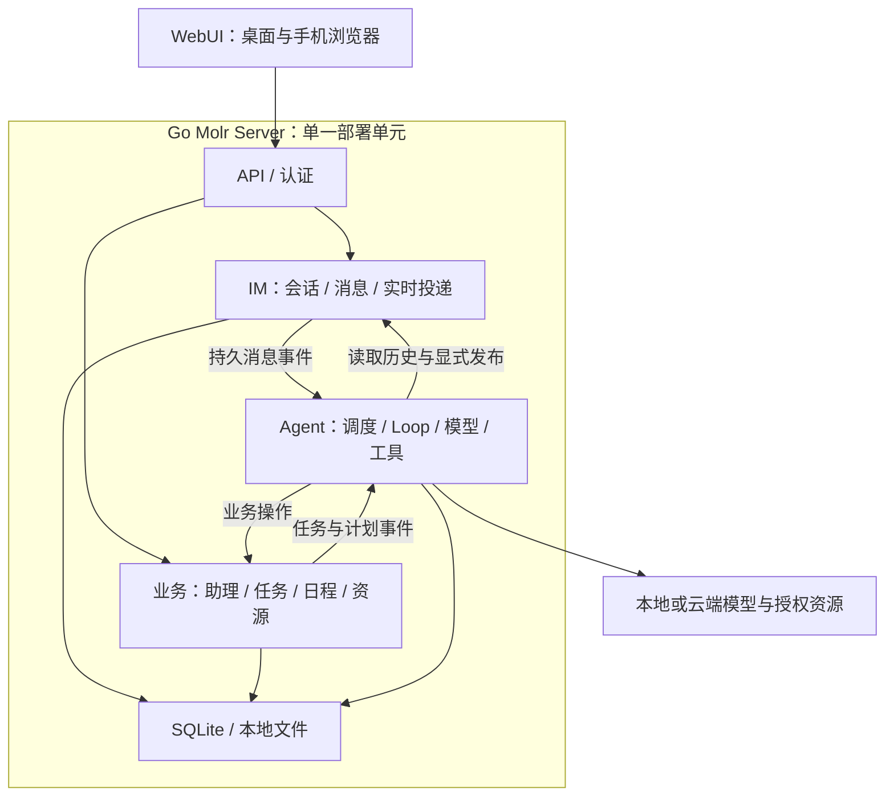

# Molr Runtime 架构设计

2026-10-03：已加入账号隔离、管理员用户组与成员独立配额；共享资源目录及双层检查见[多用户与成员配额](MULTI_USER.md)。

更新：2026-10-03。状态：单体 Runtime 已接入真实实现；验证范围与适配器限制见 [Runtime README](../../runtime/README.md)。

开源版提供一个独立的 **Go Molr Server**，按模块化单体设计，全部功能内置并统一编译发布。API、实时通信、模型代理、业务、调度与 Agent Loop 都在同一个 server 内，统一启动、配置和升级。支持部署在个人设备或公网服务器，公网访问的认证和授权属于首版基础要求。云服务版本未来才考虑微服务拆分，Agent 与业务模块当前不实现分布式部署与独立水平扩展；存储、计算、网络可由独立 Sandbox 服务提供。

持久化使用 **内嵌 SQLite + 本地文件存储**，用户无需额外部署数据库或消息队列。业务逻辑、Agent 与通用基础能力统一使用 Go 实现。技术选择与升级方式见 [技术底座](TECH_STACK.md)，产品功能见 [产品范围](../PRODUCT_SCOPE.md)。

## 1. 运行结构

单一 Go 主进程承载核心模块，模块之间直接调用接口。需要执行外部程序时，由内置工具管理受控子进程。默认只启动一个 server，使用一个数据目录和一个对外入口。

## 2. 独立助理 Loop 与会话工具

每位助理拥有独立 Agent Loop，这是独立的执行状态，不代表独占一个进程。Loop 根据事件推进，空闲时休眠；同一助理按序处理事件，多位助理在并发配额内运行。

聊天会话只保存用户与助理的真实交互历史。原始聊天记录不自动成为模型上下文，Loop 根据当前事件、任务状态、工作摘要和工具结果组织上下文。

| 会话工具 | 用途 |
| --- | --- |
| 读取会话 | 按消息引用或范围取得实际交互内容 |
| 检索会话 | 按权限取得有来源的历史片段 |
| 向会话发送 | 显式发布文本或结构化卡片，可关联任务与日程 |

模型内部输出和工具返回不自动写入聊天。助理发送消息不作为新的用户输入再次触发自身。用户消息、定时计划和执行结果是不同来源的事件；定时触发不伪造用户消息。

## 3. 内部模块

按 **IM / Agent / 业务** 划分三个功能域。IM 管会话、消息、已读与实时投递；Agent 管调度、Loop、上下文、模型与工具；业务管助理身份、任务、待办、计划、资源、记忆与偏好。认证、权限、审计、检索和存储为公共支撑。导出接口已落实到 Go 包，见 [接口合同](INTERFACES.md)。

IM 不直接依赖 Agent 或业务包。用户发送与助理发布共用消息格式和存储，但使用不同写入入口绑定身份；Agent 调度消费 IM 的持久消息事件，只把真实用户输入转为执行输入，助理发布不反复触发自身。

| 内部模块 | 主要职责 |
| --- | --- |
| 接入与实时通信 | HTTP API、TLS／可信代理接入、认证中间件、SSE 与断线补发 |
| 账号与认证 | 独立账号、管理员与用户组、密码与二次验证、登录会话、设备注销和客户端令牌 |
| 安全审计 | 登录、权限变更、敏感操作与异常访问记录 |
| IM | 会话、消息、已读、反馈、消息创建事件和授权实时投递 |
| 业务与策略 | 助理、任务、待办、日程、记忆、设置、授权和预算 |
| 调度与执行 | 持久事件、定时发生点、执行配额、重试、取消与恢复 |
| Agent Runtime | 独立 Loop、上下文、模型选择、记忆策略、检查点与验收 |
| 模型与凭证代理 | 供应商协议适配、流式调用、受保护的凭证使用和用量回执 |
| 内置工具与资源 | 会话工具、文件、外部应用操作和受控程序执行 |
| 检索与索引 | 历史和资料检索、内容解析、索引更新与重建 |
| 持久化 | 事务、领域仓储、消息与事件、操作记录、版本登记、文件和备份 |

所有模块统一随 server 编译、发布和升级。内置本机 Sandbox 与独立 `molr-sandbox` 复用受控文件和 Linux 隔离实现，Runtime 通过 sandbox router 选择本机调用或带操作回执和租约的 HTTPS 连接。远程服务不承载 Agent、会话和模型调用。新增内置工具和模型适配通过更新 Go 程序交付。插件通过受控扩展点提供页面、主题、沙盒工具和 Skills，不加载 Go 动态业务模块；见 [插件机制](PLUGINS.md)。Agent 可以在授权的 Linux 沙盒中执行脚本，并从助理工作区加载项目指令与 Skills；这些能力不等于动态加载服务端代码。前端 SDK 与主题机制另见 [主题与 UI 包](../frontend/UI_PACKAGES.md)。模型连接、权限、预算和日程等仍作为产品设置管理。

内置能力执行前统一检查授权、预算和资源可用性。外部程序不能获得 server 全部数据与凭证访问权。检索读取授权来源；记忆实时读取本地 Markdown，不保存数据库索引副本。其他可重建投影不能修改原始会话或记忆。

## 4. 一次委托如何执行

1. API 验证请求，IM 在同一事务中保存真实用户消息、消息创建事件和可见事件。Agent 调度消费消息事件，按业务中的会话绑定找到助理，原子保存去重的助理输入与消息事件消费进度。
2. 调度模块唤醒对应 Loop，Loop 通过工具读取消息，按需检索历史和资料。
3. Loop 明确目标、资源范围和验收条件，必要时通过发送工具向用户询问。
4. 核心检查当前授权与预算，记录操作，通过模型代理或内置工具执行，保存结果与检查点。
5. 业务模块保存任务状态和产物；Loop 通过发送工具发布文本或卡片。
6. IM 实时通信模块推送已提交的可见事件，客户端断线后从持久记录补取。

全新聘请（`Hire`）在助理、会话、模型授权和 Loop 初始化完成后，于同一创建事务中写入 `born` 事件；事件写入失败时整个创建事务回滚。事件以账号、助理和 `born` 来源去重，使用 `when_idle` 进入现有持久队列。模型收到出生指引后通过 `conversation_publish` 发送简短初始消息；创建接口不等待生成。复制（`Clone`）、返聘、重启和重置上下文均不产生出生事件；不补发已有助理，不对用户已开始交流的情况增加特殊分支。重试、恢复、取消及消息发布幂等均沿用正常执行机制。

定时任务走 `计划到点 → 持久定时事件 → 助理 Loop → 执行 → 按需发布结果`。一个任务可持续跨越多次模型调用，不创建另一个用户聊天会话。追加要求形成任务修订，旧版产物和累计费用保留；普通聊天不强制创建任务，指派待办不自动启动执行。

定时触发公共能力由 `internal/trigger` 提供：计划和夜间做梦共享重复规则、时区、漏执行策略及发生点去重。计划仍保存用户事项和任务；做梦保存自己的配置、回放进度与记忆整理记录，不创建隐藏计划。业务适配器将发生点、进度及事件在同一事务中提交，随后进入共同的 Agent 队列。详见 [夜间做梦与记忆使用](DREAM_MEMORY.md)。

## 统一用户通知

`internal/notification` 在 Runtime 内保存按 OwnerID 隔离的通知记录与来源索引。来源标识由类型和业务对象组成，相同原因的持续异常复用一条记录；改变原因或恢复后再次发生创建新 ID，旧设备的确认只能作用于它实际看到的 ID。通知的 ReadAt、DismissedAt、ResolvedAt 独立于业务状态，更新天然幂等。通知与源状态通过同一 SQLite 事务写入，提交 `notification.changed` 到现有持久 SSE 流；GET 只读取，不制造通知。这些记录用于提醒投递、去重和确认，不作为业务历史页面；长期内容仍归属聊天、授权、计划和任务。

微信投递在结果写入时同步，Agent 在等待／恢复／停止状态提交时同步，授权申请在创建／处理事务中同步，任务失败和后台调度结果在状态提交时同步。计划交接由现有调度 Tick 在同一快照中判断依赖与执行状态并同步通知。短暂工作状态不被当作恢复，避免每次重试重新激活已忽略的问题。通知内容仅包含类型、原因码、业务引用与显示名称，不保存模型上下文、原始错误或凭据。

## 5. 单实例并发、持久化与恢复

同一数据目录仅允许一个 server 实例运行。内部对每位助理串行调度，API、模型、Loop、工具和索引作业分别设并发配额，避免长任务耗尽资源。

消息、任务、事件、操作和检查点持久保存；内存通知只负责唤醒。进程重启后扫描未完成事件，从检查点恢复；同一计划发生点去重，并按明确规则处理停机期间错过的计划。单体仍需幂等和恢复，但当前不引入分布式租约、服务发现或跨实例事件广播。

暂停保留进度，取消停止后续执行。超时或崩溃时，外部操作可能已经成功或计费；恢复先核对，再决定是否重试。消息发送和结果发布使用稳定操作标识，避免重复展示。

SQLite 保存结构化数据，本地文件模块管理附件与产物。备份需涵盖一致的数据库状态、关联文件和必要配置；恢复后核对资源与凭证可用性。详细存储规则见 [技术底座](TECH_STACK.md)。

## 6. 权限与生命周期

本机初始化创建首个管理员，未初始化时不开放业务服务。管理员可创建独立账号和用户组；资源目录全局管理，聊天、助理、计划等私人数据按账号隔离，执行还受成员组级配额约束。公网经 HTTPS 访问，登录与静态登录资源以外的业务接口统一认证，包括 SSE、搜索和文件下载。账号、会话、二次验证和审计内置于 server。

认证确认用户身份，业务授权检查对象归属和动作，助理授权另行检查资源范围、Grant 和预算。三者不可互相替代；后台计划使用绑定的助理身份执行，不依赖浏览器保持登录。Cookie／令牌撤销后终止对应访问和推送。

详细的登录、可信代理、CSRF、文件与 SSRF 防护、限流和审计要求见 [公网部署与安全](SECURITY.md)。

资源、操作、任务和授权分别由对应模块管理；早期架构中的 Work 是概念抽象，当前实现使用 Task、Plan 引用与执行记录。任务只能收窄助理权限；工具、文件、网络和数据去向分别受控。模型调用前预留预算，调用回执持久化后结算，未知费用保留待核对状态。

凭证只由受信任代理使用，不进入 Agent 上下文或外部执行程序。内置工具仍须落实文件、网络与程序执行权限。

用户消息在 Loop 读取并确认接手后标记已读，内部事件和后台检索不产生聊天红点。

- 解雇归档助理并停止后续执行，保留已发生的操作与费用。
- 返聘恢复原助理和会话，旧任务、权限与日程按明确选择恢复。
- 克隆产生独立身份和 Loop，复制确认范围内的记忆、消息与有效授权，不复制在途任务和临时上下文。

## 7. 当前实现与维护入口

Runtime 已有 SQLite、认证授权、业务模块、Agent Loop、持久队列、HTTP/SSE、沙盒与命令行维护入口。WebUI 是真实客户端；Desktop/Mobile/CLI 的展示原型不等于独立原生客户端已经发布。

模块职责原先在 `RUNTIME_SERVICES.md` 重复维护，现合并到本文。具体 Go 包对应关系与事务合同由 [模块接口](INTERFACES.md) 维护；客户端路由由 [HTTP API](HTTP_API.md) 维护。内置能力及限制见 [Runtime README](../../runtime/README.md)，验证入口见 [测试说明](../../runtime/tests/README.md)。

状态与事件同事务持久化，提交后才唤醒执行；同一助理串行推进，多位助理有界并发。未知外部结果先核对，不能因客户端重试或服务重启重复副作用。文件发布与 SQL 状态通过暂存和恢复协议协调，不声称跨文件系统事务。

验收需覆盖消息到回复、定时发生点去重、取消与撤权、断线补取、异常退出后的恢复、未知结果与预算占用、整体升级和备份恢复。测试记录应带日期，不能把架构中的验收要求写成所有环境已经验证。

云服务未来可按实际负载设计扩容；当前没有跨实例调度、内部 RPC 或分布式接管。部署与升级步骤由 [部署指南](../../docs/deployment/README.md) 维护。
