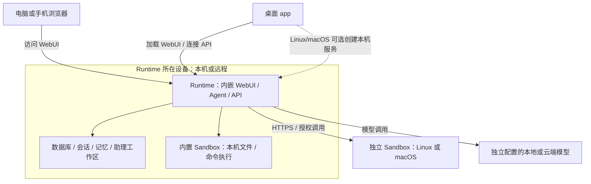

# 安装与服务管理

在官网选择「让 Agent 为我安装」并复制指令，可由能够操作目标设备的 Agent 完成环境检查、安装与验证，流程见[让 Agent 为我安装](agent-install.md)。

## 客户端、Runtime 与 Sandbox

客户端负责显示界面、登录和连接实例；Runtime 的 `server` 模式负责运行助理并保存数据，`sandbox` 模式为已有完整服务提供其他设备上的文件与命令执行资源。Sandbox 也是完整服务内置的本机资源能力。把桌面 app 连到另一台电脑上的 Runtime，不会把那台电脑的助理或数据搬到桌面端。

| 组件 | 职责与部署位置 |
| --- | --- |
| 手机端 | 当前使用手机浏览器访问 WebUI，没有原生 iOS／Android App 安装包。手机连接可访问的 Runtime，不在手机上部署 Runtime 或 Sandbox。 |
| 桌面 app | 提供连接管理、独立登录会话和 WebUI 容器。Linux、macOS 和 Windows 完整版均可安装和管理本机 Runtime；WSL 也按远程实例处理。 |
| WebUI | 聊天、助理、资源和管理页面，在浏览器或桌面 app 中运行。正式 Runtime 内嵌 WebUI，由同一服务地址提供网页和 API，无需单独安装前端服务器。桌面 app 从所连接的 Runtime 加载 WebUI。 |
| Runtime | 同一个服务程序支持 `server` 和 `sandbox` 两种模式。`server` 模式提供账号、Agent 执行、任务调度、模型调用及持久化。数据库、会话、记忆、附件和助理工作区保存在 Runtime 所在设备。模型服务独立配置，安装包不包含模型权重或推理服务。 |
| 内置 Sandbox | 编译在 Runtime 中，管理本机受控文件访问和命令执行。Linux 使用 Bubblewrap 等系统能力，macOS 使用 Seatbelt；本机运行无需单独部署沙盒节点。 |
| 独立 Sandbox | 在另一台 Linux/macOS 设备运行 `molr serve --mode sandbox`，由 Runtime 通过 HTTPS 连接。只提供授权目录与执行能力，不承载账号、Agent、聊天会话或 WebUI。 |



客户端连接的是 Runtime；额外执行节点由 Runtime 连接。远程 Runtime 与远程 Sandbox 是两种部署关系：前者运行整套助理服务，后者只增加执行和目录资源。独立节点上的已授权目录位于该节点，助理自身的工作区仍在 Runtime 设备。具体权限与部署见[沙盒资源](../resources/sandbox.md)和[独立 Sandbox 服务](../sandbox/remote.md)。

桌面 app 的 Electron 渲染进程沙盒用于限制网页访问桌面系统接口；上文的 Sandbox 用于限制助理的文件和命令操作，两者分别起作用。

## 安装包包含哪些组件

官网只展示 GitHub Releases 中正式发布的安装包，排除草稿、预发布版和 Nightly。下表说明各类产物的内容；系统依赖由目标设备或包管理器准备，不等于全部打进了安装包。

| 安装包或入口 | 包含的组件 | 安装与使用方式 |
| --- | --- | --- |
| Linux 桌面完整版 `.deb`，AMD64／ARM64 | Electron 桌面程序、连接管理界面、`molr`（内嵌 WebUI 和本机 Sandbox）、`molr-setup` | 安装桌面程序后，可只连远程 Runtime，也可在应用内创建本机服务。DEB 声明 Bubblewrap、静态 BusyBox、systemd 等依赖，由包管理器准备。 |
| macOS 桌面完整版 `.dmg`，Apple Silicon／Intel | `.app` 内含 Electron、连接管理界面、`molr`（内嵌 WebUI 和本机 Sandbox）、`molr-setup` | 安装桌面程序后按需创建 launchd 用户服务；创建服务时选择资源权限预设，命令能力由生成的配置决定。 |
| Windows 桌面完整版 `.exe`，AMD64 | Electron、连接管理界面、内嵌 WebUI 的 `molr.exe` 和 `molr-setup.exe` | 按需创建当前用户的计划任务，登录 Windows 后自动启动；无需 WSL。受控 PowerShell 使用 AppContainer 文件权限与网络开关，Full Access 独立授权。 |
| Linux/macOS Runtime `.tar.gz`，AMD64／ARM64 | `bin/molr`（内嵌 WebUI 和本机 Sandbox）、`bin/molr-setup`、发行元数据和许可证 | 同一 `molr` 程序支持 `server` 和 `sandbox` 模式，不含 Electron 桌面程序。通过 CLI 选择服务模式，再用浏览器或客户端连接。官网 `install.sh` 下载的就是这类 Runtime 包。 |
| 源码归档 | 经发布检查的项目源码 | 用于自行构建，不是编译好的应用安装包；构建依赖见[源码部署](source-build.md)。 |
| Docker | 本地构建的镜像包含 `molr`、内嵌 WebUI 和本机 Sandbox 实现 | 不含桌面 app 或 `molr-setup`。基础镜像默认关闭命令执行；`isolated` 构建目标另带 Linux 隔离依赖。当前没有官方预构建镜像，见[Docker 部署](docker.md)。 |

WebUI 无需另外下载安装包；手机当前使用同一 WebUI，没有可下载的原生手机 App。桌面包和 Runtime 包均随附许可证与第三方声明，桌面包另保留 Electron/Chromium 的许可资料。

## 桌面应用

官网“桌面应用”入口只按正式渠道清单显示安装包；没有正式版时显示“即将推出”。源码构建与原生验收命令见[桌面 README](../../../apps/desktop/README.md)。

Linux、macOS 和 Windows 完整版均包含原生 Runtime，也可连接远程实例；WSL 中的 Runtime 按远程连接添加。点击“添加连接”，填写名称和 Runtime 根地址，然后在该实例页面登录。HTTPS 为默认选择；回环或可信私网 HTTP 需要显式启用，没有传输加密。每个连接独立保存登录状态，修改服务器地址会使用新会话。

完整版选择“安装并启动”后创建专属用户服务，默认仅监听回环地址。已有 CLI 安装保持独立，可作为远程连接添加。Linux 依赖沿用下文沙盒环境要求；依赖、主机策略或目录权限检查失败时先修复环境，再重试。macOS 命令执行由所选权限预设决定，能力边界仍遵守 macOS 沙盒说明。

Windows 本机 Runtime 使用当前用户的计划任务，在登录后自动启动，注销 Windows 用户会停止该会话的服务。AppContainer 不支持任意 CLI 的兼容性保证；启动探针失败时拒绝受控执行。Windows 按当前用户串行运行受控命令，同时启动返回忙碌状态；授权目录总计超过 100,000 个条目会被拒绝。Windows 当前不提供 TTY、受控端口转发和硬资源配额；网络开关仍受系统防火墙与 AppContainer 回环限制。

关闭窗口或退出桌面 app 后，本机服务继续运行；休眠、关机或用户服务退出会影响任务。停止、重启或卸载需在桌面管理界面明确操作，卸载默认保留配置和数据。删除桌面应用本身不等于卸载后台 Runtime；需移除服务时先在应用中卸载 Runtime。

桌面程序目前通过下载安装新版手动升级，再明确更新其管理的 Runtime。CLI/Web 更新入口不更新桌面管理的实例。远程 Runtime 和 WSL Runtime 由各自部署方维护。桌面包发布前需通过原生验收。证书申请期间，Windows 暂时提供未签名测试包，macOS 提供 ad-hoc 签名但未公证的测试包；下载页面标明状态，系统可能显示未知发布者或阻止启动。本地构建不作为已发布的安装包。

### Runtime 和 Sandbox 是否可选

这里需要区分安装包携带程序、创建后台服务和开启执行能力：

| 操作 | 当前是否可选 |
| --- | --- |
| 从 Linux/macOS 完整版中排除 Runtime 文件 | 不可选。完整包固定携带 Runtime，没有组件勾选页，也没有单独的 Linux/macOS 纯客户端安装包。 |
| 创建并启动本机 Runtime 服务 | 可选。首次打开桌面 app 不会自动创建服务；点击“安装并启动”才执行。只连远程实例时可跳过这一步。 |
| 单独安装或不安装内置 Sandbox | 没有独立安装步骤或勾选项，它是 Runtime 的一部分。不会自动创建额外的沙盒节点。 |
| 开启本机命令执行 | 创建服务前选择资源权限预设；宽松预设开启，最小权限预设关闭。随后可修改 `sandbox.enabled` 并重启。助理仍需计算授权。 |
| 跳过 Linux DEB 的沙盒系统依赖 | 当前不可选。即使只连接远程 Runtime，安装 DEB 时仍需满足它声明的沙盒依赖；跳过创建本机服务不会去掉这些包依赖。 |

因此，当前已有“按需创建本机 Runtime 服务”，尚未实现“安装时分别勾选 Runtime／Sandbox 组件”。macOS 的执行配置见[macOS 原生命令权限](../sandbox/macos.md)，Linux 的执行环境与授权见[Linux 沙盒部署](../sandbox/linux.md)。

## 环境要求

以下为运行 Molr 服务（Runtime 与 WebUI）、连接云端或其他设备上的模型时的初步容量建议，尚未经系统性性能基准验证。最低配置用于启动服务和单人少量对话；推荐配置为日常使用和少量并发任务预留余量。

CPU 架构须为 64 位 x86（amd64）或 ARM（arm64）。

| 硬件 | 最低配置 | 推荐配置 |
| --- | --- | --- |
| CPU | 1 核 | 4 核及以上 |
| 内存 | 512 MiB | 8 GiB 及以上 |
| 可用磁盘空间 | 5 GiB | 20 GiB 及以上，优先使用 SSD |
| GPU | 无需独立显卡 | 根据本地模型部署需求选择 |

在同一设备上运行本地模型时，需要额外预留模型权重、推理内存及可能需要的显存，具体取决于模型大小、量化方式和上下文长度。运行沙盒任务需要额外的 CPU 与内存，尤其是浏览器自动化、代码构建或多个沙盒并发执行；附件、工作区和备份会持续占用磁盘空间，应按实际任务规模扩容。沙盒资源配置见 [Linux 命令环境](../sandbox/linux.md)。

Linux 使用 systemd；macOS 使用下文的用户级 launchd 安装。源码开发另见[源码部署](source-build.md)。

## Runtime 模式与资源权限预设

同一 Runtime 安装包支持 `server`（默认）和 `sandbox` 两种模式，分别运行完整服务或沙盒节点。完整 Runtime 提供账号、助理、WebUI 和内置沙盒；独立沙盒只为另一台 Runtime 提供资源，不创建 Runtime 账号或助理工作区。

```bash
./bin/molr-setup --mode server --resource-preset permissive
./bin/molr-setup --mode sandbox --name molr-node --resource-preset least-privilege
```

安装器记录运行模式，并为后台服务生成 `molr serve --mode server|sandbox` 命令；升级、修复和重启沿用记录。交互安装在未指定 `--mode` 时询问模式，资源权限预设单独选择。非交互安装未指定时选择 `server` 和最小权限预设。桌面端创建本机 Runtime 时展示预设选择，预选宽松预设。

- **宽松预设（个人部署推荐）**：在运行账户的系统权限范围内，允许接入任意本机目录、网络及计算资源，通过 Molr 配置和分配权限。助理仍需单独授权。Linux 自动发现支持的 GPU；CPU、内存等授权额度不额外设置部署上限，执行后端和协议容量边界仍适用。Full Access 能力开放，但仍需单独授权且显式调用。
- **最小权限预设**：默认不开放本机目录、网络访问或命令执行资源。随后可调整部署配置开放资源，再为助理授权。Runtime 自身的数据存储和助理内置工作区仍可使用；独立沙盒的 `enabled: false` 则关闭整个节点的资源服务。

资源权限预设只生成普通配置字段，与安装记录中的运行模式独立。`--config` 与 `--resource-preset` 互斥；升级、修复和重新连接保留现有配置。已有实例可先预览，再显式应用预设：

```bash
/path/to/molr-setup configure --resource-preset permissive --dry-run
/path/to/molr-setup configure --resource-preset permissive
```

维护命令展示变更字段，保留服务路径、凭据及助理授权；运行中的实例会重启，停止的实例保持停止。此前的目录、网络规则和 GPU 选择会被所选预设替换。仍可直接编辑配置逐项调整。

独立沙盒安装自动生成 HTTPS 证书与私有服务令牌，结果显示服务地址、证书指纹和令牌文件位置；在 Runtime 的「资源 → 沙盒 → 连接沙盒」使用它们。安装、状态查询、升级及卸载使用同一 `molr-setup`；普通卸载保留配置、证书、令牌和数据。部署细节见[独立沙盒](../sandbox/remote.md)。

## macOS 命令行安装

macOS 13 及以上提供 Apple Silicon（ARM64）和 Intel（AMD64）发行包，包含内嵌 WebUI 的 `molr` 和 `molr-setup`。用户无需安装 Go、Node.js、Python 或 Homebrew。官网命令在终端中执行，自动选择本机架构：

```bash
curl -fsSL https://molr.ai/install.sh | sh
```

使用当前用户运行，不加 `sudo` 或 `--user`。安装器创建 launchd 用户服务、初始化账号、等待 HTTP 与已认证能力检查，再显示一次性登录链接；图形会话中自动打开默认浏览器，SSH 中只显示链接。服务使用 `~/Library/LaunchAgents/<实例名>.plist`，图形登录后启动；SSH-only 环境使用当前用户的后台 launchd 域。它不是登录前启动的系统 daemon。

默认程序位于 `~/Library/Application Support/Molr/program/default`，配置和数据分别位于同一 Molr 目录下的 `config/default`、`data/default`；日志和缓存位于 `~/Library/Caches/Molr/default`。`--name molr-<名称>` 可创建独立实例。安装器输出实际路径与服务命令，含空格的路径需要引号。

```bash
"$HOME/Library/Application Support/Molr/program/default/bin/molr-setup" status
"$HOME/Library/Application Support/Molr/program/default/bin/molr-setup" update
"$HOME/Library/Application Support/Molr/program/default/bin/molr-setup" uninstall
```

普通卸载保留配置和数据；明确清除使用 `uninstall --purge --yes`。更新保留账号、配置和工作区，应用内一键更新暂不支持 macOS，请使用上述 CLI。安装器检查发行包与 Mach-O 代码签名；当前采用 ad-hoc 签名，不提供 Developer ID 身份签名或 Apple 公证，支持范围为终端安装流程。

首次安装按所选资源权限预设生成 `sandbox.enabled`；未指定预设的非交互安装为 false，聊天、文件和记忆可用。设置 `sandbox.enabled: true` 并重启后可使用 Seatbelt 受控命令，按需授予计算、文件和网络权限。Full Access 需要另外启用 `sandbox.allow_full_access` 并独立授权。配置与能力边界见 [macOS 原生命令权限](../sandbox/macos.md)。

离线下载归档及相邻 `.sha256` 后，使用 `shasum -a 256 -c <归档>.sha256` 校验，再解压并运行 `./bin/molr-setup`。不要用 Finder 双击裸命令行程序代替终端安装。

## 本地发行包与快速安装

Linux 发行包提供 AMD64、ARM64 两种架构，包含主程序 `molr` 和安装维护程序 `molr-setup`。下载匹配架构的归档和 SHA-256 文件，校验后解压，在包目录运行：

```bash
sha256sum -c molr_0.1.0_linux_amd64.tar.gz.sha256
tar -xzf molr_0.1.0_linux_amd64.tar.gz
cd molr
./bin/molr-setup
```

默认安装或升级到当前包的版本，无需指定渠道或安装子命令。已有同版本实例时显示维护入口；需要重新应用文件时指定 `--repair`。制作安装包见[源码构建](source-build.md)。

首次在线安装也可以使用官网下载器：

```bash
curl -fsSL https://molr.ai/install.sh | sh
```

官网的后端与沙盒入口使用 curl，自动检测系统和架构，安装正式渠道最新版；没有正式发行包时显示“即将推出”。版本号统一显示在安装区域右上角，页面不提供架构、下载工具或版本选项。官网只提供命令安装和 Agent 安装。需要手动或离线安装时，从 [GitHub Releases](https://github.com/molr-ai/molr/releases) 选择目标系统、架构及版本，下载归档和同名 `.sha256` 文件后，按本节步骤安装。Docker 安装见 [Docker 部署](docker.md)。

指定架构、版本或下载工具时，可调整以下命令。`--arch amd64` 或 `--arch arm64` 用于核对设备架构，不匹配时在下载前停止；省略则自动检测。`--version` 必须对应发布目录中存在的版本，省略时安装所选渠道最新版；默认渠道为 stable。沙盒节点将 `--mode server` 改为 `--mode sandbox`。

```bash
# Specify architecture and version
curl -fsSL https://molr.ai/install.sh | sh -s -- --mode server --arch arm64 --version 0.1.0
# Use wget when curl is unavailable
wget -qO- https://molr.ai/install.sh | sh -s -- --mode server
```

官网桌面下载、后端与沙盒入口只展示正式版。预发布版与 Nightly 可从 GitHub Releases 下载后离线安装；使用提供这些渠道的其他发布源时，通过 `--source URL --channel preview` 或 `--source URL --channel nightly` 选择。

stable 为正式版，preview 为 beta／rc 和后续正式版，nightly 为每日构建。未发布版本的渠道不会自动回退到其他渠道。下载器显示版本、架构、包名、来源、摘要及下载进度，校验后调用包内安装器。它使用已有的 curl 或 wget、tar、gzip 和 SHA-256 工具，不自动安装下载工具；安装维护程序本身无需 Python、curl 或 iproute2。

下载器默认源为 `https://molr.ai/releases`，`--source URL` 可指定其他 HTTPS 发布源。本地归档可由同一下载器校验并安装：

```bash
sh install.sh --archive /path/package.tar.gz
```

相邻的 `package.tar.gz.sha256` 必须存在。直接运行已解压的安装包不需要网络；系统依赖应提前准备。SHA-256 用于核对下载内容，不是独立的发布者签名。

官网发布源只提供扫描范围内最新正式版的清单；`--version` 必须是当前目录中包含的版本。安装其他历史版本时，从 GitHub Releases 下载对应归档和 SHA-256 文件，按上文离线安装。

## 交互式与静默安装

有控制终端时默认交互安装，先展示安装位置、账户、依赖及权限问题，再确认执行。也可显式选择模式：

```bash
./bin/molr-setup --interactive
./bin/molr-setup --non-interactive --install-deps \
  --directory-permissions fix --no-browser
./bin/molr-setup --dry-run
```

静默模式不提问、不打开浏览器；`--install-deps` 授权系统依赖准备，所需管理员权限应预先配置。已手动准备依赖时使用 `--skip-dependencies`。`--dry-run` 展示计划，不修改账户、权限、配置或服务；通过下载器预览仍会下载临时包。

目录可被组或其他用户写入时，可选择修复、忽略或退出。修复只移除该目录的组／其他用户写权限，不递归修改内容；静默模式以 `--directory-permissions fix|ignore` 明确选择。`--yes` 跳过一般确认，不代替权限选择。所有者不符、符号链接和受管理文件可被其他用户修改时会报错。

省略 `--config` 时自动生成局域网 HTTP 配置、初始化所有者、启动服务并验证已认证 API 与沙盒。输出按检查、准备、安装、验证、结果排列。结果为 `verified` 才表示认证检查通过；`verification_pending` 表示已安装但需要使用当前密码完成检查，退出码为 3；`not_started` 对应 `--no-start`。失败输出包含当前阶段和可能发生的变更。

## Linux 服务与命令环境

当前服务适配使用 systemd。启用 Linux 沙盒需要 systemd 254+、cgroup v2 委派、Bubblewrap、静态 BusyBox、CA 证书及 util-linux 的 nsenter／setpriv。它们是运行能力要求，不按发行版名称或版本拒绝安装。当前自动依赖准备支持 APT；其他环境可按[沙盒要求](../sandbox/linux.md)手动准备。systemd 用户管理器需要正常的 SSH／桌面登录会话。

启用 AppArmor 非特权用户命名空间限制时，安装器以服务账户及 `NoNewPrivileges` 检查 Bubblewrap，先尝试已加载的 `chrome` profile，再尝试原有受限路径；已有配置可用时无需安装新 profile。两条路径均失败且获得授权后可安装并加载发行版的 `bwrap-userns-restrict` 策略，再次验证。已有策略不覆盖，冲突需管理员处理；不会关闭系统隔离限制。隔离依赖缺失不会自动切换为 Full Access。

### 安装时选择运行账户

默认安装当前普通用户的 `molr.service`。root 安装必须显式指定非 root 的 `--user USER`，创建系统服务；不存在的账户会创建为无登录权限的系统账户。已有账户的 HOME、shell、附加组保持原样，不递归改变已有数据目录的所有者。

```bash
./bin/molr-setup --name molr-demo --port 8788 --public-host "<LAN_IP>"
sudo ./bin/molr-setup --user molr-sandbox --install-deps
# Custom configuration; initialize using a password from stdin
./bin/molr-setup --config /path/server.json --init-owner owner \
  < /private/owner-password
```

`<LAN_IP>` 替换为实际局域网 IPv4 地址。自定义配置首次安装需指定 `--init-owner` 或使用 `--no-start` 稍后初始化。服务和沙盒始终以同一普通账户运行。

| 内容 | 当前用户安装 | 系统安装 |
| --- | --- | --- |
| 程序、安装记录与许可证 | `~/.local/lib/molr/<实例>/` | `/opt/molr/<实例>/` |
| 配置 | `${XDG_CONFIG_HOME:-$HOME/.config}/molr/<实例>/` | `/etc/molr/<实例>/` |
| 默认持久数据 | `${XDG_DATA_HOME:-$HOME/.local/share}/molr/<实例>/` | `/var/lib/molr/<实例>/` |
| 缓存与临时文件 | `${XDG_CACHE_HOME:-$HOME/.cache}/molr/<实例>/` | `/var/cache/molr/<实例>/` |
| 服务文件 | `${XDG_CONFIG_HOME:-$HOME/.config}/systemd/user/<服务名>.service` | `/etc/systemd/system/<服务名>.service` |
| 管理命令 | `systemctl --user` | `sudo systemctl` |

服务 `molr` 对应实例 `default`，`molr-demo` 对应 `demo`；`molr-default` 为保留名称。`--program-root /path/programs` 调整程序根目录，实际安装到其实例子目录。两个命令位于程序目录的 `bin/` 下；配置为 `server.json`。用户配置权限为 `0600`，系统配置为 root 所有、服务组可读的 `0640`。

程序、配置、数据和缓存目录不能重叠。自定义 `data_dir` 和外置工作区沿用配置，需允许服务账户访问。数据库、密钥、附件和助理工作区属于持久数据；缓存可以重建。许可证随程序保存，WebUI 也提供 `/LICENSE` 和 `/THIRD_PARTY_NOTICES.md`。

Linux 用户服务启动后，安装器检查 linger；尚未开启或状态无法确认时，自动尝试开启并再次验证。此步骤不请求密码，也不自动调用 sudo。若权限不足、命令不可用或验证失败，安装继续，并提示服务可能在最后一个登录会话退出后停止；按提示执行 `sudo loginctl enable-linger USER`，再用 `loginctl show-user USER -p Linger` 确认输出为 `Linger=yes`。linger 是整个 Linux 用户账号的设置，卸载时保留。`--dry-run` 和 `--no-start` 不修改 linger；系统服务无需 linger。使用容器运行完整程序见 [Docker 部署](docker.md)，其中包含 WebUI、持久数据和可选命令执行的配置。

## 更新与重复运行

运行已安装实例的安装维护程序，会显示状态并进入维护菜单；无终端时只显示状态。它通过自身位置识别实例，因此无需切换到特定工作目录。

```bash
~/.local/lib/molr/default/bin/molr-setup
~/.local/lib/molr/default/bin/molr-setup status
~/.local/lib/molr/default/bin/molr-setup update
~/.local/lib/molr/default/bin/molr-setup update --version 0.2.0-rc.1
~/.local/lib/molr/default/bin/molr-setup update --channel preview
```

更新使用安装记录中保存的发布源和渠道，显示目标包并下载校验。`--source`／`--channel` 指定此次更新及成功后继续使用的订阅。系统实例使用 `sudo /opt/molr/default/bin/molr-setup update`。Go 更新器也允许显式的私网或回环数字 HTTP 镜像地址。

重新运行官网下载命令、运行另一份安装包均可升级已有实例；保留配置、数据、凭证和账户。程序原子替换，保留 `molr.previous`、`molr-setup.previous` 与 `server.previous.json`。同版本默认不重装，`--repair` 重新应用当前包。降级必须显式使用 `--allow-downgrade`，并先自行备份数据。

安装未完成或记录损坏时会明确报错。不要删除安装记录来绕过检测；使用完整安装包对原实例修复。`--record /path/installation.json` 可明确指定管理的实例。

浏览器等组件的安装、更新与修复见[组件管理](../administration/components.md)。

## 启动后的检查

安装、更新、重启后核对实际页面与已认证沙盒能力：

```bash
~/.local/lib/molr/default/bin/molr doctor -config /path/server.json
~/.local/lib/molr/default/bin/molr access -config /path/server.json
```

默认使用数据目录的初始密码；已改密时增加 `-password-stdin`，启用 MFA 时增加 `-mfa-code`。命令通过正常认证 API 工作。`access` 生成 15 分钟一次性登录链接。

未关闭沙盒时，要求 `/api/sandbox` 返回 `Enabled=true`、`Capabilities.Reason=available`，以及 `Shell`、`ProcessIsolation`、`FileIsolation`、`NetworkIsolation`、`ResourceLimits` 全部为 `true`。端口监听和服务 active 状态不能代替此检查。排查见[沙盒检查](../sandbox/linux.md#检查与验证)。

## 卸载

离线卸载使用已安装的维护程序：

```bash
~/.local/lib/molr/default/bin/molr-setup uninstall --dry-run
~/.local/lib/molr/default/bin/molr-setup uninstall
~/.local/lib/molr/default/bin/molr-setup uninstall --purge --yes
sudo /opt/molr/demo/bin/molr-setup uninstall --purge
```

默认停止对应服务，移除程序、服务文件和实例缓存，保留配置、持久数据及安装记录。重新安装同一实例可复用数据。`--purge` 删除受管理配置与默认数据；交互模式需输入实例名确认，静默模式必须带 `--yes`。

自定义数据、外置工作区、未知文件、系统账户、系统依赖和 linger 设置保留。无法确认服务归属、服务停止失败或删除目录包含挂载点时中止。默认卸载后维护程序已移除；需要继续清除数据时，使用完整包的维护程序指定保留的安装记录：

```bash
./bin/molr-setup uninstall --record /path/installation.json --purge --yes
```
