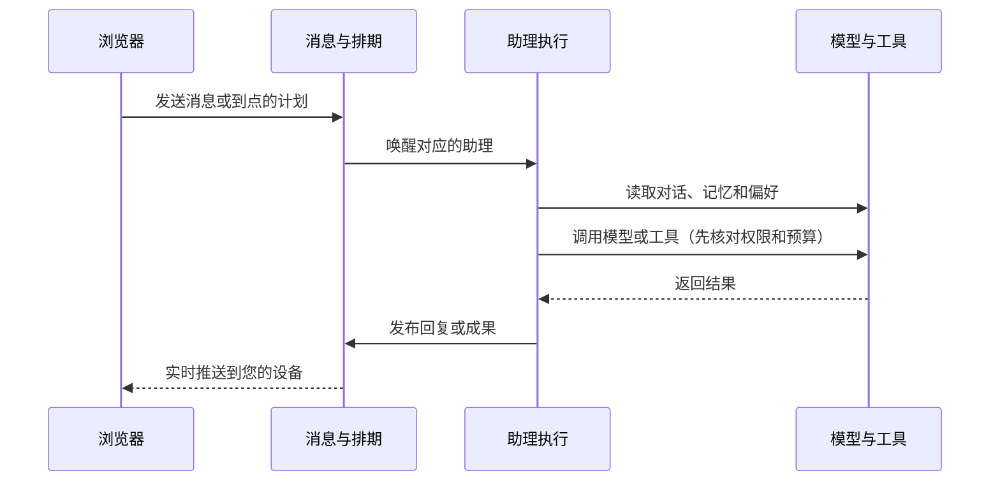
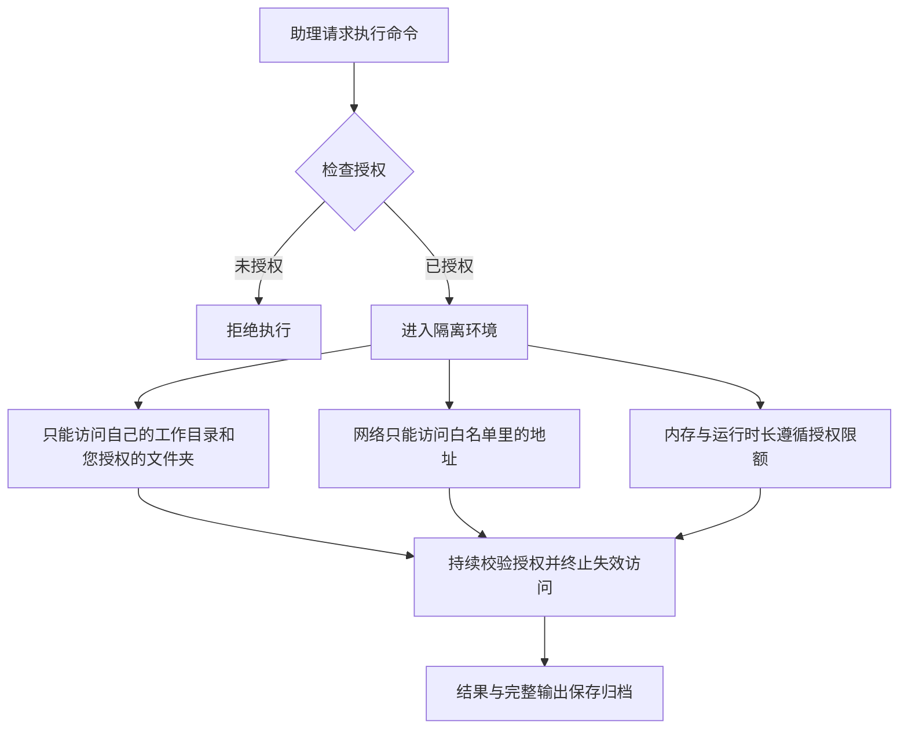

# 架构总览

Molr 由网页界面和一个您自己运行的服务组成。本文用通俗的方式介绍它包含哪些部分、一次委托如何被执行、您的数据放在哪里。不需要计算机专业背景也能读懂。具体安装步骤见[部署与维护](deployment/README.md)；更深入的实现设计见[开发者文档](../dev-docs/README.md)。

## 三个组成部分


- **网页界面（WebUI）**：您在桌面或手机浏览器里使用的页面。它只是静态页面，连接您自己的 Molr 服务。
- **Molr 服务（Runtime）**：核心程序，账号登录、聊天、任务安排、文件和命令执行都由它负责。它是一个单独的程序，使用一个数据目录，在同一台机器上只需要运行一份。
- **命令沙盒（可选）**：助理执行 Linux 命令时使用的隔离环境，默认就内置在服务里；也可以放到另一台机器上单独运行。

您如何访问自己的服务有三种常见方式：直接使用 HTTPS、经由反向代理服务器、或先在本机试用。选择与配置方法见[部署指南](deployment/README.md)。

## 一次委托是如何执行的



1. 您发送消息，或计划时间到了自动触发。所有内容先完整保存，再开始处理。
2. 对应的助理被唤醒：它读取相关对话、记忆和您的偏好，组织本轮上下文。
3. 每一步调用模型或使用工具之前，服务都会核对授权范围和预算余额；超出范围的操作会被拒绝。
4. 助理完成后的回复和成果显式发布到对话里，实时推送到您的设备；设备离线后再上线也能补看。

聊天记录只保存真实交互。定时计划按自己的节奏触发，不会伪装成您发来的消息。执行进度会持续保存，服务重启后先核对已发生的操作，再恢复可以继续的工作；结果未知的操作需要核对，Shell 活进程不会恢复。

## 助理如何安全地执行命令

需要执行 Linux 命令时（例如整理文件、运行脚本），助理不会直接操作您的电脑：



- 命令在一个隔离环境里运行：它只能看到助理自己的工作目录、本次命令的临时目录，以及您明确授权过的文件夹。
- 网络访问按白名单放行，其余一律拒绝；内存等资源受额度约束。执行时长由授权及本次命令共同限制，不限时运行需要明确授权。
- 执行过程中可撤销授权；计算和存储授权失效会终止相关执行，网络授权失效会限制对应连接。远程沙盒依靠授权租约停止失联执行，不承诺网络分区下瞬时撤权。
- 如果运行环境不支持隔离，命令功能会直接显示为不可用，而不是退回到在您的电脑上直接执行。

命令环境的准备与依赖见 [Linux 命令环境](deployment/sandbox.md)。

## 您的数据放在哪里

Runtime 默认把数据保存在私有数据目录中；自定义工作区、外部授权目录和远程沙盒需另外管理。默认目录示意：

```text
数据目录/
├── runtime.db       # 主数据库：账号、聊天、任务、执行记录、网络账本
├── keys/            # 加密密钥：用来加密封存的模型访问密钥
├── files/           # 聊天附件与助理产出的文件
├── media/           # 图片、音频等处理缓存（可自动重建）
├── sandbox/         # 默认助理工作目录
└── backups/         # 执行备份命令生成的数据库快照
```

需要了解的几点：

- 聊天内容和任务记录以原始形式保存在您自己的数据库里，不会发送给 Molr 官方。
- 模型的访问密钥等敏感凭证是加密保存的；加密密钥单独放在 `keys/` 目录，**不会出现在备份文件里**。请把备份和 `keys/` 目录分开保管——丢失密钥时，已保存的模型密钥将无法恢复。
- 与云端模型对话时，对话内容会发送给您选择的模型服务商；这一点与是否自己部署无关。

备份与恢复的具体操作见[部署指南](deployment/README.md)。

## 安全边界一览

| 边界 | 保护什么 |
| --- | --- |
| 登录与设备 | 只有您能访问：登录需要密码（可开启验证器二次验证），每台登录过的设备都可以单独注销 |
| 助理权限 | 每位助理只能访问您明确授权的内容：哪个文件夹、只读还是可写、哪个模型、花费上限；随时可以收回 |
| 命令隔离 | 助理的命令在隔离环境中运行，接触不到服务本身的数据、密钥和其他进程 |
| 网络访问 | 模型与命令的网络访问都有明确目的地限制，防止被用于探测内网 |
| 费用控制 | 每次模型调用前先估算并预留预算，超出上限自动停止 |

支持多账号独立使用，通过用户组分配资源和每位成员独立的配额；不提供用户间交互或公开注册。详见[用户与用户组](users-and-groups.md)。

## 想了解更多

- [快速开始](getting-started.md)：从安装到完成第一次委托。
- [资源、权限与预算](resources-and-permissions.md)：授权范围、费用控制与撤权。
- [部署与维护](deployment/README.md)：构建、HTTPS、备份恢复与升级。
- 面向开发者的完整设计（模块划分、API 合同、沙盒实现、安全模型）见[开发者文档](../dev-docs/README.md)。

## 实时更新与断线恢复

消息与其他可见事件在服务端事务提交成功后唤醒已连接的浏览器，服务端按各连接的游标批量推送。空闲时不轮询事件记录；权限校验和连接心跳独立运行。断线后浏览器使用最后收到的游标补取已提交事件，后台执行不依赖网页保持打开。当前使用单实例 Runtime 内部通知，具体机制见 [Runtime 架构](../dev-docs/runtime/ARCHITECTURE.md#实时事件交付)。
