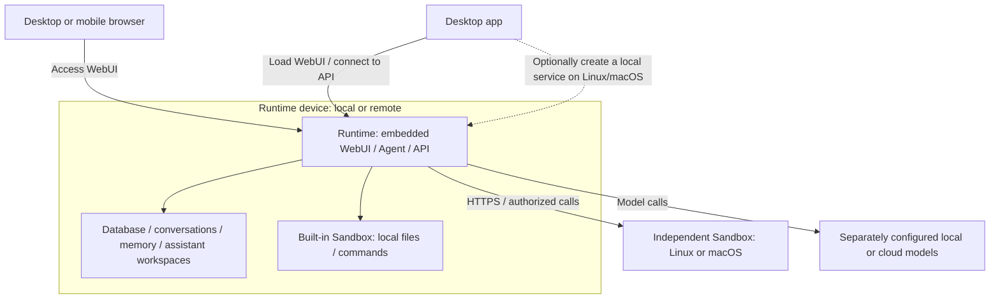

# Installation and service management

Choose “Let an Agent install for me” on the website and copy the instructions to an Agent with access to the target device. It can inspect, install, and verify the environment; see [Agent installation](agent-install.md).

## Clients, Runtime and Sandbox

Clients display the interface, handle sign-in and connect to instances. Runtime `server` mode runs assistants and persists their data; `sandbox` mode supplies another device’s directories and execution resources to an existing server. The complete server also includes local Sandbox capabilities. Connecting a desktop app to a Runtime on another computer does not move that computer's assistants or data to the client.

| Component | Responsibility and location |
| --- | --- |
| Mobile client | Mobile users currently access WebUI in a phone browser; there is no native iOS/Android App installer. Phones connect to a reachable Runtime and do not host Runtime or Sandbox. |
| Desktop app | Manages connections, separate sign-in sessions and the WebUI container. Linux, macOS and Windows full editions can install and manage a native local Runtime. WSL instances remain ordinary remote connections. |
| WebUI | Provides chat, assistant, resource and administration pages in a browser or desktop app. Release Runtime binaries embed WebUI and serve pages and APIs at the same address; no separate frontend server is required. The desktop app loads WebUI from the connected Runtime. |
| Runtime | One service program with `server` and `sandbox` modes. `server` provides accounts, Agent execution, scheduling, model calls and persistence. Databases, conversations, memory, attachments and assistant workspaces live on the Runtime device. Model services are configured separately; packages include neither model weights nor inference servers. |
| Built-in Sandbox | Compiled into Runtime to manage controlled local file access and commands. Linux uses Bubblewrap and other system capabilities; macOS uses Seatbelt. Local execution needs no additional sandbox node. |
| Independent Sandbox | Runs `molr serve --mode sandbox` on another Linux/macOS device, connected to Runtime over HTTPS. Provides authorized directories and execution, without hosting accounts, Agents, chat sessions or WebUI. |



Clients connect to Runtime; Runtime connects to additional execution nodes. A remote Runtime hosts the complete assistant service, while a remote Sandbox adds execution and directory resources. Authorized directories on a remote node remain on that node; the assistant's own workspace stays on the Runtime device. See [sandbox resources](../resources/sandbox.md) and [independent Sandbox deployment](../sandbox/remote.md).

The desktop app's Electron renderer sandbox restricts web pages' access to desktop system interfaces. The Sandbox described above restricts assistants' file and command operations. These are separate protections.

## What each package contains

The website lists only stable installers published in GitHub Releases, excluding drafts, prereleases and nightly builds. The table describes each artifact's contents. The target device or package manager prepares system dependencies; they are not necessarily bundled inside the installer.

| Package or entry point | Included components | Installation and use |
| --- | --- | --- |
| Linux full desktop `.deb`, AMD64/ARM64 | Electron desktop app, connection manager, `molr` with embedded WebUI and built-in Sandbox, and `molr-setup` | After installing the desktop app, connect only to remote Runtimes or create a local service from the app. The DEB declares Bubblewrap, static BusyBox, systemd and other dependencies for the package manager to prepare. |
| macOS full desktop `.dmg`, Apple Silicon/Intel | An `.app` containing Electron, connection manager, `molr` with embedded WebUI and built-in Sandbox, and `molr-setup` | Create a launchd user service on demand after installing the app. Choose a resource permission preset when creating the service; generated settings control command capabilities. |
| Windows full desktop `.exe`, AMD64 | Electron, connection manager, `molr.exe` with embedded WebUI, and `molr-setup.exe` | Creates an interactive-user scheduled task on demand, with Windows logon startup; WSL is unnecessary. Controlled PowerShell uses AppContainer file scopes and a network toggle; Full Access requires separate authorization. |
| Linux/macOS Runtime `.tar.gz`, AMD64/ARM64 | `bin/molr` with embedded WebUI and built-in Sandbox, `bin/molr-setup`, release metadata and licenses | The same `molr` binary supports `server` and `sandbox` modes, without Electron. Choose the service mode using the CLI, then connect through a browser or client. The website's `install.sh` downloads this type of Runtime package. |
| Source archive | Project source reviewed for distribution | For building your own artifacts, not a compiled application installer. See [source deployment](source-build.md) for build dependencies. |
| Docker | Locally built image with `molr`, embedded WebUI and the built-in Sandbox implementation | Includes neither the desktop app nor `molr-setup`. The base image defaults to commands disabled; the `isolated` target adds Linux isolation dependencies. No official prebuilt image is currently provided. See [Docker deployment](docker.md). |

WebUI needs no separate installer. Phones currently use that same WebUI, with no native mobile App download. Desktop and Runtime packages carry licenses and third-party notices; desktop packages additionally preserve Electron/Chromium license materials.

## Desktop app

The website's Desktop app option lists only stable installers. It shows “Coming soon” when no stable version has been published. Source builds and native verification commands are in the [desktop README](../../../../apps/desktop/README.md).

The connection manager shows saved local and remote services as cards, followed by Add connection. An empty list opens the add flow directly. Without an installed local service, choose this computer or a remote service; otherwise, adding opens the remote form. The connection name is optional and defaults to the hostname. HTTPS is the default; loopback or private-network HTTP requires explicit opt-in. Connections keep separate login state, and changing the server origin creates a new session. Add WSL and existing CLI installations by their service address.

The connection manager defaults to the Forest palette and system display mode. After sign-in it inherits the account’s saved palette and display mode, retaining the last signed-in service’s appearance when returning to the list or restarting the app. System mode continues following OS changes; no separate desktop appearance settings are needed.

Choose this computer, set an administrator username and password, review resource permissions, then install and start. The installer uses the password in memory for initialization and capability checks without creating `initial-password`. The dedicated service listens on loopback. Installation returns to the list with a This computer card; clicking Connect automatically signs in and continues model/assistant setup. If the link expired or the app restarted, sign in with the chosen credentials. Existing CLI installations remain independent and can be added as external connections. Linux retains the sandbox prerequisites below. Resolve missing dependencies, host-policy errors or directory permissions before retrying. macOS command execution follows the selected resource preset and its platform-specific sandbox boundaries.

Native Windows Runtime runs as a scheduled task for the signed-in user and stops when that user signs out. AppContainer does not guarantee arbitrary CLI compatibility; failed startup probes disable controlled execution. Concurrent commands and terminals in one Runtime can reuse exact directory scopes. Nested active scopes or the same scope in another Runtime report busy. A scope with more than 100,000 descendants is rejected. Windows terminals use ConPTY (APIs available since Windows 10 1809), subject to the startup probe. Controlled port forwarding and hard resource quotas remain unavailable; the network toggle still respects Windows firewall and AppContainer loopback restrictions.

Closing windows or quitting the app leaves the Runtime running. Sleep, shutdown or termination of the user service affects tasks. Explicitly stop, restart or uninstall the Runtime in the management interface; uninstall retains configuration and data. Removing the desktop application itself does not uninstall its background Runtime, so remove the service from inside the app first when needed.

Desktop upgrades currently use a manually downloaded installer, followed by an explicit upgrade of its managed Runtime. CLI/web update entry points do not update desktop-managed instances. Operators maintain remote and WSL Runtimes independently. Desktop releases require native acceptance. While certificates are pending, Windows temporarily provides unsigned test builds and macOS provides ad-hoc signed, unnotarized test builds. Developer ID-signed macOS installers may also be published as “Signed, not notarized” when the notarization wait expires. Download pages and Release notes show the status; the operating system may warn about an unknown publisher or block the first launch. If you trust the source, follow [Apple’s instructions](https://support.apple.com/en-us/102445) to allow opening in System Settings → Privacy & Security. Device management policies may restrict this action. Local builds are evaluation artifacts, not published releases.

The This computer card shows an update notice when the bundled service has higher SemVer precedence. Version notices use the same non-interactive badge style as running status. Open service management from the card menu to see the current and target versions and update. A newer installed service shows a version mismatch and advises updating the desktop app, without a download shortcut or a downgrade action. Identical versions show no extra notice. Different build metadata or unrecognized version strings show a mismatch, not an available update. Comparison uses the service version actually bundled with the desktop app.

### Are Runtime and Sandbox optional?

Bundled program files, background service creation and command capabilities are separate choices:

| Action | Current choice |
| --- | --- |
| Exclude Runtime files from the Linux/macOS full edition | Not available. Full packages always include Runtime, with no component selection page or separate Linux/macOS client-only installer. |
| Create and start a local Runtime service | Optional. Opening the app for the first time does not create a service; Install and start does. Skip this step when connecting only to remote instances. |
| Install or omit the built-in Sandbox separately | There is no separate installation step or checkbox: it is part of Runtime. Additional sandbox nodes are not deployed automatically. |
| Enable local commands | Controlled by Runtime configuration; the desktop installation interface has no toggle yet. New Linux instances enable commands by default; macOS disables them. Change the instance's `sandbox.enabled` and restart to switch. Chat, files and memory remain available when disabled, as do separately configured remote Sandboxes. Assistants still need the relevant grants to execute commands. |
| Skip the Linux DEB's sandbox system dependencies | Not available. Installing the DEB requires its declared sandbox dependencies even for remote-only use. Skipping local service creation does not remove those package dependencies. |

Local Runtime service creation is already optional. Selecting Runtime and Sandbox as separate installation components is not implemented. See [native macOS command permissions](../sandbox/macos.md) and [Linux sandbox deployment](../sandbox/linux.md) for configuration and authorization.

## Environment requirements

The following are initial sizing estimates for running the Molr service (Runtime and WebUI) while connecting to cloud models or models hosted on another device. They have not yet been validated by systematic performance benchmarks. The minimum configuration targets service startup and occasional single-user chat; the recommended configuration leaves room for daily use and a few concurrent tasks.

The CPU must use a 64-bit x86 (amd64) or ARM (arm64) architecture.

| Hardware | Minimum | Recommended |
| --- | --- | --- |
| CPU | 1 core | 4 or more cores |
| Memory | 512 MiB | 8 GiB or more |
| Available disk space | 5 GiB | 20 GiB or more, preferably on an SSD |
| GPU | No dedicated GPU required | Choose based on local model deployment requirements |

Running a local model on the same device requires additional storage for model weights, inference memory, and potentially GPU memory, depending on model size, quantization, and context length. Sandbox tasks require additional CPU and memory, especially browser automation, code builds, and concurrent sandboxes. Attachments, workspaces, and backups consume disk space over time, so scale capacity to your workload. For sandbox resource configuration, see [Linux Command Environment](../sandbox/linux.md).

For native macOS Runtime builds, Full Access, and service management, see [source deployment](source-build.md#native-macos-execution). The systemd steps below apply to Linux; macOS uses the user launchd installation described below.

## Runtime modes and resource permission presets

The same Runtime package supports `server` (default) and `sandbox` modes for a complete service or a resource node. Runtime provides accounts, assistants, WebUI and its built-in sandbox. A standalone Sandbox supplies resources to another Runtime without creating Runtime accounts or assistant workspaces.

```bash
./bin/molr-setup --mode server --resource-preset permissive
./bin/molr-setup --mode sandbox --name molr-node --resource-preset least-privilege
```

The installer records the mode and generates `molr serve --mode server|sandbox` for the service. Updates, repairs, and restarts retain it. Interactive setup asks for the mode only when `--mode` is omitted; resource permissions are selected independently. Unattended setup defaults to `server` and least privilege. Desktop shows the preset choice before creating a local Runtime, initially selecting permissive.

- **Permissive (recommended for personal deployments)**: connect local directories, networks and compute within the service account's OS permissions, then configure and assign access in Molr. Assistants still require individual grants. Linux discovers supported GPUs. No additional deployment ceilings are set for CPU, memory and other authorization quotas; backend and protocol capacity bounds still apply. Full Access is exposed but requires a separate grant and explicit invocation.
- **Least privilege**: expose no local directories, network access or command execution. Adjust deployment configuration later to expose resources, then grant assistants access. Runtime data and built-in assistant workspaces remain usable. On standalone nodes, `enabled: false` disables the entire node's resources.

Resource presets generate ordinary settings independently of the mode saved in the installation record. `--config` and `--resource-preset` are mutually exclusive. Updates, repairs and reconnects preserve existing configuration. Preview and explicitly apply a preset to an installed instance:

```bash
/path/to/molr-setup configure --resource-preset permissive --dry-run
/path/to/molr-setup configure --resource-preset permissive
```

Maintenance shows changed fields and preserves service paths, credentials and assistant grants. Running instances restart; stopped instances remain stopped. Existing directory rules, network rules and GPU selections are replaced by the selected preset. Settings can also be edited individually.

Standalone installation generates an HTTPS certificate and private service token. Results show the address, certificate fingerprint and token file location for Runtime's Resources → Sandboxes → Connect sandbox form. The same `molr-setup` manages installation, status, updates and uninstall. Normal uninstall preserves configuration, certificates, tokens and data. See [standalone deployment](../sandbox/remote.md).

## macOS command-line installation

macOS 13 and later has Apple Silicon (ARM64) and Intel (AMD64) packages containing `molr` with its embedded WebUI and `molr-setup`. End users do not need Go, Node.js, Python, or Homebrew. Run the website command in Terminal; it selects the native architecture:

```bash
curl -fsSL https://molr.ai/install.sh | sh
```

Run as the current user without `sudo` or `--user`. Setup registers a launchd user service, initializes the account, waits for HTTP and authenticated capability checks, and prints a one-time login link. It opens the default browser in a desktop session and only prints the link over SSH. The service uses `~/Library/LaunchAgents/<instance-name>.plist` and starts at desktop login; SSH-only environments use the current user's background launchd domain. This is not a system daemon that starts before login.

The default program directory is `~/Library/Application Support/Molr/program/default`. Configuration and data use `config/default` and `data/default` under the same Molr directory. Logs and caches use `~/Library/Caches/Molr/default`. Use `--name molr-<name>` for separate instances. Setup prints the actual paths and service commands; quote paths containing spaces.

```bash
"$HOME/Library/Application Support/Molr/program/default/bin/molr-setup" status
"$HOME/Library/Application Support/Molr/program/default/bin/molr-setup" update
"$HOME/Library/Application Support/Molr/program/default/bin/molr-setup" uninstall
```

Normal uninstall retains configuration and data; explicitly remove them with `uninstall --purge --yes`. Updates preserve accounts, configuration, and workspaces. In-app updates are not yet supported on macOS; use the CLI. Setup verifies the archive and Mach-O code signatures. Packages currently use ad-hoc signatures without Developer ID signing or Apple notarization; the supported distribution path is Terminal installation.

Unattended installation without an explicit preset uses `sandbox.enabled: false`; chat, files, and memory remain available. Set `sandbox.enabled: true` and restart to enable Seatbelt-controlled commands, then grant compute, file, and network access as needed. Full Access requires a separate `sandbox.allow_full_access` opt-in and grant. See [native macOS command permissions](../sandbox/macos.md).

For offline installation, download the archive and adjacent `.sha256`, verify with `shasum -a 256 -c <archive>.sha256`, extract, and run `./bin/molr-setup`. Do not substitute Finder double-clicking a bare executable for Terminal installation.


## Local packages and quick installation

Linux packages are available for AMD64 and ARM64 and include the `molr` application and the `molr-setup` maintenance program. Download the matching archive and SHA-256 file, verify and extract them, then run from the package directory:

```bash
sha256sum -c molr_0.1.0_linux_amd64.tar.gz.sha256
tar -xzf molr_0.1.0_linux_amd64.tar.gz
cd molr
./bin/molr-setup
```

The default operation installs or upgrades to this package's version without a channel or installation subcommand. An existing instance at the same version opens maintenance; use `--repair` to reapply files. See [source builds](source-build.md) to create packages.

For an initial online installation, use the website downloader:

```bash
curl -fsSL https://molr.ai/install.sh | sh
```

The website’s backend and sandbox entries use curl, detect the OS and architecture automatically, and install the latest stable release. They show “Coming soon” when no stable package is available. The version appears in the installation area’s top-right corner; architecture, download tool, and version controls are omitted. The website offers command-line and Agent installation. For manual or offline installation, select the target OS, architecture, and version in [GitHub Releases](https://github.com/molr-ai/molr/releases), download the archive and matching `.sha256` file, and follow the steps in this section. For containers, see [Docker deployment](docker.md).

To choose an architecture, version, or download tool, adapt these commands. `--arch amd64` or `--arch arm64` checks the device architecture and stops before downloading on a mismatch; omit it for automatic detection. `--version` must refer to a version in the release catalog; omit it to install the latest release in the selected channel, which defaults to stable. For a sandbox node, replace `--mode server` with `--mode sandbox`.

```bash
# Specify architecture and version
curl -fsSL https://molr.ai/install.sh | sh -s -- --mode server --arch arm64 --version 0.1.0
# Use wget when curl is unavailable
wget -qO- https://molr.ai/install.sh | sh -s -- --mode server
```

Website desktop, backend and sandbox entries display only stable releases. Download prerelease and nightly packages from GitHub Releases for offline installation. With another source that publishes these channels, select them using `--source URL --channel preview` or `--source URL --channel nightly`.

Stable tracks final releases, preview tracks beta/RC and subsequent final releases, and nightly tracks daily builds. Empty channels do not fall back to other channels. The downloader displays version, architecture, filename, source, checksum and progress, verifies the package, then runs its installer. It uses existing curl or wget, tar, gzip and a SHA-256 tool without installing download tools. The maintenance program itself needs no Python, curl or iproute2.

The default source is `https://molr.ai/releases`; use `--source URL` for another HTTPS source. The downloader also verifies and installs local archives:

```bash
sh install.sh --archive /path/package.tar.gz
```

An adjacent `package.tar.gz.sha256` is required. Running an extracted package needs no network when system dependencies are prepared. SHA-256 verifies downloaded content; it is not an independent publisher signature.

The website source contains manifests only for the latest stable version within the scan window. `--version` must name a version in the current catalog. For other historical versions, download the archive and SHA-256 file from GitHub Releases and use the offline installation steps above.

## Interactive and unattended installation

A controlling terminal enables interaction by default. The installer displays paths, account, dependencies and permissions before confirmation. Modes can be selected explicitly:

```bash
./bin/molr-setup --interactive
./bin/molr-setup --non-interactive --install-deps \
  --directory-permissions fix --no-browser
./bin/molr-setup --dry-run
```

Unattended mode neither prompts nor opens a browser. `--install-deps` authorizes system preparation; arrange administrator privileges beforehand. Use `--skip-dependencies` for manually prepared hosts. `--dry-run` shows the plan without changing accounts, permissions, configuration or services; previewing through the downloader still downloads a temporary package.

For group/other-writable directories, choose fix, ignore or quit. Fix removes only those directory write bits, without recursion. Unattended mode requires `--directory-permissions fix|ignore` when a choice is needed. `--yes` skips general confirmation but does not choose a permission policy. Ownership mismatches, symlinked paths and writable managed files cause errors.

Without `--config`, setup generates LAN HTTP configuration, initializes the owner, starts the service and verifies authenticated APIs and sandbox capabilities. Output follows inspection, preparation, installation, verification and results. `verified` means authenticated verification passed. `verification_pending` means installation succeeded but current credentials are needed, with exit code 3. `not_started` corresponds to `--no-start`. Failures report the current stage and possible changes.

## Linux services and command environment

The current service adapter uses systemd. The Linux sandbox requires systemd 254+, cgroup v2 delegation, Bubblewrap, static BusyBox, CA certificates and util-linux nsenter/setpriv. These are capability requirements; installation does not reject distribution names or versions. Automatic dependency preparation currently supports APT. Other environments can be prepared manually using the [sandbox requirements](../sandbox/linux.md). User services need a normal SSH/desktop login session and user manager.

When AppArmor restricts unprivileged user namespaces, setup probes Bubblewrap as the service account under `NoNewPrivileges`, first with the already loaded `chrome` profile and then through the original restricted path. No new profile is needed if the existing configuration works. If both paths fail, with authorization it can prepare and load the distribution's `bwrap-userns-restrict` policy and repeat the probe. Existing policies are preserved; conflicts require administrator intervention. System isolation restrictions are not disabled, and missing dependencies do not trigger Full Access.

### Selecting the runtime account during installation

The default is the current regular user's `molr.service`. Root installation requires a non-root `--user USER` and creates a system service. Missing accounts are created as system accounts without login access. Existing HOME, shell and supplementary groups are preserved; existing data ownership is not changed recursively.

```bash
./bin/molr-setup --name molr-demo --port 8788 --public-host "<LAN_IP>"
sudo ./bin/molr-setup --user molr-sandbox --install-deps
# Custom configuration; initialize using a password from stdin
./bin/molr-setup --config /path/server.json --init-owner owner \
  < /private/owner-password
```

Replace `<LAN_IP>` with the actual private IPv4 address. Initial installation with custom configuration requires `--init-owner`, or `--no-start` for later initialization. Runtime and its sandbox always use the same regular account.

| Content | User installation | System installation |
| --- | --- | --- |
| Programs, installation record and licenses | `~/.local/lib/molr/<instance>/` | `/opt/molr/<instance>/` |
| Configuration | `${XDG_CONFIG_HOME:-$HOME/.config}/molr/<instance>/` | `/etc/molr/<instance>/` |
| Default persistent data | `${XDG_DATA_HOME:-$HOME/.local/share}/molr/<instance>/` | `/var/lib/molr/<instance>/` |
| Cache and temporary files | `${XDG_CACHE_HOME:-$HOME/.cache}/molr/<instance>/` | `/var/cache/molr/<instance>/` |
| Service file | `${XDG_CONFIG_HOME:-$HOME/.config}/systemd/user/<service>.service` | `/etc/systemd/system/<service>.service` |
| Management command | `systemctl --user` | `sudo systemctl` |

Service `molr` uses instance `default`; `molr-demo` uses `demo`. `molr-default` is reserved. `--program-root /path/programs` changes the program base; files go into its instance child. Both commands live under `bin/`; configuration is `server.json`, with mode `0600` for user installs or root-owned, service-group-readable `0640` for system installs.

Program, configuration, data and cache directories must not overlap. Custom `data_dir` and external workspaces retain their configured paths and must be accessible to the service account. Databases, keys, attachments and assistant workspaces are persistent data; caches can be rebuilt. Licenses are installed with the programs and available in WebUI at `/LICENSE` and `/THIRD_PARTY_NOTICES.md`.

After starting a Linux user service, the installer checks linger. If it is disabled or its state cannot be confirmed, the installer attempts to enable it and verifies the result. This step never prompts for a password or invokes sudo. If authorization is required, the command is unavailable, or verification fails, installation continues with a warning that the service may stop after the last login session ends. Follow the instructions to run `sudo loginctl enable-linger USER`, then confirm `Linger=yes` with `loginctl show-user USER -p Linger`. Linger applies to the entire Linux user account and is retained on uninstall. `--dry-run` and `--no-start` leave linger unchanged; system services need no linger. See [Docker deployment](docker.md) to run the complete application with WebUI, persistent data, and optional command execution.

## Updates and repeated execution

Running the installed maintenance program shows status and opens a maintenance menu; without a terminal it only shows status. It locates the instance using its executable location, independently of the working directory.

```bash
~/.local/lib/molr/default/bin/molr-setup
~/.local/lib/molr/default/bin/molr-setup status
~/.local/lib/molr/default/bin/molr-setup update
~/.local/lib/molr/default/bin/molr-setup update --version 0.2.0-rc.1
~/.local/lib/molr/default/bin/molr-setup update --channel preview
```

Updates use the source and channel saved in the installation record, show the selected package, then download and verify it. `--source`/`--channel` select the subscription for this update and subsequent successful updates. System instances use `sudo /opt/molr/default/bin/molr-setup update`. The Go updater also accepts explicitly specified private or loopback numeric HTTP mirrors.

Rerunning the website command or installing another extracted package also upgrades an existing instance, preserving configuration, data, credentials and accounts. Atomic program replacement retains `molr.previous`, `molr-setup.previous` and `server.previous.json`. The same version is not reapplied by default; use `--repair`. An intentional downgrade needs `--allow-downgrade` and a prior data backup.

Incomplete installation or damaged records produce explicit errors. Do not delete records to bypass detection; use a complete package to repair the original instance. `--record /path/installation.json` selects a specific installation.

Component installation, updates and repairs are covered in [Component management](../administration/components.md).

## Administrator initialization

Interactive CLI installation asks for an administrator username (suggested default `owner`) and a confirmed password of at least 12 bytes. Password entry does not echo and is not saved in configuration or logs. Unattended installation can explicitly choose:

- `--auto-init-admin`: create `owner` with a random password saved as `initial-password` (0600), retaining the automatic workflow.
- `--init-owner NAME`: read a chosen password from stdin without creating a password file. Only the username goes in arguments. Download the installer script to a file before executing it, leaving stdin available for credentials.

These options are mutually exclusive. A first installation without a terminal or explicit initialization option reports the missing input. Updates, retries and reinstallations with retained accounts never overwrite credentials. Standalone sandbox mode does not create administrators.

The local card’s management menu contains stop, restart, update, logs and uninstall. Stopping or failure leaves the card in place; successful uninstall removes it while retaining account/configuration/data. Remote cards can be edited or removed; removal clears only the desktop connection and its local login state.

## Post-startup checks

After installation, update or restart, verify the actual page and authenticated sandbox capabilities:

```bash
~/.local/lib/molr/default/bin/molr doctor -config /path/server.json -username YOUR_ADMIN -password-stdin
~/.local/lib/molr/default/bin/molr access -config /path/server.json -username YOUR_ADMIN -password-stdin
```

Use the username and password chosen during installation. With automatic initialization and a still-valid initial password file, omit `-password-stdin` to read it. With MFA, also supply `-mfa-code`. These commands use normal authentication APIs. `access` creates a one-time login link valid for 15 minutes.

Unless the sandbox was disabled, `/api/sandbox` must report `Enabled=true`, `Capabilities.Reason=available` and all of `Shell`, `ProcessIsolation`, `FileIsolation`, `NetworkIsolation`, `ResourceLimits` as `true`. A listening port or active service does not replace this check. See [sandbox checks](../sandbox/linux.md#checks-and-verification).

## Uninstallation

Use the installed maintenance program for offline uninstallation:

```bash
~/.local/lib/molr/default/bin/molr-setup uninstall --dry-run
~/.local/lib/molr/default/bin/molr-setup uninstall
~/.local/lib/molr/default/bin/molr-setup uninstall --purge --yes
sudo /opt/molr/demo/bin/molr-setup uninstall --purge
```

The default stops the instance and removes programs, service files and cache while retaining configuration, persistent data and the installation record. Reinstalling the same instance reuses them. `--purge` removes managed configuration and default data; interactive mode requires typing the instance name, and unattended mode requires `--yes`.

Custom data, external workspaces, unknown files, system accounts, dependencies and linger settings are retained. Ambiguous service ownership, stop failures or mount points inside removal directories stop deletion. Default uninstallation removes the maintenance binary; to purge retained data later, use a complete package and the retained record:

```bash
./bin/molr-setup uninstall --record /path/installation.json --purge --yes
```
