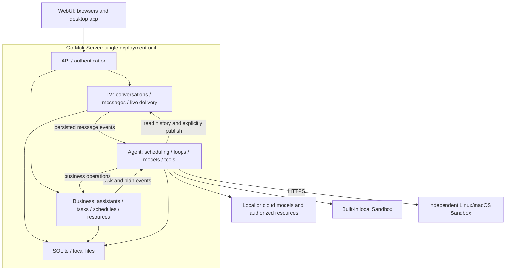

# Architecture Overview

Molr adopts a Go modular monolith, using SQLite and local files for data storage. The WebUI connects to the Runtime via HTTP and SSE; command execution can use the built-in sandbox or an independent Linux/macOS Sandbox.

## Components

- The Go Runtime provides identity authentication, data persistence, Agent execution, planning, resource authorization, and cost management.
- WebUI is embedded in release Runtime binaries and connects to the same instance from desktop/mobile browsers or the desktop app.
- The Electron desktop app manages connections; Linux, macOS and Windows packages can optionally create a bundled native Runtime service and can connect to remote instances.
- Phones currently use WebUI in a browser; no native iOS/Android App is implemented. Package contents and installation choices are described in [Installation and service management](../../admin/deployment/installation.md).
- UI Design uses mock data to display components and interactions; its Desktop/Mobile/CLI views do not represent independent native clients.
- The official website provides product introductions and public documentation, deployed separately from user Runtime instances.

## 1. Runtime Structure

A single Go main process hosts core modules, which call interfaces directly. When external programs need to be executed, built-in tools manage controlled subprocesses. By default, only one server is started, using one data directory and one external entry point.

## 2. Independent Assistant Loop and Session Tools

Each assistant has an independent Agent Loop, which is an independent execution state and does not imply an exclusive process. The Loop advances based on events and sleeps when idle; the same assistant processes events sequentially, while multiple assistants run within concurrency quotas.

Chat sessions only save the actual interaction history between users and assistants. Raw chat records do not automatically become model context; the Loop organizes context based on current events, task status, work summaries, and tool results.

| Session Tool | Purpose |
| --- | --- |
| Read Session | Retrieve actual interaction content by message reference or range |
| Search Session | Retrieve historical fragments with sources according to permissions |
| Send to Session | Explicitly publish text or structured cards, which can be associated with tasks and schedules |

Model internal outputs and tool returns are not automatically written to chat. Assistant messages do not trigger the assistant itself again as new user input. User messages, scheduled plans, and execution results are events from different sources; scheduled triggers do not forge user messages.

## 3. Internal Modules

Divided into three functional domains: **IM / Agent / Business**. IM manages sessions, messages, read status, and real-time delivery; Agent manages scheduling, Loops, context, models, and tools; Business manages assistant identity, tasks, to-dos, plans, resources, memory, and preferences. Authentication, permissions, auditing, retrieval, and storage are common support. Export interfaces are implemented in Go packages, see [Interface Contracts](../reference/module-interfaces.md).

IM does not directly depend on Agent or Business packages. User sending and assistant publishing share message formats and storage but use different write entry points to bind identity; Agent scheduling consumes IM's persistent message events, converting only real user input into execution input, and assistant publishing does not repeatedly trigger itself.

Session read cursors only advance forward and do not accept sequence numbers beyond the message tail. Remaining unread assistant messages are counted via database covering indexes by account, session, sender, and sequence number range; cursors and counts are updated within the same write transaction, maintaining consistency with appended messages.

| Internal Module | Main Responsibilities |
| --- | --- |
| Access & Real-time Communication | HTTP API, TLS/trusted proxy access, authentication middleware, SSE, and retransmission after disconnection |
| Account & Authentication | Independent accounts, administrators and user groups, passwords and two-factor authentication, login sessions, device deregistration, and client tokens |
| Security Auditing | Records of logins, permission changes, sensitive operations, and abnormal access |
| IM | Sessions, messages, read status, feedback, message creation events, and authorized real-time delivery |
| Business & Policy | Assistants, tasks, to-dos, schedules, memory, settings, authorization, and budgets |
| Scheduling & Execution | Persistent events, scheduled occurrence points, execution quotas, retries, cancellation, and recovery |
| Agent Runtime | Independent Loops, context, model selection, memory strategies, checkpoints, and acceptance |
| Model & Credential Proxy | Vendor protocol adaptation, streaming calls, protected credential usage, and usage receipts |
| Built-in Tools & Resources | Session tools, files, external application operations, and controlled program execution |
| Retrieval & Indexing | History and material retrieval, content parsing, index updates, and rebuilding |
| Persistence | Transactions, domain repositories, messages and events, operation records, version registration, files, and backups |

All modules are compiled, released, and upgraded uniformly with the server. Runtime `server` mode includes a local Sandbox; `sandbox` mode initializes only the resource service. Both modes reuse controlled file and Linux isolation implementations; the Runtime selects local calls or HTTPS connections with operation receipts and leases via the sandbox router. Remote services do not host Agents, sessions, or model calls. New built-in tools and model adaptations are delivered by updating the Go program. Plugins provide pages, themes, and HTTP tools through controlled extension points, without loading Go dynamic business modules; see [Plugin Mechanism](../extensions/plugins.md). Agents can execute scripts in authorized Linux sandboxes and load project instructions and Skills from the assistant workspace; these capabilities do not equate to dynamically loading server-side code. Frontend SDKs and theme mechanisms are detailed in [Themes and UI Packages](../frontend/themes.md). Model connections, permissions, budgets, and schedules are still managed as product settings.

Built-in capabilities uniformly check authorization, budget, and resource availability before execution. External programs cannot gain full access to server data and credentials. Retrieval reads authorized sources; memory reads local Markdown in real-time and does not save database index copies. Other reconstructable projections cannot modify original sessions or memory.

`internal/catalog` owns the fixed installation resource namespace. `internal/modelcatalog` handles model resolution, pricing and group visibility. `internal/objectaccess` checks ownership through domain readers, including attachment references; `app` wires these capabilities into policy and execution. Startup and execution use the current data formats without upgrading old tasks, events or checkpoints.

## 4. How a Delegation is Executed

1. The API validates the request; IM saves the real user message, message creation event, and visible event in the same transaction. Agent scheduling consumes the message event, finds the assistant based on session binding in Business, and atomically saves the deduplicated assistant input and message event consumption progress.
2. The scheduling module wakes up the corresponding Loop; the Loop reads messages via tools and retrieves history and materials as needed.
3. The Loop clarifies goals, resource scope, and acceptance criteria, and asks the user via the send tool if necessary.
4. The core checks current authorization and budget, records operations, executes via model proxy or built-in tools, and saves results and checkpoints.
5. The Business module saves task status and artifacts; the Loop publishes text or cards via the send tool.
6. The IM real-time communication module pushes committed visible events; clients retrieve from persistent records after disconnection.

A new hire (`Hire`) writes the `born` event in the same creation transaction after assistant, session, model authorization, and Loop initialization are complete; if the event write fails, the entire creation transaction rolls back. Events are deduplicated by account, assistant, and `born` source, entering the existing persistent queue using `when_idle`. After receiving birth instructions, the model sends a brief initial message via `conversation_publish`; the creation interface does not wait for generation. Copying (`Clone`), rehiring, restarting, and resetting context do not generate birth events; existing assistants are not backfilled, and no special branches are added for cases where users have already started communicating. Retries, recovery, cancellation, and message publishing idempotency follow normal execution mechanisms.

Scheduled tasks go through `计划到点 → 持久定时事件 → 助理 Loop → 执行 → 按需发布结果`. A task can span multiple model calls continuously without creating another user chat session. Additional requirements form task revisions; old version artifacts and accumulated costs are retained; ordinary chat does not force task creation, and assigning to-dos does not automatically start execution.

Scheduled trigger common capabilities are provided by `internal/trigger`: plans and nighttime dreaming share recurrence rules, time zones, missed execution policies, and occurrence point deduplication. Plans still save user items and tasks; dreaming saves its own configuration, replay progress, and memory organization records, without creating hidden plans. Business adapters commit occurrence points, progress, and events in the same transaction, then enter the common Agent queue. See [Nighttime Dreaming and Memory Usage](../runtime/dream-memory.md).

## Real-time Event Delivery

Business data, `im.visible` events, and account event sequence numbers are committed in the same transaction. Event writes register account-level wakeups via `Tx.NotifyAfterCommit`; the underlying Store broadcasts after the outermost transaction successfully commits and releases the transaction gate. Nested savepoint rollbacks discard registrations at that layer; outer rollbacks or commit failures do not broadcast. All real-time event writers created on the same underlying Store share the notifier; notifications do not cross processes and do not carry business content.

SSE subscriptions register listeners first and then backfill by cursor, pre-reading at most 100 items each time. Each connection has a wakeup channel with a capacity of 1; multiple notifications can be merged, and events are still read sequentially from persistent records. Consuming wakeups happens before queries to avoid missing commits between query and wait. Connections only read events on first read, buffer exhaustion, or receipt of commit notifications; there is no high-frequency polling or low-frequency compensation queries. After process exit or network interruption, reconnection backfills using the last cursor received by the client; network boundaries may deliver duplicates, which cannot be considered confirmation of client processing completion.

Event queries use composite indexes by account, sequence number, and optional topic. Multiple topics are read bounded separately and then merged, avoiding sparse topics scanning all events of other topics. Buffers do not grow with backlog; slow consumers are still constrained by HTTP write timeouts and do not block transaction commits. Permissions are verified before each event delivery. Idle subscriptions in the Runtime observe account changes and session/token revocations via account-level post-commit notifications, and re-check based on the nearest deadline among session absolute validity, idle validity, or token validity; there are no high-frequency authentication queries. Ordinary requests update activity time without broadcasting notifications; at the original idle deadline, the latest activity time is read and timing restarts. Authentication listeners register first then read; commits during reading retain notifications; rollbacks and failed commits do not wake up; changes in other accounts do not wake up. The HTTP layer retains identity verification before sending, sending network heartbeats via an independent 15-second timer, without repeating idle authentication. Closing subscriptions, request cancellation, or Store closure releases event and authentication listeners and wakes up waiters. Modules calling independent combined Feeds without providing authentication listeners still verify permissions according to their configured intervals.

This mechanism serves the visible event stream of the current single-process Runtime; Agent scheduling reuses underlying post-commit notifications but uses independent signals and task claiming transactions. All visible event producers must use `realtime.Store.Append` and cannot write to event collections directly; independent processes sharing the database cannot obtain in-process wakeups.

## Agent Queue Wakeup and Claiming

The IM outbox notifies independent consumers after message commit; consumers subscribe first and then backfill, continuously processing backlog in batches, and committing assistant events, initial `agent.jobs` records, and outbox acknowledgments in the same transaction. Event source deduplication remains unchanged; cancellation records pre-saved by stop operations are not overwritten by delayed messages. `UserStopped` only saves control events and does not create pending tasks.

Each executor subscribes to an independent scheduling signal, querying the queue on first startup, and subsequently re-claiming only on commit notifications or candidate task expiration. Event enqueuing, task state transitions, and dreaming session state changes wake up via `Tx.NotifyAfterCommit`; rollbacks do not wake up. Similar to SSE, listeners are registered first, and merged notifications are consumed only before queries to avoid missing commits between query and wait.

Claiming is completed in a single transaction. Pending and retry states use state/queue order composite indexes respectively, reading at most 100 items per path before merging; when encountering an occupied assistant, it continues by cursor, not letting the first batch block other assistants. Queue order is determined by event priority, nanosecond-precision UTC expiration time, and event identity, calculated uniformly when saving tasks; completed, failed, and cancelled history do not enter claim queries. Executors check run/retry status, stop boundaries, and active dreaming sessions per assistant, maintaining serial execution for the same assistant and original priorities.

When requested states do not include canceled, task lists select candidate keys through indexes on account, optional assistant, and stored state before reading them in the existing key order; queued/retry queries do not load ended task history. Queries including canceled retain the full scope because stop boundaries can turn other stored states into canceled. Read transactions reuse stop boundaries by account and assistant, including absent boundaries; candidates are filtered and paginated after calculating their visible state with the current boundary. Each list request re-reads boundaries, and cancellation writes also read the latest status in that transaction.

Delayed retries, future inputs, and dreaming occupation deadlines use the nearest candidate deadline for wakeup, requiring no new writes; the end of one task also wakes up work waiting for the same assistant. Startup recovery only reads running tasks and continues to reconcile external side effects. Task status in the database is the basis for execution; memory notifications are only hints and do not serve as persistent queues or execution confirmations.

Plan occurrence points, handovers, dreaming, and maintenance still use independent `Tick`, checking by default every second; message enqueuing and task claiming do not depend on this timer loop. Schedules use indexes by enabled status and expiration key, reading at most 200 items per batch; dreaming expiration checks read in batches by active status and deadline key, 100 items per batch, until all due records for this cycle are processed. Time keys are derived from original times by the write path, using fixed nanosecond-precision UTC strings to avoid sorting impacts from time zones and variable decimal places; these keys are only saved in private records. Plan handovers only read candidates pending check and unresolved handover reminders; task execution history is queried by account, plan type, and plan ID. Candidate marking and plan association records are committed together; ignored but unresolved reminders still participate in status reconciliation and can be resolved normally after pausing, removing dependencies, starting execution, or deleting sources. When the runtime environment is temporarily unavailable, it re-probes every second, during which no tasks are claimed and attempt counts are not increased. Current optimizations do not change plan occurrence point deduplication, missed execution policies, or remote node probing rules.

Interruption detection during model generation uses owner/assistant-level post-commit notifications. Task state transitions and urgent inbox writes register the same assistant signal in their respective transactions; commits from other accounts or assistants do not trigger reads for this request. Listeners register first, then read persistent tasks and urgent messages; merged notifications are consumed only before queries, and commits during queries are retained for the next check. Idle waiting does not poll the database; future intervenable events set one-time timers based on the earliest `NotBefore`, delaying retries only on read failure. Listeners are released when model requests end, are cancelled, or the Store closes; dreaming does not subscribe to ordinary input. This notification is still limited to the underlying Store within the same process and does not change the intervention semantics of `interrupt`, `after_step`, `when_idle`, or billing receipt processing.

## Unified User Notifications

`internal/notification` saves notification records isolated by OwnerID and source indexes within the Runtime. Source identifiers consist of type and business object; persistent anomalies with the same reason reuse one record; changing the reason or recurring after recovery creates a new ID, and acknowledgments from old devices can only act on the ID they actually saw. Notification ReadAt, DismissedAt, and ResolvedAt are independent of business status, and updates are naturally idempotent. Notifications and source status are written via the same SQLite transaction, committing `notification.changed` to the existing persistent SSE stream; GET only reads and does not create notifications. These records are used for reminder delivery, deduplication, and acknowledgment, not as business history pages; long-term content still belongs to chat, authorization, plans, and tasks.

Notification lists are queried in SQLite by account, status, and optional business filters, decoding at most `limit + 1` records per page. Creation time uses nanosecond-precision UTC private sorting keys, combined with notification ID and storage key for stable pagination; cursors are bound to account and filter conditions. Pending counts and unread counts are counted via covering indexes, always representing active notifications for the entire account, independent of list filters and cursors; both counts and the current page share the same transaction snapshot. When indexes are first installed, sorting keys are only supplemented for the notification collection, without repeatedly scanning other business collections.

WeChat delivery is synchronous upon result writing; Agent is synchronous upon commit in waiting/resume/stop states; authorization requests are synchronous in creation/processing transactions; task failures and background scheduling results are synchronous upon status commit. Plan handovers are judged for dependencies and execution status in the same snapshot by the existing scheduling Tick and notified synchronously. Brief working states are not treated as recovery, avoiding reactivation of ignored issues on every retry. Notification content only includes type, reason code, business reference, and display name, without saving model context, raw errors, or credentials.

## 5. Single Instance Concurrency, Persistence, and Recovery

Only one server instance is allowed to run per data directory. Internally, each assistant is scheduled serially. Concurrency quotas are set separately for APIs, models, Loops, tools, and indexing jobs to prevent long-running tasks from exhausting resources.

Messages, tasks, events, operations, and checkpoints are persisted; memory notifications are only responsible for waking up processes. After a process restart, incomplete events are scanned and recovery is performed from checkpoints. Duplicate firing points within the same plan are deduplicated, and missed schedules during downtime are handled according to explicit rules. The monolith still requires idempotency and recovery, but distributed leases, service discovery, or cross-instance event broadcasting are not currently introduced.

Model and tool operations use SQLite composite index queries based on account and idempotency keys, reading at most one operation and not loading irrelevant history. Deduplication and creation are completed within the same write transaction; duplicate requests from the same account return the existing operation, changes in execution identity or parameters return a conflict, and different accounts can use the same idempotency key.

Pausing preserves progress, while cancellation stops subsequent execution. In case of timeout or crash, external operations may have already succeeded or incurred charges; recovery first verifies the state, then decides whether to retry. Message sending and result publishing use stable operation identifiers to avoid duplicate display.

SQLite stores structured data, and the local file module manages attachments and artifacts. Backups must cover a consistent database state, associated files, and necessary configurations; after recovery, verify the availability of resources and credentials. For detailed storage rules, see [Technical Foundation](tech-stack.md).

## 6. Permissions and Lifecycle

Local initialization creates the first administrator; business services are not exposed before initialization. Administrators can create independent accounts and user groups; resource directories are managed globally, while private data such as chats, assistants, and plans are isolated by account. Execution is further constrained by member group-level quotas. Public network access is via HTTPS; business interfaces other than login and static login resources require unified authentication, including SSE, search, and file downloads. Accounts, sessions, two-factor authentication, and auditing are built into the server.

Authentication confirms user identity, business authorization checks object ownership and actions, and assistant authorization separately checks resource scope, Grants, and budgets. The three cannot replace each other; background plans execute using the bound assistant identity and do not rely on the browser maintaining a login session. After Cookie/token revocation, corresponding access and push notifications are terminated.

For detailed requirements on login, trusted proxies, CSRF, file and SSRF protection, rate limiting, and auditing, see [Public Network Deployment and Security](../security/security-model.md).

Resources, operations, tasks, and authorizations are managed by their respective modules; Work in the early architecture was a conceptual abstraction, and the current implementation uses Task, Plan references, and execution records. Tasks can only narrow down assistant permissions; tools, files, network, and data destinations are controlled separately. Budgets are reserved before model calls, settled after call receipts are persisted, and unknown costs are kept in a pending verification state.

Credentials are used only by trusted proxies and do not enter the Agent context or external execution programs. Built-in tools must still enforce file, network, and program execution permissions.

User messages are marked as read after the Loop reads and confirms takeover; internal events and background retrieval do not generate chat red dots.

- Firing archives the assistant and stops subsequent execution, preserving operations and costs that have already occurred.
- Rehiring restores the original assistant and sessions; old tasks, permissions, and schedules are restored according to explicit choices.
- Cloning creates an independent identity and Loop, copying memory, messages, and valid authorizations within the confirmed scope, but not in-flight tasks or temporary context.

## 7. Current Implementation and Maintenance Entry Points

The Runtime already includes SQLite, authentication and authorization, business modules, Agent Loop, persistent queues, HTTP/SSE, sandbox, and command-line maintenance entry points. The WebUI is a real client; display prototypes for Desktop/Mobile/CLI do not mean that independent native clients have been released.

Specific Go package mappings and transaction contracts are maintained in [Module Interfaces](../reference/module-interfaces.md); client routing is maintained in [HTTP API](../reference/http-api.md). For built-in capabilities and limitations, see [Runtime README](../../../../runtime/README.md); for verification entry points, see [Test Instructions](../../../../runtime/tests/README.md).

State and events are persisted in the same transaction; execution is woken up only after commit. The same assistant progresses serially, while multiple assistants have bounded concurrency. Unknown external results are verified first; side effects must not be duplicated due to client retries or service restarts. File publishing and SQL state are coordinated through staging and recovery protocols, without claiming cross-filesystem transactions.

Acceptance testing must cover message-to-reply flows, deduplication of scheduled firing points, cancellation and revocation, disconnection recovery, recovery after abnormal exit, unknown results and budget occupation, overall upgrades, and backup recovery. Test records should be dated; acceptance requirements in the architecture must not be written as if they have been verified in all environments.

Cloud services can be designed for scaling based on actual load in the future; currently, there is no cross-instance scheduling, internal RPC, or distributed takeover. Deployment and upgrade steps are maintained in [Deployment Guide](../../admin/README.md).

## Persistence Query and Full-Scan Boundaries

Accounts, assistants, executions, credential summaries, resources, and time ranges are bound in storage queries; single-match, deduplication, and existence checks have read limits. Normal lists use cursor pagination with bound query ranges, applying database filtering and sorting first, then reading one page plus one successor record; Unicode name matching preserves Go's case semantics and continues searching through bounded batches. Cursors do not replace permission checks. Message pages batch-load feedback by account/message keys for the current page within the same read transaction; missing feedback is returned as unrated, and successor probe records do not participate in feedback queries.

SQLite composite expression indexes cover these ranges. Time fields requiring precise sorting write internal UTC nanosecond sort keys, while the original domain time remains unchanged. When installing these indexes for the first time, derived sort keys for existing records are backfilled in bounded batches and committed in the same transaction as the completion marker; subsequent startups do not re-read history. Attachment references, plan dependencies, and dream sources are queried through derived array member indexes; record insertion, update, deletion, and transaction rollback synchronously maintain member indexes. File capacity aggregation is performed within the database; full-range deletion does not first deserialize records that will be discarded. Shared resource directories first resolve the installation-level owner, while personal data continues to be isolated by account.

Assistant events and initial tasks are written in the same transaction. Stop, compression deduplication, and Shell reminder checks inspect pending tasks without traversing completed event history; the stop boundary for unconsumed IM outbox inputs is still preserved. Execution identity validation only accepts the current running state; historical settlement can still verify ended executions, but settlement permissions cannot be used to initiate new calls.

Retained business full-bucket reads all have explicit full-range purposes: checking all account formats and user group associations at startup, administrator requests for the complete user group directory, installation-level debug retention settings changes notifying all workbenches, checking all pending remote waits for recovery, and processing all files pending deletion. The latter two sets only store pending items. `tests/architecture/full_scan_test.go` fixes these exceptions; adding new full-scan reads requires simultaneous review of their purpose; do not automatically consider conditional `Select` as performance-compliant, actual query plans and read quantities must still be checked.

Reply execution statistics aggregate operation status, model receipts, and execution duration within the same read transaction. Operation queries extract only ID, action, status, and creation time; task queries extract only status and attempt count, without loading tool result bodies.

Files pending deletion first have physical objects removed outside the database transaction, then the recycling queue is confirmed in batches of at most 128 items. Objects that fail deletion are retained for retry; if cancellation or queue submission fails, unconfirmed items remain in the queue and are recovered later through idempotent deletion.

Verification entry points are found in the query performance regression section of the Runtime README. Query plan tests check indexes and sorting; storage observation tests check that irrelevant history is not loaded; behavioral tests continue to cover account isolation, permissions, pagination, precise time, rollback, and recovery.

### Search Read Scope

Search first selects the source, then reads data from that source. When searching only assistants, resources, or tasks, chat records or memory directories are not traversed; when searching only memory, other sources in the database are not loaded. Assistant filtering takes effect during database reading; after specifying an assistant, global memory that would ultimately be excluded is not read. Search entry points authenticate first; within the selected scope, candidates are filtered by text first, then, after all source reads finish, current permissions for each matching object are checked individually. Unauthorized items and database objects missing at authorization time do not enter counts or results; entry authentication is checked again before returning. Empty queries still check all candidates, responding to cancellation signals during item-by-item traversal; cursors continue to bind the account and complete query conditions.

Default data sources traverse candidates in independent read transactions of at most 200 records, releasing each transaction before decoding and matching. Memory file reads, sorting, and pagination also run outside transactions; search does not first assemble a temporary document array containing bodies from all sources. Messages first select sessions matching account, assistant, and archive conditions, reading each session only once and capturing its `LastSequence` as a high-water mark before scanning messages by session/sequence index. Later appends do not extend that scan; sessions are not re-fetched for each message. Query plan regression checks assistant session indexes and message sequence indexes; storage observation regression checks that irrelevant sources, other assistants, and other account records are not loaded.

Search reads live batches rather than one request-wide database or permission snapshot. Archive and assistant scope use source state when read, and memory files use their content at read time; permissions are checked individually during result collection. Concurrent changes can affect counts and subsequent pages, and cursors do not freeze the result set. Counts and the current page come from the same set of matches that passed authorization in this traversal.

Summaries are constructed from the first 240 Unicode code points of the body, with a fixed temporary character buffer size. Precise result counting and existing relevance sorting still require processing all candidates within the selected scope, with hit results sorted in memory. Returned pages copy only their selected entries so callers do not retain the entire match array; this does not reduce peak memory during sorting. No full-text index is introduced, and Unicode substring matching is not changed. Index maintenance rebuilds and authoritative document callbacks can still read the full-range data they explicitly require. Verification entry points are found in the search read scope regression section of the Runtime README.

For user capabilities and operation entry points, see [Basic Concepts](../../user/concepts.md); for technical choices, see [Technical Foundation](tech-stack.md). Currently, single-instance operation is adopted, with no multi-replica takeover or distributed scheduling provided.

## Chat channel background scheduling

The six fixed chat channels are assembled in `internal/app/build_channels.go`, sharing account/assistant authorization, liveness checks, and revocation signals. A common registry invokes each channel’s existing binding checks while preserving each entry point’s check order and first error. Unconfirmed Slack, DingTalk, and QQ reservations still block other channels from binding; reservation checks remain separate from WebUI input checks. Background execution starts after channel construction, preserving the Runtime’s construction order and failure cleanup.

Weixin, Telegram, Slack, Feishu, and DingTalk share `internal/im/channelworker`. Startup reads current bindings once and registers observers. Subsequent binding changes and discovery records commit together before waking the affected connection. Account disablement, assistant dismissal, and binding generation changes cancel and join old connections and processing tasks; re-enablement resumes from current state. Telegram serializes receive connections for the same bot to prevent overlapping long polls during rebinding.

Committed outgoing messages, incoming records, and processing results wake only their binding. Indexed queries select bounded queue heads by binding, state, and message order; a head awaiting retry prevents later messages from overtaking it. Retry and pairing expiry use deadline timers. Slack processes its inbox in binding-scoped batches. With no changes or pending deadlines, workers do not query binding or message collections. Protocol long polling, connection failure backoff, and send throttling remain channel responsibilities. Unknown send outcomes retain each channel's recovery rules.

The architecture guard recognizes `Scan` and statically identifiable unscoped `Select/Query` calls, including local empty-query variables and import aliases; it is not a complete dynamic query analysis. Per-channel idle database access tests, commit/rollback, deadline, revocation, and generation tests constrain background behavior. SQLite query-plan tests ensure queue-head reads do not become unbounded scans or sorts.
