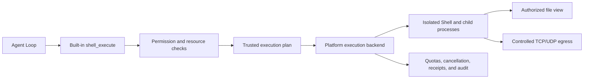

# Agent Shell Sandbox Implementation and Boundaries

Updated: 2026-10-01. Status: Linux Shell supports foreground, background, and TTY sessions. This document retains the architecture and cross-platform evolution design; current configuration, limits, and deployment steps are subject to the [Linux Sandbox User Guide](../../admin/sandbox/linux.md). macOS supports confined files and explicit Full Access; its isolation backend and the Windows backend are not implemented.


## Platform boundaries

Basic file capability is reported separately from command execution. `textfiles/files_unix.go` shares file versions, authorization rechecks, and atomic commits. Linux uses `openat2`; macOS uses `O_NOFOLLOW_ANY` to reject symlinks in every component during kernel path resolution and exclusive rename for creation. Only fixed macOS system directory aliases are recognized; user links in workspaces or external resources remain rejected. Hard-link and special-file checks are retained. Protected-directory overlap checks also compare filesystem identities so case variants and system aliases cannot expose private Runtime directories.

`direct_unix.go` shares direct execution authorization, output, deadlines, and task lifecycle. Linux/macOS files provide process attributes and PTY initialization. Isolated execution remains a Linux backend and fails explicitly on unsupported systems. `maintenance.Service` separates Runtime from the installer: Linux connects to the existing worker; other platforms report maintenance unavailable without preventing core startup. Platform selection stays in build constraints and composition. Business file operations query backend capability instead of OS names.

See [native macOS deployment](../../admin/deployment/source-build.md#native-macos-execution) for operation and current limitations.

## Full Access Permissions and Dual-Path Execution

The following isolation mechanisms apply to standard calls. `sandbox.allow_full_access` defaults to false; when enabled, the same Runner can concurrently handle standard isolated calls and explicit Full Access calls. Nodes do not have a global execution mode. Full Access must simultaneously satisfy deployment allowance, user group allowance (administrators are allowed by default), valid `Scope.FullAccess` compute authorization, and the current `full_access: true`.

`direct_unix.go` executes `/bin/sh` directly in the service environment, inheriting the environment and setting `MOLR_WORKSPACE`, supporting background, TTY, input, cancellation, and port forwarding; it does not create namespaces, seccomp, cgroups, or resource limits, and does not promise file, network, or process isolation. File tools use absolute paths or workspace aliases. Full Access does not depend on standard compute, file, or network authorizations, and does not count towards the standard task limit of ten concurrent executions. Timeouts, authorization durations, output pagination, and API request size boundaries explicitly set by the caller are retained; these are call lifecycle and protocol boundaries, not resource quotas.

Standard calls never automatically upgrade; the two types of compute authorization are matched independently. Direct execution periodically re-checks authorization; revocation, expiration, assistant deactivation, and remote lease invalidation will cancel the task and its process group; no mandatory isolation is promised for malicious processes that detach from the process group. Full Access revocation only stops the corresponding path, while standard tasks continue to run. `Capabilities.FullAccess` is probed separately, and can be true even if isolation preparation fails; the five isolation capabilities and Reason continue to accurately reflect the standard path.

Full Access is designed for environments where external containers/virtual machines already provide the required isolation. Processes inherit existing system limits from the external environment; Molr does not remove limits inherent to the deployment environment itself.

## 1. Conclusion and Phase 1 Scope

Adopt **Bubblewrap + seccomp + cgroup v2 + controlled network egress**, initially supporting only Linux. The Go Runtime remains a single deployment unit, responsible for authorization, execution lifecycle, transparent network egress, and auditing; Bubblewrap and trusted helper processes are managed by the Runtime, without adding new business microservices or introducing a plugin system.

Bubblewrap is responsible for constructing the isolated environment but does not provide a complete security policy; the policy is generated and verified by Molr. It shares the kernel with the host, and this solution does not promise isolation strength equivalent to virtual machines. [Bubblewrap Official Documentation](https://github.com/containers/bubblewrap)

Shell supports single foreground commands, background tasks that are explicitly detached or automatically detached after 60 seconds, and TTY sessions that persist until exit. A single assistant has a maximum of 10 total executions; each execution establishes an independent sandbox, and only `/work` persists across executions. The TTY system Shell priority and BusyBox fallback strategy are consistent with standard commands; default interactive sessions load `/work/.profile`; non-interactive commands do not load it. Tasks have no wall-clock deadline by default, with an optional actual timeout; resource, authorization, and isolation limits are always in effect. Explicit task TCP port forwarding is supported; NVIDIA GPU device access is provided based on compute permissions; other device passthrough and cross-platform execution are not currently provided. Interpreters such as Python and Node are still provided by the deployment environment; host software installation capabilities are not open.

External directories and networks are denied by default; the current assistant's own `/work` is managed by the Runtime and is available to file tools by default; real hardware is invisible by default. If the operating system or deployment environment cannot enforce the requirements, Shell displays as unavailable, while other Runtime functions continue to run normally; it never degrades to direct host execution.

## 2. Division of Labor Between Current Implementation and General Runner

The Linux backend is located in `runtime/internal/platform/sandbox`, reusing `platform.Runner` / `Process` and extending mount, network, and limit information for trusted `Command`. `runner.go` manages authorization and lifecycle, `backend_linux.go` and `seccomp_linux.go` construct isolation, `prepare_linux.go` manages base assets and delegation, and `network_*.go` / `helper_linux.go` manage controlled egress; other platforms are explicitly rejected by `backend_other.go`.

The original general Runner continues to be used for trusted whitelisted programs and does not have equivalent isolation guarantees. Standard Agent Shell only calls the mandatory isolation entry point; explicit Full Access uses the direct execution path after independent permission checks. Resource assembly registers the local compute environment but does not automatically grant assistants execution permissions.

The `openat2` check in file tools does not automatically constrain arbitrary programs; see [Tool Contract](../reference/file-tools.md) for differences between file tools and direct mounts. Model scripts are handed to a fixed Shell inside the sandbox; host startup parameters, resource paths, and execution identities are constructed by trusted code.

## GPU Execution Boundaries

`Sandbox.GPU` is the deployment whitelist, and `ComputeConstraints.GPU.DeviceIDs` is the scope of the assistant's compute authorization; the default GPU scope for user groups is empty. `ComputeCeilings()` brings the deployment whitelist into capabilities, approvals, and execution checks, and does not accept a second independent GPU limit configuration. Standard `shell_execute` automatically uses effective authorizations and does not accept device or mount parameters. Device identity uses the hardware UUID within the node; before execution, the mapping between UUID and device node is re-verified, and verified character devices are mounted via fixed FDs. CPU calls do not mount GPUs, and GPU errors do not degrade execution.

The current backend reuses read-only driver libraries provided by the host tool mode, using fixed `nvidia-smi` XML output to read the whole-card UUID, name, video memory, and device minor. Only the selected GPU, `nvidiactl`, and `nvidia-uvm` are injected; host management sockets, display devices, or other GPUs are not injected. The probe uses system Python's ctypes to directly call the CUDA Driver API, verifying the actual available device set and performing small video memory read/write operations, without installing the CUDA SDK or Python packages. GPU status is published independently via `Info.GPUs`.

Standard and GPU Shells use the same controlled Unix IPC policy, supporting STREAM/SEQPACKET sockets and anonymous pairs. DGRAM remains denied to prevent `sendto` from reaching host paths. All `bind`/`connect` calls are emulated by the trusted supervisor in the same sandbox: it validates the notification ID, pins the socket FD with pidfd, and copies sockaddr; it never uses `SECCOMP_USER_NOTIF_FLAG_CONTINUE`. Abstract addresses stay in the execution's private network namespace. Pathname addresses resolve through the calling task's root and must belong to the execution's private `/tmp` filesystem. The broker pins that root and verifies the tmpfs device, so a nested chroot cannot be bypassed. `openat2` rejects symlinks, magic links, mount crossings and path escapes. Connect pins the socket inode; bind pins the parent and atomically creates the final node, avoiding pathname replacement races. Sockets in `/work`, resource directories or relative paths cannot be bound or connected, even when those files are readable/writable.

Scripts still cannot use `pidfd_getfd`, `process_vm_readv`, ptrace, mknod or network-bypass syscalls; only the trusted supervisor uses the first two to emulate connections. Standard Shell also requires seccomp notifications and supervisor access to child FDs. Failed real startup/network probes leave it unavailable without relaxing host security. The supervisor acts as a child subreaper, adopts double-forked descendants and reaps exited children, preserving the ancestor relationship required by Yama without granting scripts additional debugging rights. Each execution handles at most 32 concurrent notifications, returning EAGAIN beyond that limit. The supervisor and children remain in the existing execution cgroup, covered by resource limits, cancellation and revocation cleanup.

Authorization changes and temporary scope expiration reuse compute execution plan re-checks and cgroup cleanup; remote lease renewal also compares the currently effective compute configuration. Task receipts record the `GPUDeviceIDs` actually started. Shared GPU access does not provide guarantees for video memory, compute power, or exclusive scheduling; standard `memory.max` cannot be treated as a video memory limit.

Real GPU acceptance is executed in `runtime/` using `MOLR_GPU_INTEGRATION=1 scripts/test-sandbox-linux.sh -run TestLinuxGPUIsolation -v`; it requires at least two NVIDIA GPUs, verifying single/dual-card CUDA, invisibility of unauthorized devices, unconnectability of host Unix sockets, and availability of approved TCP.

## 3. Authorization and Execution Flow

Effective permissions are: **Deployment static upper limit ∩ Assistant's current authorization ∩ Resource scope of the current request**.

Deployers determine the runtime environment, exposable resources, and limit upper bounds in static configuration; the WebUI only assigns assistant permissions within registered resources. Standard calls can only submit resource IDs and relative paths within resources; they cannot submit host paths, mount parameters, or runtime identities. `full_access` is an authorized call option, not a deployment switch that can be opened independently.



Shell execution requires `execute` for compute resources; read-only mounts require storage `read`, and read-write mounts require both `read` and `write`. If only `write` is present, the resource is not mounted, and writes are still performed via controlled file tools; read permissions cannot be implicitly increased. Network resources declare their supported connection actions. Authorizing a model does not incidentally authorize Shell access to that Provider or grant an API Key. GPU device scopes are bound to compute authorizations; only hardware UUIDs allowed by the deployment and user groups can be authorized.

Compute resources include execution environments and limits defined by the deployer; assistant authorizations are associated with these resources. Phase 1 does not introduce a second currency budget; CPU, memory, and disk quotas are compute capacity limits, distinct from existing assistant model cost budgets.

## 4. Linux Execution Boundaries

### File System and Runtime Environment

- Use a versioned minimal read-only rootfs by default. `host_tools: true` read-only shares host system tools; the execution identity always inherits the current non-root account of the entire Runtime; the installer determines the identity via `User=` for user services or system services, without relying on specific usernames, login-less shells, or independent resource services. Additional groups for existing users are retained as usual; private files readable by this account within the shared scope remain readable. The current/molr-sandbox values from the old `host_tools_user` serve only as compatibility aliases for enabling shared tools and do not switch accounts. Private data and the total workspace cannot be located under shared system directories; see the deployment guide for specific directories and configuration scopes. The official solution does not use `--ro-bind / /`, nor does it map the entire host `/etc`, HOME, `/run`, or Runtime data directory into the sandbox.
- Use independent mount, user, PID, IPC, network, UTS, and other namespaces; the minimal `/dev` provides only necessary pseudo-devices, and `/proc` is limited to sandbox processes. The working disk uses mount restrictions such as `nodev`, and does not expose host `/sys`, cgroup control files, or management sockets.
- Owner, assistant, and execution IDs are determined by the server. Assistant workspaces and resource mounts expose only logical paths; the current workspace is `/work`, and external directories return stable `ShellPath` via `permission_list`; the model must not infer host paths.
- Inherited environments, file descriptors, and sockets are cleaned up; only variables required for fixed execution and Go parallelism corresponding to CPU quotas are injected. Provider keys, login tokens, and the Runtime private database are never passed in.
- Bubblewrap paths and rootfs must be fixed and verified by deployment configuration, and cannot be looked up from the assistant-writable PATH; the assistant cannot modify sandbox programs, policy files, or execution plans.

**Phase 1 defaults to directly mounting the assistant working directory and approved resource subdirectories, without copying the entire directory tree, scanning for differences after execution ends, or performing unified write-backs.** Read-only authorization configurations use read-only mounts, and read-write authorization configurations use read-write mounts; actual files are read by the file system when accessed by the program. Startup work primarily depends on the number of mounts, path validation, and policy preparation, and should not involve full copying/traversal based on total directory bytes or total file count. When access to a small number of artifacts is needed, only explicitly specified files are read.

Direct mounting follows standard file system semantics: modifications, creations, renames, and deletions take effect immediately on the original directory; failures or cancellations do not roll back; automatic conflict detection is not provided when users edit simultaneously. The authorization interface should state that read-write includes these operations. Scenarios requiring "create only," "append only," "write-only," or per-file review should continue to use controlled file tools and not be mapped to standard read-write mounts. Snapshots, change previews, and rollbacks can be designed separately later and are not prerequisites for Phase 1 Shell.

Mount sources are resolved from resource IDs and approved paths by trusted code to prevent symlink and path substitution races; only the actually authorized subtree is exposed. Mount propagation is isolated, and unapproved nested mounts are excluded or rejected, with verification that read-only restrictions are not bypassed by sub-mounts or another writable alias. The host root directory, Runtime private directories, and their parent directories cannot be used as resource mounts. Security boundaries are enforced by mount structure, system call restrictions, and resource configuration, and cannot be replaced by scanning file names before execution.

The existing file tool rule "prohibit all links and special files" does not automatically equate to Shell mount semantics. Symlinks are resolved according to the sandbox file view and cannot thereby obtain unmounted host paths; hard links may share the same inode, and Bubblewrap does not recognize their other host names. Direct directory authorization includes existing file objects within that directory and cannot promise that hard link aliases will not affect other names. Standard directories do not require independent storage volumes; file objects pre-placed by users in authorized directories fall within the scope of that directory's authorization. Runtime private directories and their parent paths remain prohibited from mounting, and unexposed host paths cannot be used by Shell to create new links. Use controlled file tools when stricter per-file restrictions are needed. Do not claim to continuously resolve this issue by performing a full scan once beforehand.

Devices, host management sockets, and other cross-boundary IPC are still blocked via minimal `/dev`, `nodev`, socket/system call restrictions, etc.; file visibility does not imply the ability to connect to sockets within them. When importing artifacts into chat or the resource library, they are still validated by the trusted file module for authorization, regular file type, path, and capacity; checks are not skipped just because artifacts are located in an authorized directory.

### Processes, System Calls, and Limits

- The sandbox supervisor and exec helper explicitly set `GOMAXPROCS=2` in the startup environment, ensuring that the Go package initialization phase also adheres to the helper's parallelism limits, avoiding exhaustion of the execution's PID quota on high-core hosts before entering the main function. The parallelism of the business Shell continues to be set based on the current CPU limit.
- Allow controlled execution-local Unix STREAM/SEQPACKET communication and anonymous pairs; deny Unix DGRAM, host pathname sockets and cross-execution abstract sockets.
- Remove Linux capabilities, maintain `no_new_privs`, and allow nested user/PID/network namespaces while prohibiting mount/IPC/UTS/cgroup/time namespaces, setns and mount APIs. Namespace-local capabilities confer no authority over parent namespaces. Use architecture-matched, versioned seccomp configurations to restrict mount, ptrace, BPF, critical ioctls, and system calls that bypass network restrictions; do not simply prohibit all clone calls as this would break normal subprocesses and threads.
- TTY uses a dedicated PTY and new session, not inheriting the host controlling terminal. Non-TTY still has no stdin; stdout/stderr have total volume limits. The Shell inherits the same boundaries when running all download programs, scripts, and interpreters.
- The PTY session is created before Bubblewrap enters the PID namespace; the internal helper's `supervise` sets `SysProcAttr.Foreground` when starting the TTY subprocess, creating a subprocess group within the current PID namespace and setting the terminal foreground, then executing the Shell. This operation uses the parent process's stdin FD and occurs before restoring the subprocess signal mask, avoiding SIGTTOU blocking. Initialization failure returns 125 via the existing helper startup failure path, without continuing to execute the script. The non-TTY path does not set this attribute.
- Each execution runs in an independent cgroup, setting limits for CPU, memory, swap, PID count, etc.; limit configuration and process attribution are completed before untrusted code starts, and limits cannot be applied after running. Output, wall-clock duration, concurrency, and network transfer volumes have separate limits.
- Cancellation, timeout, assistant deactivation, and revocation terminate the entire execution cgroup and wait for it to be empty before closing output and saving the final state. Process groups and parent process death signals can only be used as additional means. Runtime restart first cleans up leftover executions from this instance and cannot just kill processes based on expired PIDs.

Bubblewrap can load seccomp BPF and supports blocking the sandbox from creating user namespaces again; cgroup management needs to be supplemented by Molr and the deployment environment. [Bubblewrap Parameters](https://github.com/containers/bubblewrap/blob/main/bwrap.xml) · [cgroup v2 Delegation and Controllers](https://docs.kernel.org/admin-guide/cgroup-v2.html)

**Capacity protection does not require users to prepare independent volumes.** Persistent working directories and authorized directories directly use the existing file system; Runtime sets a hard limit on single file size and checks for low disk watermarks before startup and during execution, terminating execution when space is insufficient. Temporary directories use capacity-limited tmpfs. This is not a hard quota on total directory capacity; the interface clearly reports the protection type and does not masquerade periodic monitoring as a hard limit; additional hard quotas belong to advanced deployment options.

### Shell and Tool Selection

In host tool mode, static BusyBox continues to be mounted as a managed read-only asset to `/molr/busybox`; when preparing the rootfs, `--list` is read from the copied and verified static binary, generating `/molr/bin` links for all actual applets, with PATH order `/usr/bin:/bin:/usr/sbin:/sbin:/molr/bin`. The versioned rootfs also includes read-only Shell probes; startup does not depend on the assistant-writable PATH, and missing assets are not silently disguised as a normal tool environment. The minimal environment continues to use the original `/bin/sh` and BusyBox toolset.

The internal helper, after completing namespace, mount, seccomp, and cgroup restrictions, uses a fixed side-effect-free script to sequentially verify `/bin/sh`, `/bin/dash`, `/bin/bash`, and the managed BusyBox. Probes check external command lookup and actual execution, identifying cases where BusyBox standalone mode bypasses PATH; workspace profiles are not loaded, and user scripts are not run. If the system Shell is incompatible, the next item is tried, and finally, an independent startup probe confirms that BusyBox works; if only BusyBox that does not meet priority probes can be used, Shell is still provided, and explicit limitations are output to stderr. The final user script is executed only once, and non-zero exit codes do not trigger tool or Shell switching retries. Probing is repeated for each execution to adapt to host program updates; existing sessions do not dynamically switch Shells.

This priority is the default behavior for managed Shells; Shell built-in commands, user-defined PATH/aliases, and explicitly started other Shells continue to follow their respective semantics. Security boundaries are not relaxed to unify tool implementations, and missing host software is not installed.

### Task Lifecycle and Notifications

`app.shellTasks` persists the task record and occupies the assistant quota before startup; foreground detachment only changes the mode. Running tasks hold a private context capability that cannot be constructed from requests, bound to the original owner/assistant/execution/operation; the end of the original Loop does not invalidate it, nor does it grant valid identity to arbitrary new tool calls. Compute, file, and network authorizations are still continuously rechecked by the original plan, and the original plan does not expand privileges. Task completion releases the capability and quota; completion status and `shell_task_finished` events are committed in the same transaction, and failure writes are retried by the manager. Unfinished records are marked as interrupted at startup; effects are not restored or replayed.

`platform.Command.Managed` allows no default runtime deadline, but actual timeouts and authorization expirations still take the earlier one. The PTY master end is held by the Runtime, and only the dedicated slave end is passed to the isolated process. `interrupt` sends terminal interrupt characters, acting on the foreground process group; `stop` cancels execution and clears the cgroup. Background non-TTY stdout/stderr are archived separately, while TTY is merged into stdout. Controlled interfaces limit each input to 8 KiB and output reads to 16 KiB, providing byte cursors; reading archives still validates assistant ownership, regular files, and paths. WebUI distinguishes between submitting text and control characters: only text submissions carry the local draft version, clearing input upon success if the version remains the same; editing or switching tasks advances the version, avoiding late responses clearing new input.

Reminders are aggregated by owner/assistant (current architecture has one serial Loop per assistant), starting a five-minute timer upon the first background or TTY launch, with new tasks not refreshing the deadline. Upon triggering, `shell_tasks_running` is written, including the mode and cumulative duration of still-alive tasks; pending reminders update the original event to avoid queue accumulation, and ended tasks are removed from pending reminders. All endings cancel the timer and unconsumed reminders. TTY exit and synchronous completion do not send completion events; background completion is sent independently of reminders immediately. They enter the Loop via the persistent event queue, not through context file injection.

Remote Sandbox declares `ShellSessions` in info; long-running Shell must still renew every three seconds, and the server terminates upon fifteen-second lease expiration. Only Shell is allowed to have no fixed deadline; file operations maintain original deadline limits. Terminal control is via `shell_control` bound to the original execution identity, and output reading uses side-effect-free `shell_read`, not writing every output poll to the operation ledger.

### Network

Network remains disconnected when no network resources are specified. When resources are specified, Runtime establishes an execution-specific user/net namespace, automatically creating TUN, addresses, routes, and read-only resolver files within it. The final Bubblewrap retains only this isolated network and never shares the host network; capability removal and seccomp remain enforced. The final user namespace restores the service account’s numeric UID/GID while retaining the same underlying host identity; the trusted network initializer’s internal root mapping is not inherited as the Shell identity.

On Ubuntu, Bubblewrap's sub-AppArmor configuration may prohibit network management; use an independent trusted initializer to enter the newly created user/net namespace with pinned FDs to establish networking, without modifying global security policies. The keeper and network stack reside in an independent, restricted execution cgroup (256 MiB / 64 PID / 100% CPU). TUN FDs, readiness, and authorization messages are passed via anonymous `SOCK_SEQPACKET`, with a control message limit of 512 bytes; host control sockets are not mounted for scripts, and namespace paths or identities provided by scripts are not accepted. Scripts are not executed before initialization is complete; network stack exit immediately terminates execution, and recovery failure closes the Runner.

gVisor Go netstack converts traffic into standard TCP/UDP connections. Transport protocols, target domains/IPs, ports, and exclusions are checked according to the same authorization rules; hostname-form exclusions only take effect in the domain resolution path, while direct IP connections are checked only against IP/CIDR entries. Each connection and DNS request queries Runtime for authorization via a private control channel; authorization expiration is constrained by the execution deadline, and revocation/cancellation closes all connections via the existing synchronous stop mechanism. TCP supports half-close; UDP sessions are reclaimed after 60 seconds of idle time. Traffic budgets are billed based on the actual bidirectional payload forwarded, avoiding premature pre-allocation that blocks read buffers and starves the other direction.

Internal DNS supports A/AAAA queries over TCP/UDP, using the system resolver to handle real CNAMEs. It returns virtual addresses within the execution, binding domain identity to the connection; new connections re-resolve, and all actual answers must be authorized before directly dialing the checked IP. Domains are not directly converted into a global IP whitelist. Virtual mappings are limited to 1024 entries, with a TTL of 30 seconds; DNS concurrency is separately limited to 8, and cannot be overridden externally or reused across executions. Unauthorized domains, arbitrary DNS record types, and unknown virtual IPs are all rejected.

Network authorization only expresses host/address, port, and TCP/UDP; it does not express URL paths or content within TLS. The built-in presets `internet`/`lan`/`host` (Internet Access / LAN Access / Host Access) are merely candidate resources; connections and assistant authorization are still performed explicitly. All three presets open all TCP/UDP ports; `host` includes the service's own listening ports; `lan` includes only RFC1918/ULA, excluding loopback, while host LAN addresses are still judged as `lan`; deployments can disable presets. Legacy undeclared protocol configurations are rejected upon loading; remote protocols use ``/v2/sandbox/`` and ``Protocol=7``, rejecting legacy services before connection and execution. For detailed configuration, internal host aliases, and limits, see [Deployment Instructions](../../admin/sandbox/linux.md).

Readiness probes actually execute isolated commands and verify DNS, TUN, and TCP forwarding on a temporary loopback endpoint, without relying on the public internet. The host tool environment downloads via standard `curl`; the minimal BusyBox environment does not guarantee HTTPS download capability. Tool parameters are not mandatory boundaries; networking is still authorized by Runtime. ``NetworkBackend=transparent`` and ``NetworkProtocols=[tcp,udp]`` are reported with the capability interface; network readiness must not be claimed solely based on process liveness.

### Shell HTTP/WS Port Forwarding

``forward_ports`` is validated at the tool and platform layers, with a maximum of 4 unique valid ports per execution. Runtime allocates listeners before starting the command, and the receipt carries the task ``Forwards``; the target is fixed to the original execution's IPv4 loopback, rejecting host addresses, PIDs, or namespace paths. Even when only forwarding is present without outbound authorization, an execution-specific network session is established, but egress rules are empty, and external connections remain prohibited.

The network keeper's user/net namespace FD is held pinned throughout its lifecycle; the startup script uses a copy and does not close the original FD prematurely. Each forwarding operation enters the corresponding namespace via a restricted helper through the pinned FD, connects to ``127.0.0.1:<port>``, and returns the connected TCP socket to the parent process via a private `SCM_RIGHTS` channel. The socket retains its original namespace, and the helper does not persistently act as a data proxy. The helper is included in the execution's auxiliary cgroup, with a timeout during creation; the final script cannot join the keeper’s namespaces or change mounts. The full execution identity and declared ports are validated on every dial, and the local host re-checks the original authorization simultaneously.

Local calls use `Runner.DialForward`; remote connections establish streams via authenticated HTTP/1.1 Upgrade (``molr-tcp-v1``) over ``/v2/sandbox/forward``. This reuses controlled dialing, fixed TLS certificates, service tokens, and rejection of browser Origins; this endpoint exists only in the independent Sandbox service. Manager validates the active execution identity and lease, and Runner re-checks the original execution and port. Established streams use bounded frames to pass raw bytes and half-closes, supporting WebSocket, SSE, and TCP protocols that require reading responses after a write half-close; streams are not written to the operation ledger and do not occupy concurrency slots for standard JSON requests.

Runtime allows 32 connections per entry and 128 globally; Runner allows 32 target connections per execution, and 64 global remote stream entries. Probing is an independent TCP dial with a timeout. Forwarding does not use the original outbound cumulative traffic budget. Task termination, revocation, or lease expiration closes target connections; Runtime simultaneously closes listeners and client connections. Remote observation connection failures reclaim the entry, without automatically switching to other tasks or replaying commands.

``Info.PortForwarding`` serves as the protocol's capability field; requests with forwarding must first confirm support; if unsupported, they are explicitly rejected, not silently ignored. Tool receipts, ``shell_task list``, SDK, and task interfaces retain the same fields, and model context trimming also retains the actual address. For boundaries regarding user operations, address selection, and session authentication, see [Deployment Documentation](../../user/guides/files-and-commands.md#shell-port-forwarding).

The public listener accepts HTTP/WS only. It checks Host, Origin when present (required for WS), the current login session and task ownership before dialing the declared target. All Molr credentials are removed upstream; reserved response cookies and Clear-Site-Data are removed downstream. Each connection is counted before HTTP/TLS parsing. A session watch closes HTTP streams and upgraded WS on logout, expiry or revocation. The task capability remains required at every namespace dial. Public TCP selection is rejected by tool parsing and execution; the internal remote TCP transport is unchanged.

### Permission Changes and Failures

Re-check authorization and version after constructing the plan and before releasing the startup barrier; active execution registration and authorization changes require serial coordination, covering the race condition of "revocation immediately after check passes." Revocation, scope reduction, resource disconnection, and authorization expiration all close egress connections, terminate related executions, and wait for all child processes holding file handles to exit; simply unmounting directories cannot substitute for terminating processes. Revocation results must distinguish between authorization revocation and execution cleanup completion; it cannot be claimed that all access has stopped if cleanup is incomplete. Permission changes do not dynamically add mounts within a running sandbox; the next call rebuilds the environment.

Egress re-authorizes on every connection and sets a lifecycle for existing connections constrained by the execution lease; access is denied if the control channel disconnects, the lease expires, or Runtime exits. Data already written or sent cannot be revoked via permission withdrawal; this is explained in the operation receipt.

Shell has side effects. Operation IDs, plan summaries, and authorization versions should be persisted before startup; if execution results are unknown after a restart, first reclaim processes, verify artifacts and receipts, and do not automatically rerun the entire script. Independent services retain completion results and execution slots when result transactions fail, retrying only ``sandbox.operations`` writes, with a backoff limit of one second and a maximum of five seconds per write; if result encoding exceeds the record limit, store the ``unknown`` receipt of ``sandbox_invalid_result`` instead, without retrying external effects; shutdown aborts subsequent retries and returns an unsaved error. If exiting without successful saving, restart still recovers according to ``unknown``, without replaying external effects.

## 5. Cross-Platform Interfaces and Directories

Currently reuses ``platform.Command``, ``Runner``, ``Process`` and capability reports, see [Platform Interface Code](../../../../runtime/internal/platform/api.go). ``ExecutionPlan`` in early drafts is a design concept, not an implemented public type with the same name; this document no longer maintains hypothetical directory trees and interface tables.

Capability reports must express actual isolation probe results; backends cannot delete unsupported restrictions and continue execution. Normal process exit does not imply automatic acceptance of business tasks; record output, exit classification, and explicit artifacts, without promising a complete file change list.

Host paths exist only in the trusted adaptation layer. Paths within resources use independent logical representations, mapped by the backend; cross-platform shared code cannot assume ``/workspace``, drive letters, or case rules. Future Windows support must separately handle UNC, reparse points, junctions, ADS, named pipes, and handle inheritance. Shell types are explicitly defined as POSIX shell, PowerShell, etc.; the same script string cannot be automatically switched to a different interpreter for execution.

| Platform | Implementation Direction | Differences Requiring Independent Verification |
| --- | --- | --- |
| Linux, Phase 1 | Bubblewrap + seccomp + cgroup v2 + controlled egress | user namespace, AppArmor, cgroup delegation, kernel and CPU architecture compatibility |
| macOS | Confined files and explicit Full Access; isolated execution is not implemented | Native path, locking, PTY, and revocation verification; direct execution provides no isolation or compute hard quotas |
| Windows, Future | Evaluate AppContainer/restricted identities, ACLs, Job Objects, and controlled network policies | Arbitrary CLI compatibility, handles and file permissions, network forced egress; Job Objects handle lifecycle/resource management and cannot solely act as file and network sandboxes |

macOS reports isolated Shell as unsupported and provides explicit Full Access. The Windows backend is not implemented. If a WSL2 backend is provided in the future, it should be explicitly displayed as a Linux execution environment and not counted as a native Windows backend. Interface reuse does not imply that security capabilities are naturally equivalent across platforms. [Microsoft AppContainer](https://learn.microsoft.com/en-us/windows/win32/secauthz/appcontainer-isolation) · [Job Objects](https://learn.microsoft.com/en-us/windows/win32/procthread/job-objects) · [Apple App Sandbox Inheritance](https://developer.apple.com/library/archive/documentation/Miscellaneous/Reference/EntitlementKeyReference/Chapters/EnablingAppSandbox.html)

## 6. Deployment and Local Assessment

Production deployment depends on Bubblewrap, a suitable Linux kernel, available user namespaces, cgroup v2 delegation, and a controlled rootfs. It is recommended to use an independent unprivileged account, delegating the execution subtree via systemd services; the installer handles dependencies and service integration; Runtime automatically generates runtime assets and working directories, automatically discovers delegation or requests dedicated temporary units, and performs actual isolation probes. Users do not need to configure these internal paths; WebUI or Agent must not modify sysctl, AppArmor, service permissions, or mount policies. The runtime does not call `sudo`, nor does it require the entire Molr Server to run as root.

When deploying Molr in Docker, nested user namespaces, seccomp/AppArmor, and cgroup delegation must also be assessed. Do not default to requiring ``--privileged``, mounting the Docker socket, or disabling all host security restrictions just to start the sandbox; if configuration is insufficient, disable Shell capabilities and provide diagnostics.

Deployment steps, default limits, and failure causes are unified in [Linux Command Environment](../../admin/sandbox/linux.md). Old standalone minimal probe records have been deleted, as they cannot prove the isolation capabilities of the current service.

## 7. Verification

Standard Go tests cover authorization, operation idempotency, initialization failure closure, and interfaces. Real Linux tests are executed in the ``runtime/`` directory:

```bash
bash scripts/test-sandbox-linux.sh -count=1 -v
```

The script uses an independent systemd user unit and temporary data to verify automatic resource allocation, direct directory read/write, single-file hard limits, process reclamation, controlled egress, and FD isolation; it fails when dependencies are insufficient and must not substitute skip for pass. Test execution must adhere to workspace isolation conventions.

Each actual service startup also requires an authenticated query to `/api/sandbox`; this cannot be replaced by ordinary unit tests, minimal Bubblewrap probes, or HTTP connectivity checks. Refer to the deployment guide for the fields to check and their expected values.

## 8. Reference Implementation

[Anthropic Sandbox Runtime](https://github.com/anthropics/sandbox-runtime) demonstrates an approach combining native sandboxing with proxy filtering, which can be referenced for file and network boundaries. Molr maintains a Go implementation and fixed module assembly, and does not directly introduce its Node runtime dependencies; if code is actually reused, the corresponding version's license and security boundaries should be verified first.


## Browser compatibility acceptance

There is no browser-specific sandbox or permission switch. Nested user/PID/network namespaces support Chromium's native sandbox. The filter still denies all mount APIs, mount namespaces, setns, ptrace, device creation and network bypasses. UID/GID mapping preserves the same host identity with and without networking. The Unix broker respects the notified task's root as well as the outer private tmpfs, preventing a nested chroot from being bypassed. Default Bubblewrap startup first probes the host's loaded `chrome` AppArmor profile, then the original restricted path if unavailable. Selection covers offline/networked execution and the namespace keeper; it never retries business commands or changes system policies, and explicit launchers retain the administrator's choice. This application exemption removes an additional blanket capability denial while retaining Molr authorization and outer isolation; see the [deployment instructions](../../admin/sandbox/linux.md#local-ipc-and-browser-programs). `--no-sandbox` remains an explicit fallback under Molr's outer boundary, without Chromium's inner process protection.

`MOLR_SANDBOX_HOST_TOOLS=1 MOLR_TEST_AGENT_BROWSER=/absolute/agent-binary-directory MOLR_TEST_CHROMIUM=/absolute/chromium-directory bash runtime/scripts/test-sandbox-linux.sh -run 'TestLinuxBwrapProfile|TestLinuxPrivateSockets|TestLinuxAgentBrowser|TestLinuxNestedNamespaceBoundaries|TestLinuxExecutionIdentityWithNetworking' -v` uses reviewed, preinstalled assets. The Linux amd64 fixture expects `agent-browser-linux-x64` and `chrome`. Leave `MOLR_TEST_BWRAP` unset for default acceptance to exercise automatic profile selection; specify a trusted launcher only for custom deployments. Set `MOLR_TEST_CHROMIUM_SANDBOX=1` to require native sandbox status; it does not silently skip/fall back after a failed native launch. Tests cover read/fill/click/screenshot, authorized HTTP, rejected ports, sandbox status, nested mount/setns rejection, chroot IPC isolation and UID/GID consistency. Without the native flag the existing outer-sandbox compatibility path is tested. Full regression also retains file, network, cgroup, FD leak, cancellation, revocation, TTY and opt-in GPU checks.

## Browser task control

Browser tasks reuse `shellTasks`, the execution lease, cgroup, grants and task quota. Only trusted launch wiring supplies readonly program mounts. Each assistant has one active task and its own persistent profile. Private bridge ports are declared for namespace dialing without public listeners. Screenshots pass through the existing scoped file/media reader.

Control is bound to owner session, browser-window client ID and generation. Input sequence numbers prevent replay. The frontend retains its client ID, sequence and serial queue for the page lifetime, discards unsent input on panel close, and restores control after checking the server identity on reopen. Other windows do not inherit the identity. Tab counts use a cached private readonly query independently of frame streams. Handoff first fences new writes, waits for the accepted operation, resets held pointer buttons, then changes the controller. Lost mutating responses or failed handoffs stop the execution. User takeover permits model snapshot/screenshot/tab/URL reads only. `shell_task` cannot bypass browser control. Returning control emits `browser_control_returned`; model writes require a fresh snapshot first. The native bridge uses acknowledged structured input, bounded commands and output, with no arbitrary eval or launch options.

Frames use a private WS connection and authenticated owner SSE, capped at 10 fps with ACK pacing. Cancellation covers the WS handshake, which has a five-second deadline. Viewer disconnects cancel the stream. Hidden or offline pages disconnect and cancel drawing, decoding and reconnect timers; visible online pages reconnect. Clients discard queued input when control or connection changes. Same-size frames reuse the canvas backing store; drawing and floating-window layout are coalesced by animation frame. Each task reuses at most two private HTTP command connections and closes idle connections on exit. The execution lease continues checking grants and closes forwarded connections on revocation. Connection reuse does not automatically retry writes. The frontend supports pointer input, scrolling, keyboard text/IME, navigation and tabs. Forced termination can discard unflushed profile data.
