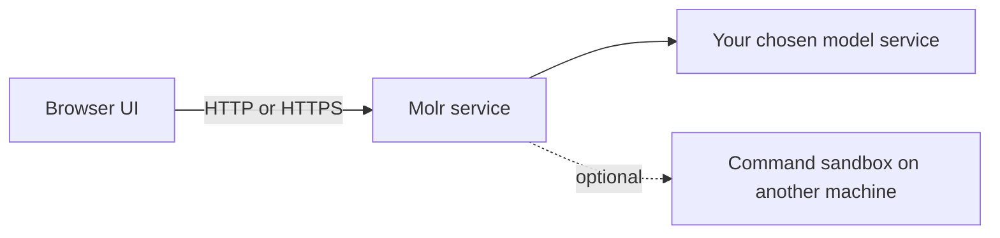
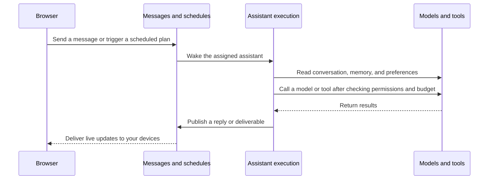
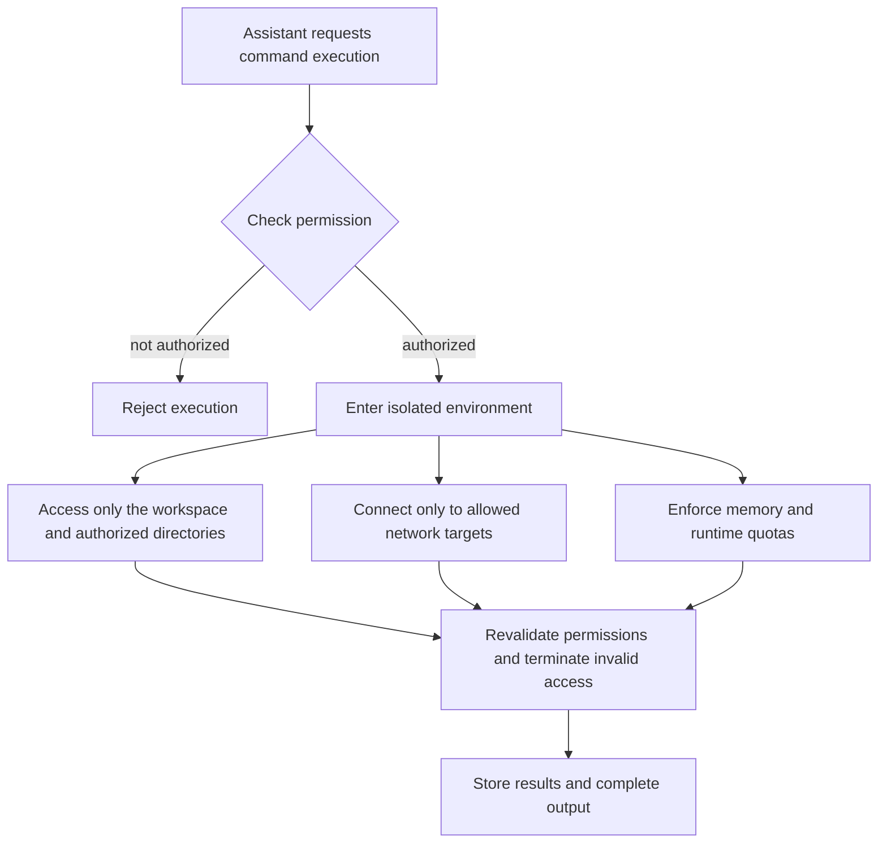

# Basic Concepts

Molr connects to the service you run via a browser. After logging into the same account on desktop and mobile, you can continue viewing chats, plans, and execution results.

## Assistants, Plans, and Memory

Each assistant has its own persistent chat, workspace, memory, permissions, and budget. Chats are used to assign tasks and obtain results; plans store schedules, recurring rules, prerequisite handoffs, and execution records. While the service is running, background execution does not depend on the browser remaining open.

Memory stores facts and preferences worth retaining long-term. Assistants periodically review their experiences, and you can also view, edit, or forget them; for specific operations, see [Memory and Automatic Organization](guides/memory.md). Stopping execution preserves completed operations; canceling a task does not undo files already written or data already sent.

Administrators connect models, directories, and sandboxes, and allocate available resources via user groups. Within this scope, users grant specific actions and quotas to their assistants; see [Permissions and Budgets](guides/permissions-and-budget.md).

## Three Components

- **Web Interface (WebUI)**: The page you use in a desktop or mobile browser. It is merely a static page that connects to your own Molr service.
- **Molr Service (Runtime)**: The core program responsible for account login, chat, task scheduling, file handling, and command execution. It is a standalone program using a single data directory; only one instance needs to run on the same machine.
- **Command Sandbox (Optional)**: An isolated environment used when assistants execute Linux commands. It is built into the service by default but can also be run separately on another machine.

There are three common ways to access your service: using HTTPS directly, via a reverse proxy server, or trying it locally first. For selection and configuration methods, see the [Deployment Guide](../admin/README.md).

## How a Delegation is Executed

1. You send a message, or a scheduled time triggers automatically. All content is fully saved before processing begins.
2. The corresponding assistant is awakened: it reads relevant conversations, memory, and your preferences to organize the context for this round.
3. Before each step calls a model or uses a tool, the service verifies the authorization scope and budget balance; operations outside the scope are rejected.
4. After the assistant completes its work, replies and results are explicitly published to the conversation and pushed to your devices in real time; if devices are offline, they can catch up upon reconnecting.

Chat logs store only actual interactions. Scheduled plans trigger at their own pace and do not masquerade as messages sent by you. Execution progress is continuously saved; after a service restart, it first verifies operations that have already occurred before resuming work that can continue. Operations with unknown results require verification; active Shell processes are not restored.

## How Assistants Safely Execute Commands

Standard Linux commands are executed in an isolated environment. For example, when organizing files or running scripts, authorization is verified according to the following process:

- Commands run in an isolated environment: they can only see the assistant's own working directory, the temporary directory for the current command, and folders you have explicitly authorized.
- Network access is allowed only via a whitelist; all other access is denied. Resources such as memory are constrained by quotas. Execution duration is limited by both authorization and the current command; unlimited runtime requires explicit authorization.
- Authorization can be revoked during execution; expiration of compute and storage authorization terminates related executions, while expiration of network authorization restricts corresponding connections. Remote sandboxes rely on authorization leases to stop executions that lose connection; instantaneous revocation during network partitions is not guaranteed.
- If the runtime environment does not support isolation, command functionality is directly displayed as unavailable rather than falling back to direct execution on your computer.

[Full Access](guides/permissions-and-budget.md#full-access-permissions) calls, which are openly deployed and explicitly approved by you, use the service account to execute directly and do not have the aforementioned isolation and resource limits; other calls continue to use the standard isolated path. For command environment preparation and dependencies, see [Linux Sandbox Deployment](../admin/sandbox/linux.md).

## Where Your Data is Stored

Your account data is stored by the Molr service you use. The administrator maintains server backups; you can export your own data in [Personal settings](guides/settings.md#data-export). When you use cloud models or external tools, the relevant information is sent to those services.

## Security Boundaries Overview

| Boundary | What it Protects |
| --- | --- |
| Login and Devices | Only you can access: login requires a password (two-factor authentication via authenticator can be enabled), and each logged-in device can be individually logged out. |
| Assistant Permissions | Each assistant can only access content you have explicitly authorized: which folder, read-only or writable, which model, spending limit; these can be revoked at any time. |
| Command Isolation | Standard commands run in an isolated environment, unable to access the service's own data, keys, or other processes. |
| Network Access | Network access for models and commands has explicit destination restrictions to prevent use for internal network probing. |
| Cost Control | Before each model call, the budget is estimated and reserved; execution automatically stops if the limit is exceeded. |

Multiple accounts can be used independently, with resources allocated via user groups and independent quotas for each member; interaction between users or public registration is not provided. For details, see [Users and User Groups](../admin/administration/users-and-groups.md).

## Runtime Scope and Disconnection Recovery

The current service uses a single-instance Runtime, with desktop and mobile accessing via browser; multi-device continuity requires connecting to the same service. While the service is running, closing the page or browser disconnection does not stop background work; after reconnecting, you can catch up on saved messages. Recovery after a service restart depends on the task state; active Shell processes are not restored.

Local command isolation and independent sandboxes currently support Linux. The base environment provides BusyBox; other tools depend on the deployment environment and installed dependencies. Image, audio, and video processing depend on actual model capabilities.

When using cloud models, WeChat, or external network services, relevant data is sent to the corresponding services. Self-hosting preserves local data, but whether processing is offline still depends on the connected models and tools.

For specific installation methods, see [Deployment and Maintenance](../admin/README.md); for modules and execution mechanisms, see [Architecture Overview](../dev/architecture/overview.md).
