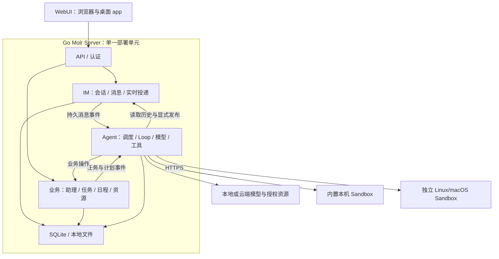

# 架构总览

Molr 采用 Go 模块化单体，使用 SQLite 与本地文件保存数据。WebUI 通过 HTTP 与 SSE 连接 Runtime；命令执行可使用内置沙盒或独立 Linux/macOS Sandbox。

## 组成

- Go Runtime 提供身份认证、数据持久化、Agent 执行、计划、资源授权和费用管理。
- WebUI 随发行 Runtime 内嵌，由电脑／手机浏览器或桌面 app 连接同一实例。
- Electron 桌面 app 管理连接；Linux/macOS 包可按需创建随包附带的本机 Runtime 服务，Windows 只连接远程 Runtime（包括 WSL）。
- 手机当前通过浏览器使用 WebUI，尚未实现原生 iOS／Android App。各包内容和安装选择见[安装与服务管理](https://molr.ai/zh/docs/admin/deployment/installation/)。
- UI Design 使用模拟数据展示组件和交互；其 Desktop／Mobile／CLI 视图不代表独立原生客户端。
- 官网提供产品介绍和公开文档，与用户的 Runtime 实例分别部署。

## 1. 运行结构

单一 Go 主进程承载核心模块，模块之间直接调用接口。需要执行外部程序时，由内置工具管理受控子进程。默认只启动一个 server，使用一个数据目录和一个对外入口。

## 2. 独立助理 Loop 与会话工具

每位助理拥有独立 Agent Loop，这是独立的执行状态，不代表独占一个进程。Loop 根据事件推进，空闲时休眠；同一助理按序处理事件，多位助理在并发配额内运行。

聊天会话只保存用户与助理的真实交互历史。原始聊天记录不自动成为模型上下文，Loop 根据当前事件、任务状态、工作摘要和工具结果组织上下文。

| 会话工具 | 用途 |
| --- | --- |
| 读取会话 | 按消息引用或范围取得实际交互内容 |
| 检索会话 | 按权限取得有来源的历史片段 |
| 向会话发送 | 显式发布文本或结构化卡片，可关联任务与日程 |

模型内部输出和工具返回不自动写入聊天。助理发送消息不作为新的用户输入再次触发自身。用户消息、定时计划和执行结果是不同来源的事件；定时触发不伪造用户消息。

## 3. 内部模块

按 **IM / Agent / 业务** 划分三个功能域。IM 管会话、消息、已读与实时投递；Agent 管调度、Loop、上下文、模型与工具；业务管助理身份、任务、待办、计划、资源、记忆与偏好。认证、权限、审计、检索和存储为公共支撑。导出接口已落实到 Go 包，见 [接口合同](https://molr.ai/zh/docs/dev/reference/module-interfaces/)。

IM 不直接依赖 Agent 或业务包。用户发送与助理发布共用消息格式和存储，但使用不同写入入口绑定身份；Agent 调度消费 IM 的持久消息事件，只把真实用户输入转为执行输入，助理发布不反复触发自身。

会话已读游标只向前推进，不接受超出消息尾部的序号。剩余未读助理消息按账号、会话、发送方和序号范围通过数据库覆盖索引计数；游标与计数在同一写事务内更新，与追加消息保持一致。

| 内部模块 | 主要职责 |
| --- | --- |
| 接入与实时通信 | HTTP API、TLS／可信代理接入、认证中间件、SSE 与断线补发 |
| 账号与认证 | 独立账号、管理员与用户组、密码与二次验证、登录会话、设备注销和客户端令牌 |
| 安全审计 | 登录、权限变更、敏感操作与异常访问记录 |
| IM | 会话、消息、已读、反馈、消息创建事件和授权实时投递 |
| 业务与策略 | 助理、任务、待办、日程、记忆、设置、授权和预算 |
| 调度与执行 | 持久事件、定时发生点、执行配额、重试、取消与恢复 |
| Agent Runtime | 独立 Loop、上下文、模型选择、记忆策略、检查点与验收 |
| 模型与凭证代理 | 供应商协议适配、流式调用、受保护的凭证使用和用量回执 |
| 内置工具与资源 | 会话工具、文件、外部应用操作和受控程序执行 |
| 检索与索引 | 历史和资料检索、内容解析、索引更新与重建 |
| 持久化 | 事务、领域仓储、消息与事件、操作记录、版本登记、文件和备份 |

所有模块统一随 server 编译、发布和升级。内置本机 Sandbox 与独立 `molr-sandbox` 复用受控文件和 Linux 隔离实现，Runtime 通过 sandbox router 选择本机调用或带操作回执和租约的 HTTPS 连接。远程服务不承载 Agent、会话和模型调用。新增内置工具和模型适配通过更新 Go 程序交付。插件通过受控扩展点提供页面、主题和 HTTP 工具，不加载 Go 动态业务模块；见 [插件机制](https://molr.ai/zh/docs/dev/extensions/plugins/)。Agent 可以在授权的 Linux 沙盒中执行脚本，并从助理工作区加载项目指令与 Skills；这些能力不等于动态加载服务端代码。前端 SDK 与主题机制另见 [主题与 UI 包](https://molr.ai/zh/docs/dev/frontend/themes/)。模型连接、权限、预算和日程等仍作为产品设置管理。

内置能力执行前统一检查授权、预算和资源可用性。外部程序不能获得 server 全部数据与凭证访问权。检索读取授权来源；记忆实时读取本地 Markdown，不保存数据库索引副本。其他可重建投影不能修改原始会话或记忆。

## 4. 一次委托如何执行

1. API 验证请求，IM 在同一事务中保存真实用户消息、消息创建事件和可见事件。Agent 调度消费消息事件，按业务中的会话绑定找到助理，原子保存去重的助理输入与消息事件消费进度。
2. 调度模块唤醒对应 Loop，Loop 通过工具读取消息，按需检索历史和资料。
3. Loop 明确目标、资源范围和验收条件，必要时通过发送工具向用户询问。
4. 核心检查当前授权与预算，记录操作，通过模型代理或内置工具执行，保存结果与检查点。
5. 业务模块保存任务状态和产物；Loop 通过发送工具发布文本或卡片。
6. IM 实时通信模块推送已提交的可见事件，客户端断线后从持久记录补取。

全新聘请（`Hire`）在助理、会话、模型授权和 Loop 初始化完成后，于同一创建事务中写入 `born` 事件；事件写入失败时整个创建事务回滚。事件以账号、助理和 `born` 来源去重，使用 `when_idle` 进入现有持久队列。模型收到出生指引后通过 `conversation_publish` 发送简短初始消息；创建接口不等待生成。复制（`Clone`）、返聘、重启和重置上下文均不产生出生事件；不补发已有助理，不对用户已开始交流的情况增加特殊分支。重试、恢复、取消及消息发布幂等均沿用正常执行机制。

定时任务走 `计划到点 → 持久定时事件 → 助理 Loop → 执行 → 按需发布结果`。一个任务可持续跨越多次模型调用，不创建另一个用户聊天会话。追加要求形成任务修订，旧版产物和累计费用保留；普通聊天不强制创建任务，指派待办不自动启动执行。

定时触发公共能力由 `internal/trigger` 提供：计划和夜间做梦共享重复规则、时区、漏执行策略及发生点去重。计划仍保存用户事项和任务；做梦保存自己的配置、回放进度与记忆整理记录，不创建隐藏计划。业务适配器将发生点、进度及事件在同一事务中提交，随后进入共同的 Agent 队列。详见 [夜间做梦与记忆使用](https://molr.ai/zh/docs/dev/runtime/dream-memory/)。

## 实时事件交付

业务数据、`im.visible` 事件和账号事件序号在同一事务中提交。事件写入通过 `Tx.NotifyAfterCommit` 登记账号级唤醒；底层 Store 在最外层事务成功提交并释放事务门控后广播。嵌套 savepoint 回滚会丢弃本层登记，外层回滚或提交失败不广播。同一底层 Store 上创建的所有实时事件写入器共享通知器；通知不跨进程，不携带业务内容。

SSE 订阅先注册监听再按游标补读，每次预读至多 100 条。每个连接拥有一个容量为 1 的唤醒 channel，多次通知可以合并，事件仍从持久记录按序读取。消费唤醒发生在查询之前，避免查询与等待之间遗漏提交。连接仅在首次读取、缓冲耗尽或收到提交通知时读取事件，没有高频轮询或低频补偿查询。进程退出或网络中断后通过客户端最后收到的游标重连补读；网络边界可能重复交付，不能视为客户端处理完成的确认。

事件查询按账号、序号及可选主题使用复合索引。多主题分别有界读取后合并，避免稀疏主题扫描其他主题的全部事件。缓冲不会随积压增长，慢消费者仍受 HTTP 写超时约束，不阻塞事务提交。每条事件交付前均校验权限。Runtime 的空闲订阅通过账号级提交后通知观察账号变更与会话／令牌撤销，并按会话绝对有效期、空闲有效期或令牌有效期中的最近截止时间重新检查；没有高频鉴权查询。普通请求更新活动时间不广播通知，到原空闲截止时间再读取最新活动时间并重新计时。鉴权监听先注册再读取，读取期间的提交保留通知；回滚与失败提交不唤醒，其他账号的变更不唤醒。HTTP 层保留发送前身份校验，以独立的 15 秒定时器发送网络心跳，不重复执行空闲鉴权。关闭订阅、请求取消或 Store 关闭会释放事件与鉴权监听并唤醒等待者。独立组合 Feed 且未提供鉴权监听的模块调用仍按其配置间隔校验权限。

该机制服务于当前单进程 Runtime 的可见事件流；Agent 调度复用底层提交后通知，但使用独立信号和任务领取事务。所有可见事件生产者必须使用 `realtime.Store.Append`，不能直接写事件集合；独立进程共享数据库不能获得进程内唤醒。

## Agent 队列唤醒与领取

IM outbox 在消息提交后通知独立消费者；消费者先订阅再补读，持续分批处理积压，并将助理事件、初始 `agent.jobs` 记录和 outbox 确认同事务提交。事件来源去重不变；停止操作预先保存的取消记录不会被延迟到达的消息覆盖。`UserStopped` 只保存控制事件，不创建待执行任务。

每个执行器订阅独立的调度信号，首次启动查询队列，此后只在提交通知或候选任务到期时重新领取。事件入队、任务状态转换及做梦会话状态变化通过 `Tx.NotifyAfterCommit` 唤醒；回滚不唤醒。与 SSE 相同，先注册监听，并只在查询前消费合并通知，避免查询与等待之间遗漏提交。

领取在单一事务中完成。待执行与重试状态分别使用状态／队列顺序复合索引，每路最多读取 100 条后合并；遇到被占用助理时按游标继续，不让首批阻塞其他助理。队列顺序由事件优先级、纳秒精度 UTC 到期时间和事件身份确定，保存任务时统一计算；已完成、失败和取消历史不进入领取查询。执行器按助理检查运行／重试状态、停止边界和活动做梦会话，保持同助理串行与原有优先级。

任务列表在读取事务中按账号和助理复用停止边界，包括边界不存在的结果；用当前边界计算可见状态后再筛选和分页。每次列表请求重新读取边界，取消写入也读取该事务中的最新状态。

延迟重试、未来输入及做梦占用截止时间使用最近候选截止时间唤醒，无需新写入；一个任务结束也会唤醒等待同一助理的工作。启动恢复只读取运行中的任务，继续核对外部副作用。数据库中的任务状态是执行依据，内存通知只作提示，不承担持久队列或执行确认。

计划发生点、交接、做梦与维护仍使用独立 `Tick`，默认每秒检查；消息入队与任务领取不依赖这个定时循环。 日程按启用状态与到期键走索引，每批最多 200 条；做梦过期检查按活动状态与截止键分批读取，每批 100 条，直到本次到期记录处理完毕。时间键由写入路径从原时间派生，采用固定纳秒精度的 UTC 字符串，避免时区和可变小数位影响排序；这些键只保存在私有记录中。计划交接只读取待检查候选和未解决的交接提醒，任务执行历史按账号、计划类型和计划 ID 查询。候选标记与计划关联记录一起提交；已忽略但尚未解决的提醒仍参与状态核对，暂停、移除依赖、开始执行或删除来源后可正常解决。运行环境暂时不可用时每秒重新探测，期间不领取任务、不增加尝试次数。当前优化不改变计划的发生点去重、漏执行策略及远程节点探测规则。

模型生成期间的中断检测使用 owner/assistant 级提交后通知。任务状态转换与加急收件箱写入在各自事务中登记同一助理信号；其他账号或助理的提交不会触发该请求的读取。监听先注册，再读取持久任务与加急消息；合并通知仅在查询前消费，查询期间的提交保留到下一次检查。空闲等待不轮询数据库，未来可介入事件按最早 `NotBefore` 设置一次性定时器，读取失败才延迟重试。模型请求结束、取消或 Store 关闭时释放监听；做梦不订阅普通输入。此通知仍限定同一进程内的底层 Store，不改变 `interrupt`、`after_step`、`when_idle` 的介入语义及计费回执处理。

## 统一用户通知

`internal/notification` 在 Runtime 内保存按 OwnerID 隔离的通知记录与来源索引。来源标识由类型和业务对象组成，相同原因的持续异常复用一条记录；改变原因或恢复后再次发生创建新 ID，旧设备的确认只能作用于它实际看到的 ID。通知的 ReadAt、DismissedAt、ResolvedAt 独立于业务状态，更新天然幂等。通知与源状态通过同一 SQLite 事务写入，提交 `notification.changed` 到现有持久 SSE 流；GET 只读取，不制造通知。这些记录用于提醒投递、去重和确认，不作为业务历史页面；长期内容仍归属聊天、授权、计划和任务。

通知列表按账号、状态及可选业务筛选在 SQLite 中查询，每页最多解码 `limit + 1` 条记录。创建时间使用纳秒精度 UTC 私有排序键，配合通知 ID 与存储键稳定翻页；游标绑定账号和筛选条件。待处理数与未读数通过覆盖索引计数，始终表示整个账号的活动通知，与列表筛选和游标无关；两项计数和当前页共享同一事务快照。索引首次安装时只为通知集合补齐排序键，不反复扫描其他业务集合。

微信投递在结果写入时同步，Agent 在等待／恢复／停止状态提交时同步，授权申请在创建／处理事务中同步，任务失败和后台调度结果在状态提交时同步。计划交接由现有调度 Tick 在同一快照中判断依赖与执行状态并同步通知。短暂工作状态不被当作恢复，避免每次重试重新激活已忽略的问题。通知内容仅包含类型、原因码、业务引用与显示名称，不保存模型上下文、原始错误或凭据。

## 5. 单实例并发、持久化与恢复

同一数据目录仅允许一个 server 实例运行。内部对每位助理串行调度，API、模型、Loop、工具和索引作业分别设并发配额，避免长任务耗尽资源。

消息、任务、事件、操作和检查点持久保存；内存通知只负责唤醒。进程重启后扫描未完成事件，从检查点恢复；同一计划发生点去重，并按明确规则处理停机期间错过的计划。单体仍需幂等和恢复，但当前不引入分布式租约、服务发现或跨实例事件广播。

模型与工具操作按账号和幂等键使用 SQLite 复合索引查询，最多读取一条操作，不加载无关历史。查重与创建仍在同一写事务中完成；相同账号的重复请求返回已有操作，执行身份或参数变化返回冲突，不同账号可使用相同幂等键。

暂停保留进度，取消停止后续执行。超时或崩溃时，外部操作可能已经成功或计费；恢复先核对，再决定是否重试。消息发送和结果发布使用稳定操作标识，避免重复展示。

SQLite 保存结构化数据，本地文件模块管理附件与产物。备份需涵盖一致的数据库状态、关联文件和必要配置；恢复后核对资源与凭证可用性。详细存储规则见 [技术底座](https://molr.ai/zh/docs/dev/architecture/tech-stack/)。

## 6. 权限与生命周期

本机初始化创建首个管理员，未初始化时不开放业务服务。管理员可创建独立账号和用户组；资源目录全局管理，聊天、助理、计划等私人数据按账号隔离，执行还受成员组级配额约束。公网经 HTTPS 访问，登录与静态登录资源以外的业务接口统一认证，包括 SSE、搜索和文件下载。账号、会话、二次验证和审计内置于 server。

认证确认用户身份，业务授权检查对象归属和动作，助理授权另行检查资源范围、Grant 和预算。三者不可互相替代；后台计划使用绑定的助理身份执行，不依赖浏览器保持登录。Cookie／令牌撤销后终止对应访问和推送。

详细的登录、可信代理、CSRF、文件与 SSRF 防护、限流和审计要求见 [公网部署与安全](https://molr.ai/zh/docs/dev/security/security-model/)。

资源、操作、任务和授权分别由对应模块管理；早期架构中的 Work 是概念抽象，当前实现使用 Task、Plan 引用与执行记录。任务只能收窄助理权限；工具、文件、网络和数据去向分别受控。模型调用前预留预算，调用回执持久化后结算，未知费用保留待核对状态。

凭证只由受信任代理使用，不进入 Agent 上下文或外部执行程序。内置工具仍须落实文件、网络与程序执行权限。

用户消息在 Loop 读取并确认接手后标记已读，内部事件和后台检索不产生聊天红点。

- 解雇归档助理并停止后续执行，保留已发生的操作与费用。
- 返聘恢复原助理和会话，旧任务、权限与日程按明确选择恢复。
- 克隆产生独立身份和 Loop，复制确认范围内的记忆、消息与有效授权，不复制在途任务和临时上下文。

## 7. 当前实现与维护入口

Runtime 已有 SQLite、认证授权、业务模块、Agent Loop、持久队列、HTTP/SSE、沙盒与命令行维护入口。WebUI 是真实客户端；Desktop/Mobile/CLI 的展示原型不等于独立原生客户端已经发布。

具体 Go 包对应关系与事务合同由 [模块接口](https://molr.ai/zh/docs/dev/reference/module-interfaces/) 维护；客户端路由由 [HTTP API](https://molr.ai/zh/docs/dev/reference/http-api/) 维护。内置能力及限制见 [Runtime README](https://github.com/molr-ai/molr/blob/main/runtime/README.md)，验证入口见 [测试说明](https://github.com/molr-ai/molr/blob/main/runtime/tests/README.md)。

状态与事件同事务持久化，提交后才唤醒执行；同一助理串行推进，多位助理有界并发。未知外部结果先核对，不能因客户端重试或服务重启重复副作用。文件发布与 SQL 状态通过暂存和恢复协议协调，不声称跨文件系统事务。

验收需覆盖消息到回复、定时发生点去重、取消与撤权、断线补取、异常退出后的恢复、未知结果与预算占用、整体升级和备份恢复。测试记录应带日期，不能把架构中的验收要求写成所有环境已经验证。

云服务未来可按实际负载设计扩容；当前没有跨实例调度、内部 RPC 或分布式接管。部署与升级步骤由 [部署指南](https://molr.ai/zh/docs/admin/) 维护。

## 持久化查询与全量读取边界

账号、助理、执行、凭据摘要、资源及时间范围在存储查询中绑定；单条匹配、去重和存在性检查设置读取上限。普通列表使用绑定查询范围的游标分页，先应用数据库过滤和排序，再读取一页及一条后继记录；Unicode 名称匹配保留 Go 的大小写语义，通过有界批次继续查找。游标不代替权限校验。消息页在同一读取事务中按当前页的账号／消息键批量加载反馈；缺失反馈按未评价返回，后继探测记录不参与反馈查询。

SQLite 的复合表达式索引覆盖这些范围。需要精确排序的时间字段写入内部 UTC 纳秒排序键，原领域时间保持不变。首次安装这些索引时，有界分批补齐已有记录的派生排序键，并与完成标记在同一事务提交；后续启动不重复读取历史。附件引用、计划依赖和梦境来源通过派生的数组成员索引查询；记录插入、更新、删除和事务回滚同步维护成员索引。文件容量汇总在数据库内聚合，整范围删除不先反序列化将被丢弃的记录。共享资源目录先解析安装级所有者，个人数据继续按账号隔离。

助理事件与初始任务已在同一事务中写入。停止、压缩去重和 Shell 提醒检查待处理任务，不遍历已完成事件历史；仍保留尚未消费的 IM outbox 输入的停止边界。执行身份校验只接受当前运行状态，历史结算仍可核对已结束执行，不能用结算权限发起新调用。

保留的业务全 bucket 读取均有明确的全范围用途：启动时检查全部账号格式及用户组关联、管理员请求完整用户组目录、安装级调试保留设置变更后通知所有工作台、检查全部待恢复的远端等待、处理全部待删除文件。后两种集合只保存待处理项。`tests/architecture/full_scan_test.go` 固定这些例外，新增全量读取需要同时审查用途；不把有条件的 `Select` 自动视为性能合格，仍须检查实际查询计划和读取数量。

回复执行统计在同一读取事务中汇总操作状态、模型回执和执行耗时。操作查询只提取 ID、动作、状态与创建时间，任务查询只提取状态与尝试次数，不加载工具结果正文。

待删除文件先在数据库事务外移除物理对象，再按最多 128 项一批确认回收队列。删除失败的对象保留重试；取消或队列提交失败时，未确认的项仍留在队列，后续通过幂等删除恢复。

验证入口见 Runtime README 的查询性能回归。查询计划测试检查索引与排序，存储观测测试检查无关历史不会被加载；行为测试继续覆盖账号隔离、权限、分页、精确时间、回滚与恢复。

### 搜索的读取范围

搜索先选择来源，再读取该来源的数据。仅搜索助理、资源或任务时不遍历聊天记录或记忆目录；仅搜索记忆时不加载数据库中的其他来源。助理过滤在数据库读取时生效；指定助理后不读取最终会被排除的全局记忆。搜索入口先鉴权；所选范围内先按文本筛选候选，完成所有来源读取后再逐项检查命中对象的当前权限，未授权项和鉴权时已不存在的数据库对象不进入计数与结果；返回前再次验证入口身份。空查询仍检查全部候选，逐项遍历期间响应取消信号；游标继续绑定账号与完整查询条件。

默认数据源以每批最多 200 条独立短读事务遍历候选记录，批次取出后立即释放事务，再解码和匹配；记忆文件读取、排序和分页也在事务外执行。搜索不会先拼装包含所有来源正文的临时文档数组。消息先选取符合账号、助理和归档条件的会话，每个会话只读取一次，以当时的 `LastSequence` 为高水位，再按会话／序号索引扫描其消息，后续追加不延长本次扫描；不会为每条消息重复取得会话。查询计划回归检查助理会话索引与消息序号索引，存储观测回归检查无关来源、其他助理和其他账号记录不被加载。

搜索是分批实时读取，不提供整个请求的数据库或权限快照。归档与助理范围按读取来源时的状态筛选，记忆文件使用读取时的内容，权限按结果收集时逐项检查；并发修改可能改变计数及后续页面，游标不固定结果集。计数与当前页来自本次遍历中通过权限检查的同一命中集合。

摘要按正文的前 240 个 Unicode 码点构建，临时字符缓冲区大小固定。精确结果计数与现有相关度排序仍需要处理所选范围中的所有候选，命中结果在内存中排序；这里没有引入全文索引或改变 Unicode 子串匹配。索引维护的重建和权威文档回调仍可读取其明确要求的全范围数据。验证入口见 Runtime README 的搜索读取范围回归。

用户能力与操作入口见[基本概念](https://molr.ai/zh/docs/user/concepts/)，技术选择见[技术底座](https://molr.ai/zh/docs/dev/architecture/tech-stack/)。当前采用单实例运行，不提供多副本接管或分布式调度。

## 聊天渠道后台调度

微信、Telegram、Slack、飞书和钉钉复用 `internal/im/channelworker`。启动时读取一次当前绑定并注册观察者；后续绑定变更与发现记录在同一事务提交，再唤醒对应连接。账号禁用、助理解雇和绑定代际变化会取消并等待旧连接及处理任务退出；重新启用后按当前状态恢复。Telegram 同一机器人串行持有接收连接，防止换绑期间重叠长轮询。

消息入队、入站记录落库及处理结果提交后只唤醒对应绑定。队列按绑定、状态和消息顺序查询有限的队首，等待重试的队首阻止后续消息越过；到期重试和未完成配对使用截止时间定时器。Slack 入站队列按绑定分批处理。没有变更或待到期任务时不查询绑定与消息队列；网络长轮询、连接失败退避及发送节流仍由各渠道协议实现负责。未知发送结果仍遵守各渠道的原有恢复规则。

架构检查识别 `Scan` 和可静态确定无范围限制的 `Select/Query`，包括空查询的局部变量及导入别名；它不替代动态查询分析。各渠道的空闲数据库访问计数测试、提交与回滚、截止时间、撤权和连接代际测试共同约束后台行为，SQLite 查询计划测试检查队首读取不退化为全量扫描或排序。
