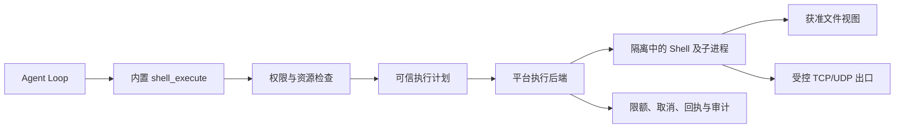

# Agent Shell 沙盒实现与边界

Linux 使用 Bubblewrap、seccomp、cgroup v2 和受控网络出口。macOS 使用原生 Seatbelt 文件策略与网络开关。Windows 使用原生 AppContainer、按执行分配的文件 ACL 与网络能力开关。各平台保留相同授权和任务管理接口，按实际后端报告能执行的限制。部署见 [Linux](https://molr.ai/zh/docs/admin/sandbox/linux/) 和 [macOS](https://molr.ai/zh/docs/admin/sandbox/macos/)。


沙盒列表的本机采样与远程检查最多同时执行四项，远程节点各保留三秒超时；单个节点失败不使整个列表失败。结果保持目录顺序，本机位于首项。请求取消时停止尚未开始的检查，并取消进行中的远程请求。


## 部署预设与目录接入

`config.SandboxPreset` 只在安装或显式维护时展开配置，不持久化模式。内置与远程沙盒共用字段：`restrict_directories` 决定目录候选范围，`enabled` 控制执行／节点，网络规则和 GPU 配置决定可分配资源。Linux 授权上限中的零表示不额外设置部署上限，实际返回执行后端可表达的容量；`gpu.all_devices: true` 发现全部支持的设备，助理与用户组仍使用显式设备授权。

管理接口接收 `SourceID` 和可选相对子目录 `Path`；无 `SourceID` 时 `Path` 是目标机器的绝对路径或 `~/` 路径。后端按当前部署根范围验证，并复用外部目录的文件身份、符号链接和私有路径保护。远端协议提供认证的 `/v2/sandbox/directory` 解析接口；目录引用携带来源和路径，每次文件或挂载操作重新解析，不把引用当作权限。只读根覆盖子目录，包含只读子树的可写挂载同样被拒绝。

沙盒信息的 `HostCapacity` 报告机器 CPU、物理内存和系统进程上限，供计算页与 `AuthorizationCeilings` 取较小值展示，不改变授权或执行约束。资源详情的 `Capacity` 从目录所在文件系统探测容量和普通用户可用空间；远程目录通过节点的 Directory 接口探测，不使用 Runtime 本机磁盘。尚未创建的本地工作区使用最近已存在的父目录所在文件系统，并扣除 `min_free_disk_bytes`。`StorageCeilingBytes` 发布当前用户组的工作区存储上限，仅用于工作区；普通目录按所在文件系统展示。探测失败保留零值，页面显示未知，不回退为无限容量。 `HostCapacity.CPUUsagePercent` 与 `MemoryUsedBytes` 为可空的占用快照，空值不渲染为零占用。Linux CPU 读取 `/proc/stat` 两次、间隔 100 ms，以计数差计算利用率；内存以总内存减 `/proc/meminfo` 的 `MemAvailable` 计算。macOS 使用固定参数调用系统 `/usr/bin/top` 采集两次日志样本，并设两秒超时，参见 [top(1)](https://github.com/apple-oss-distributions/top/blob/main/top.1)。文件系统返回 `StorageTotalBytes` 与 `StorageUsedBytes`，保留空间不计入已使用量。页面复用共享 Progress 组件，只在查询刷新时更新；进度条分母为整机／整盘容量，与授权上限分开。

## 平台边界

基础文件能力与命令执行分开报告。`textfiles/files_unix.go` 维护公共文件版本、授权重查和原子提交；Linux 使用 `openat2`，macOS 使用 `O_NOFOLLOW_ANY` 在内核路径解析时拒绝所有组件的符号链接，并使用排他 rename。仅识别 macOS 固定系统目录别名，不放行工作区或外部资源中的用户符号链接。硬链接和特殊文件检查继续保留。受保护目录的重叠检查同时比较文件身份，防止大小写或系统别名暴露 Runtime 私有目录。

`direct_unix.go` 共享原生命令的授权、输出、截止时间和进程组生命周期；macOS 受控启动在执行前包装为 `/usr/bin/sandbox-exec -p <策略> /bin/sh`，Full Access 直接执行。`backend_darwin.go` 负责启动探针、路径规范化、工具目录及安全环境变量；`seatbelt.go` 生成默认拒绝策略。文件与网络授权固定到启动计划，网络撤权通过同一授权重查停止受管进程组；不承诺脱离进程组的后代清理。PTY 只允许本任务实际分配的设备，策略拒绝其它进程的信息读取。

macOS 本机浏览器由 `browser_darwin.go` 启动固定 Chromium 和前台 agent-browser daemon，使用专用 Seatbelt 服务规则与 `--no-sandbox`；内部 Chromium 沙盒不启用，外层文件和网络策略必须存在。启动参数不接受客户端程序、CDP 地址或路径。控制 API 使用 Runtime 内存连接，daemon socket 保存在私有目录；短临时符号链接仅解决 macOS socket 路径长度限制，Seatbelt 仍检查规范目标路径。全体受控任务拒绝访问和绑定保留控制端口，浏览器仅放行自己的端口对；通用端口转发也拒绝此保留范围。启动完成前核验端口监听 PID，每次 Unix socket 连接在发送命令和代理认证信息前核验 daemon 的内核对端 PID。临时短路径禁止受控任务改写；路径被替换或进程不匹配时立即失败，不连接其他实例。

两个可信看护进程各拥有一个进程组，受控子进程不继承 Runtime 的存活管道。Runtime 退出使写端关闭，看护进程立即清理自身组；正常关闭通过 CDP 请求 Chromium 刷新并退出，再关闭看护管道。任一子进程退出、授权变化和截止时间均触发回收。此机制针对固定组件进程树，不增加 macOS 的通用进程隔离或资源额度保证。代理认证仅通过私有 daemon 协议传递，不进入启动参数和日志。原生验证方式与平台边界见 [macOS 浏览器](https://molr.ai/zh/docs/admin/sandbox/macos/#受管浏览器)。


原生运行与当前限制见[macOS 源码部署](https://molr.ai/zh/docs/admin/deployment/source-build/#macos-原生运行)。

## Full Access 权限与双路径执行

以下隔离机制适用于普通调用。`sandbox.allow_full_access` 默认 false；开启后，同一 Runner 可并发处理普通隔离调用和显式 Full Access 调用。节点没有全局执行模式。Full Access 必须同时满足部署允许、用户组允许（管理员默认允许）、有效的 `Scope.FullAccess` 计算授权和本次 `full_access: true`。

`direct_unix.go` 在服务环境中直接执行 `/bin/sh`，继承环境并设置 `MOLR_WORKSPACE`，支持后台、TTY、输入、取消和端口转发；不创建 namespace、seccomp、cgroup 或资源限额，不承诺文件、网络和进程隔离。文件工具使用绝对路径或工作区别名。Full Access 不依赖普通计算、文件、网络授权，不计入普通任务十个并发上限。调用者显式设置的超时、授权期限、输出分页和 API 请求大小边界仍保留；这些是调用生命周期和协议边界，不是资源配额。

普通调用永不自动升级；两类计算授权独立匹配。直接执行定期重查授权，撤销、过期、助理停用和远程租约失效会取消任务及其进程组；不承诺对脱离进程组的恶意进程提供强制隔离。Full Access 撤销只停止对应路径，普通任务继续运行。`Capabilities.FullAccess` 单独探测，即便隔离准备失败仍可为 true；五项隔离能力与 Reason 继续如实反映普通路径。

Full Access 设计用于外部容器／虚拟机已提供所需隔离的环境。进程继承外部环境现有的系统限制；Molr 不移除部署环境本身的限制。

## 1. 结论与一期范围

Linux 采用 **Bubblewrap + seccomp + cgroup v2 + 受控网络出口**。Go Runtime 负责授权、执行生命周期、透明网络出口与审计；Bubblewrap 和受信任辅助进程由 Runtime 管理。以下 Linux 专项机制不适用于 macOS，后者的文件、网络和生命周期边界见 [macOS 原生命令权限](https://molr.ai/zh/docs/admin/sandbox/macos/)。

Bubblewrap 负责构造隔离环境，并不提供完整安全策略；策略由 Molr 生成并验证。它与宿主共享内核，本方案不承诺达到虚拟机的隔离强度。[Bubblewrap 官方说明](https://github.com/containers/bubblewrap)

Shell 支持单次前台命令、显式或 60 秒后自动分离的后台任务，以及持久到退出的 TTY 会话。同一助理合计最多 10 个执行；每个执行建立独立沙盒，只有 `/work` 跨执行持久化。TTY 的系统 Shell 优先与 BusyBox 兜底策略和普通命令一致，默认交互会话加载 `/work/.profile`；非交互命令不加载。任务默认无墙钟截止时间，可选实际超时；资源、授权和隔离限制始终生效。支持显式任务 HTTP/WS 端口转发；支持按计算权限提供 NVIDIA GPU 设备访问，其他设备直通和跨平台执行暂不提供。Python、Node 等解释器仍由部署环境提供，不开放宿主软件安装能力。

外部目录和网络默认拒绝；当前助理自己的 `/work` 由 Runtime 管理，文件工具默认可用；真实硬件默认不可见。操作系统或部署环境不能落实要求时，Shell 显示不可用，其他 Runtime 功能照常运行；绝不降级为宿主直接执行。

## 2. 当前实现与通用 Runner 的分工

Linux 后端已位于 `runtime/internal/platform/sandbox`，复用 `platform.Runner` / `Process` 并扩展可信 `Command` 的挂载、网络和限额信息。`runner.go` 管理授权与生命周期，`backend_linux.go`、`seccomp_linux.go` 构造隔离，`prepare_linux.go` 管理基础资产与委派，`network_*.go` / `helper_linux.go` 管理受控出口；macOS 由 `backend_darwin.go` 处理，其余平台由 `backend_other.go` 明确拒绝。

原通用 Runner 继续用于可信白名单程序，不具备同等隔离保证。普通 Agent Shell 只调用强制隔离入口；显式 Full Access 经独立权限检查后使用直接执行路径。资源装配会登记本机计算环境，但不自动授予助理执行权限。

文件工具的 `openat2` 检查不会自动约束任意程序；文件工具与直接挂载的差异见 [工具合同](https://molr.ai/zh/docs/dev/reference/file-tools/)。模型脚本交给沙盒内固定 Shell，宿主启动参数、资源路径与执行身份由可信代码构造。

## GPU 执行边界

GPU 展示快照通过 `Runner.GPUSnapshot` 获取：在启动设备清单的副本上按硬件 UUID 合并 `nvidia-smi` 的 `utilization.gpu` 与 `memory.used`，两秒超时，缺失指标为 null。采样不扩展设备清单、不修改启动能力检查结果，也不改变授权设备范围。

`Sandbox.GPU` 是部署白名单，`ComputeConstraints.GPU.DeviceIDs` 是助理计算授权范围；用户组缺省 GPU 范围为空。`ComputeCeilings()` 将部署白名单带入能力、审批和执行检查，不接受第二份独立 GPU 上限配置。普通 `shell_execute` 自动使用生效授权，不接受设备或挂载参数。设备身份采用节点内硬件 UUID；执行前重新核对 UUID 与设备节点的映射，并通过固定 FD 挂载经过验证的字符设备。CPU 调用不挂载 GPU，GPU 错误不降级执行。

当前后端复用宿主工具模式提供的只读驱动库，以固定 `nvidia-smi` XML 输出读取整卡 UUID、名称、显存和设备 minor。只注入所选 GPU、`nvidiactl` 和 `nvidia-uvm`，不注入宿主管理 socket、显示设备或其他 GPU。探针使用系统 Python 的 ctypes 直接调用 CUDA Driver API，验证实际可用设备集合及少量显存读写，不安装 CUDA SDK 或 Python 包。GPU 状态通过 `Info.GPUs` 独立公布。

普通 Shell 与 GPU Shell 使用同一套受控 Unix IPC 策略，支持 STREAM／SEQPACKET 及对应的匿名 socketpair；DGRAM 仍禁止，避免通过 `sendto` 访问宿主路径。所有 `bind`／`connect` 由同一沙盒内的可信 supervisor 模拟：先校验通知 ID，以 pidfd 固定 socket FD，并复制 sockaddr；不使用 `SECCOMP_USER_NOTIF_FLAG_CONTINUE`。抽象 Unix 地址限于执行专属网络命名空间，路径地址经调用者的 root 解析，且必须属于当前执行的私有 `/tmp` 文件系统；代理固定 root FD 并核对 tmpfs 设备，不能绕过内层 chroot。`openat2` 拒绝符号链接、magic link、跨挂载及路径逃逸；连接固定 socket inode，绑定固定父目录并原子创建末级节点，避免路径替换竞争。`/work`、资源目录及相对路径中的 socket 不允许绑定或连接，即使文件可读写。

脚本仍不能使用 `pidfd_getfd`、`process_vm_readv`、ptrace、mknod 或绕过网络的系统调用；仅可信 supervisor 使用前两项模拟连接。普通 Shell 也依赖 seccomp 通知及 supervisor 读取子进程 FD 的能力，真实启动／网络探针失败时不可用，不放宽宿主安全设置。supervisor 作为 child subreaper 接管双重 fork 后脱离的后代，并回收退出的子进程，保持 Yama 所需的祖先关系，不授予脚本额外调试权限。每次执行最多同时处理 32 个连接通知，超过返回 EAGAIN；supervisor 与所有子进程处于原有执行 cgroup，统一计入资源限制、取消及撤权清理。

授权变更与临时范围到期复用计算执行计划重查及 cgroup 清理；远程租约续约还会比较当前生效计算配置。任务回执记录实际启动的 `GPUDeviceIDs`。GPU 共享访问不提供显存、算力或独占调度保证，不能把普通 `memory.max` 视为显存限制。

真实 GPU 验收在 `runtime/` 执行 `MOLR_GPU_INTEGRATION=1 scripts/test-sandbox-linux.sh -run TestLinuxGPUIsolation -v`；需要至少两块 NVIDIA GPU，验证单卡／双卡 CUDA、无授权设备不可见、宿主 Unix socket 不可连接和获准 TCP 可用。

## 3. 授权与执行流程

有效权限为：**部署静态上限 ∩ 助理当前授权 ∩ 本次请求资源范围**。

部署者在静态配置中决定运行环境、可暴露的资源和限额上限；WebUI 只在已登记资源内分配助理权限。普通调用只能提交资源 ID 和资源内相对路径，不能提交宿主路径、挂载参数或运行身份。`full_access` 是经授权的调用选项，不是可以自行打开的部署开关。



Shell 执行需要计算资源的 `execute`；只读挂载需要存储 `read`，读写挂载需要同时具有 `read` 与 `write`。仅有 `write` 时不挂载该资源，仍通过受控文件工具写入，不能隐式增加读取权限。网络资源声明其支持的连接动作。授权某个模型不会顺带授权 Shell 访问该 Provider 或取得 API Key。GPU 设备范围绑定计算授权，只有部署和用户组允许的硬件 UUID 可被授权。

计算资源包含部署者定义的执行环境与限额，助理授权关联该资源。一期不引入第二套货币预算；CPU、内存和磁盘额度属于计算容量限制，与已有助理模型费用预算区分。

## 4. Linux 执行边界

### 文件系统与运行环境

- 默认使用版本化的最小只读 rootfs。`host_tools: true` 只读共享宿主系统工具，执行身份始终继承整个 Runtime 的当前非 root 账户；安装器通过用户服务或系统服务的 `User=` 决定身份，不依赖特定用户名、无登录 shell 或独立资源服务。已有用户的附加组照常保留；共享范围内该账户可读的私有文件仍然可读。私有数据和总工作区不能位于共享系统目录下；具体目录与配置范围见部署指南。正式方案不使用 `--ro-bind / /`，也不把宿主完整 `/etc`、HOME、`/run` 或 Runtime 数据目录整体映射进去。
- 使用独立 mount、user、PID、IPC、network、UTS 等命名空间；最小 `/dev` 只提供必要伪设备，`/proc` 限于沙盒进程。工作盘使用 `nodev` 等挂载限制，不暴露宿主 `/sys`、cgroup 控制文件或管理 socket。
- 所有者、助理和执行 ID 由服务端确定。助理工作区与资源挂载只呈现逻辑路径，当前工作区为 `/work`，外部目录由 `permission_list` 返回稳定 `ShellPath`；不得让模型推断宿主路径。
- 清理继承的环境、文件描述符与 socket；仅注入固定运行所需变量及 CPU 配额对应的 Go 并行度。Provider 密钥、登录令牌和 Runtime 私有数据库永不传入。
- Bubblewrap 路径及 rootfs 必须由部署配置固定并验证，不能从助理可写 PATH 查找；助理不能修改沙盒程序、策略文件或执行计划。

**一期默认直接挂载助理工作目录与获准资源子目录，不复制整棵目录、不在执行结束后扫描差异或统一回写。** 只读授权配置只读挂载，读写授权配置读写挂载；实际文件在程序访问时由文件系统读取。启动工作主要取决于挂载数量、路径验证与策略准备，不应随目录总字节数或文件总数进行全量复制/遍历。需要访问少量产物时只读取显式指定的文件。

直接挂载沿用普通文件系统语义：修改、创建、重命名和删除立即作用于原目录，失败或取消不会回滚；用户同时编辑时也不提供自动冲突检测。授权界面应说明读写包含这些操作。需要“只创建”“只追加”“仅写不读”或逐文件审核的场景继续使用受控文件工具，不映射成普通读写挂载。快照、变更预览和回滚可后续单独设计，不是一期 Shell 的前置条件。

挂载源由可信代码从资源 ID 与获准路径解析，防止符号链接及路径替换竞态；只呈现实际授权子树。隔离挂载传播，对未批准的嵌套挂载采取排除或拒绝策略，并验证只读限制不会被子挂载或另一个可写别名绕过。宿主根目录、Runtime 私有目录及它们的上级目录不能作为资源挂载。安全边界由挂载结构、系统调用限制与资源配置落实，不能以运行前扫描文件名代替。

现有文件工具“禁止所有链接与特殊文件”的规则不自动等同于 Shell 挂载语义。符号链接按沙盒文件视图解析，不能因此取得未挂载的宿主路径；硬链接则可能共享同一 inode，Bubblewrap 不会辨认其另一个宿主名称。直接目录授权包含该目录内已有文件对象，不能承诺硬链接别名不会影响其他名称。普通目录无需独立存储卷；用户预先放入授权目录的文件对象属于该目录授权范围。Runtime 私有目录及其上级路径仍禁止挂载，未暴露的宿主路径不能被 Shell 用来创建新链接。需要更严格逐文件限制时使用受控文件工具。不能通过先全量扫描一次来宣称持续解决此问题。

设备、宿主管理 socket 与其他跨边界 IPC 仍通过最小 `/dev`、`nodev`、socket/系统调用限制等阻断；文件可见不代表可以连接其中的 socket。产物导入聊天或资源库时仍经可信文件模块验证授权、普通文件类型、路径和容量，不因产物位于已授权目录就跳过检查。

### 进程、系统调用与限额

- 沙盒 supervisor 与 exec helper 在启动环境中显式设置 `GOMAXPROCS=2`，使 Go 包初始化阶段也遵守 helper 的并行度限制，避免高核数主机在进入主函数前耗尽执行的 PID 配额。业务 Shell 的并行度继续依据本次 CPU 限额设置。
- 允许执行内受控 Unix STREAM／SEQPACKET 通信及匿名 socketpair；禁止 Unix DGRAM、宿主路径 socket 和跨执行抽象 socket。
- 去除 Linux capabilities，保持 `no_new_privs`，允许嵌套 user／PID／network namespace，继续禁止 mount／IPC／UTS／cgroup／time namespace、setns 和挂载 API；子命名空间内的 capabilities 不赋予父命名空间权限。使用架构匹配、版本化 seccomp 配置限制 mount、ptrace、BPF、关键 ioctl 和绕过网络限制的系统调用；不能简单禁止所有 clone 而破坏普通子进程与线程。
- TTY 使用专属 PTY 与新 session，不继承宿主控制终端。非 TTY 仍无 stdin；stdout/stderr 有总量上限。Shell 运行所有下载程序、脚本和解释器时都继承相同边界。
- PTY 的 session 在 Bubblewrap 进入 PID namespace 前创建；内部 helper 的 `supervise` 在启动 TTY 子进程时设置 `SysProcAttr.Foreground`，在当前 PID namespace 内创建子进程组并设置终端前台，再执行 Shell。该操作使用父进程的 stdin FD，发生在恢复子进程信号掩码之前，避免 SIGTTOU 阻塞。初始化失败按现有 helper 启动失败路径返回 125，不继续执行脚本。非 TTY 路径不设置此属性。
- 每次执行在独立 cgroup 中，设置 CPU、内存、swap、PID 数等限制；在不可信代码开始之前完成限额配置及进程归属，不能先运行后补限制。输出、墙钟时长、并发和网络传输量另有限制。
- 取消、超时、助理停用和撤权均终止整个执行 cgroup，并等待其为空，再关闭输出和保存最终状态。进程组与父进程死亡信号只能作为附加手段。Runtime 重启先清理本实例遗留执行，不能只按过期 PID 杀进程。

Bubblewrap 可加载 seccomp BPF，并支持阻止沙盒再次创建 user namespace；cgroup 管理则需要由 Molr 与部署环境补齐。[Bubblewrap 参数](https://github.com/containers/bubblewrap/blob/main/bwrap.xml) · [cgroup v2 委派与控制器](https://docs.kernel.org/admin-guide/cgroup-v2.html)

**容量保护不要求用户准备独立卷。** 持久工作目录与授权目录直接使用现有文件系统；Runtime 设置单文件大小硬上限，并在启动前及运行中检查磁盘低水位，空间不足时终止执行。临时目录使用限容 tmpfs。这不是目录总容量硬配额，接口明确报告保护类型，不把定期监控冒充硬限制；额外硬配额属于高级部署选项。

### Shell 与工具选择

宿主工具模式下，静态 BusyBox 继续作为受管只读资产挂载到 `/molr/busybox`；准备 rootfs 时从已复制且验证过的静态二进制读取 `--list`，生成全部实际 applet 的 `/molr/bin` 链接，PATH 顺序为 `/usr/bin:/bin:/usr/sbin:/sbin:/molr/bin`。版本化 rootfs 同时包含只读 Shell 探针；启动不依赖助理可写 PATH，资产缺失不静默伪装成正常工具环境。最小环境继续使用原 `/bin/sh` 与 BusyBox 工具集。

内部 helper 在 namespace、挂载、seccomp、cgroup 限制完成后，使用固定无副作用脚本依次验证 `/bin/sh`、`/bin/dash`、`/bin/bash`、受管 BusyBox。探针检查外部命令查找与实际执行，识别 BusyBox standalone 模式绕过 PATH 的情况；不加载工作区 profile，不运行用户脚本。若系统 Shell 不兼容则尝试下一项，最后以独立启动探针确认 BusyBox 能工作；只能使用不满足优先级探针的 BusyBox 时继续提供 Shell，并向 stderr 输出明确限制。最终用户脚本只执行一次，非零退出码不触发换工具或换 Shell 重试。每次执行重新探测，以适应宿主程序更新；既有会话不动态更换 Shell。

该优先级是默认受管 Shell 的行为；Shell 内建命令、用户自定义 PATH/别名和显式启动的其他 Shell 继续遵循各自语义。不会为统一工具实现放宽安全边界，也不会安装宿主缺失软件。

### 任务生命周期与通知

`app.shellTasks` 在启动前持久化任务记录并占用助理名额，前台分离只改变模式。运行任务持有私有、不可从请求构造的 context capability，绑定原 owner/assistant/execution/operation；原 Loop 结束不使其失效，也不使任意新工具调用获得有效身份。计算、文件与网络授权仍由原计划持续重查，原计划不扩权。任务结束释放 capability 和名额；完成状态和 `shell_task_finished` 事件在同一事务提交，失败写入由管理器重试。启动时将未完成记录标记中断；不恢复或重放效果。

`platform.Command.Managed` 允许无默认运行截止时间，实际超时与授权到期仍取较早者。PTY 主端由 Runtime 持有，传入隔离进程的仅为专属从端。`interrupt` 发送终端中断字符，作用于前台进程组；`stop` 取消执行并清空 cgroup。后台非 TTY 的 stdout/stderr 分开归档，TTY 合并到 stdout。受控接口限制每次输入 8 KiB、输出读取 16 KiB，并提供字节游标；读档案仍校验助理归属、普通文件与路径。WebUI 使用终端仿真器和 base64 SSE 字节流；输入有界排队、按顺序发送，不自动重试结果未知的输入。终端输出不执行 HTML、链接或剪贴板命令。

提醒按 owner/assistant 聚合（当前架构每助理一个串行 Loop），首个后台或 TTY 启动五分钟计时，新任务不刷新截止时间。触发时写入 `shell_tasks_running`，包含仍存活任务的模式和累计时长；待消费提醒更新原事件，避免排队累积，结束任务从待处理提醒移除。全部结束取消计时和未消费提醒。TTY 退出与同步完成不发送完成事件；后台完成独立于提醒立即发送。它们通过持久事件队列进入 Loop，不走上下文文件注入。

远程 Sandbox 在 info 中声明 `ShellSessions`；长期 Shell 仍必须每三秒续约，服务端十五秒租约失效即终止。只对 Shell 允许没有固定 deadline，文件操作维持原有截止时间限制。终端控制通过绑定原执行身份的 `shell_control`，输出读取走无副作用的 `shell_read`，不会把每次输出轮询写入操作账本。

### 网络

未指定网络资源时保持断网。指定资源时由 Runtime 建立执行专属的 user/net namespace，在其内部自动创建 TUN、地址、路由和只读 resolver 文件。最终 Bubblewrap 仅保留这个隔离网络，绝不共享宿主网络；继续去除 capabilities 并强制 seccomp。最终 user namespace 恢复服务账号的数字 UID／GID，底层宿主身份不变，不将可信网络初始化阶段的内部 root 映射作为 Shell 身份。

Ubuntu 的 Bubblewrap 子 AppArmor 配置可能禁止网络管理；使用独立可信初始化程序进入刚创建且已固定 FD 的 user/net namespace 建网，不修改全局安全策略。keeper 与网络栈位于独立、受限的执行 cgroup（256 MiB / 64 PID / 100% CPU）。通过匿名 SOCK_SEQPACKET 传递 TUN FD、就绪与授权消息，控制消息上限 512 字节，不向脚本挂载宿主控制 socket，也不接受脚本提供 namespace 路径或身份。初始化完成前不执行脚本，网络栈退出立即终止执行，回收失败会关闭 Runner。

gVisor Go netstack 将流量转换为普通 TCP/UDP 连接。传输协议、目标域名/IP、端口、排除项均按同一授权规则检查；其中主机名形式的排除项只在域名解析路径生效，直接以 IP 连接时仅按 IP/CIDR 条目检查。每条连接与 DNS 请求通过私有控制通道向 Runtime 回查授权；授权到期由执行截止时间约束，撤销/取消通过既有同步停止机制关闭所有连接。TCP 支持半关闭；UDP 会话空闲 60 秒回收。流量预算按实际转发的双向载荷计费，避免提前预占阻塞读缓冲饿死另一个方向。

内部 DNS 支持 TCP/UDP 的 A/AAAA 查询，使用系统解析器处理真实 CNAME。返回执行内虚拟地址，将域名身份绑定到连接；新连接重新解析，所有实际答案都须获授权，然后直拨已检查 IP。不会将域名直接转成全局 IP 白名单。虚拟映射限定 1024 项，TTL 30 秒，DNS 并发单独限定 8，不能从外部覆盖或跨执行复用。未授权域名、任意 DNS 记录类型和未知虚拟 IP 均拒绝。

网络授权只表达主机/地址、端口、TCP/UDP，不表达 TLS 内的 URL 路径或内容。内置 internet/lan/host（互联网访问／局域网访问／宿主机访问）三项预设只是候选资源，连接和助理授权仍显式进行；三项均开放 TCP/UDP 全部端口，host 包含本服务自身监听端口；lan 仅含 RFC1918/ULA、不含回环，宿主局域网地址仍按 lan 判断；部署可关闭预设。旧的未声明协议配置拒绝加载；远程协议使用 `/v2/sandbox/` 和 `Protocol=9`，连接和执行前拒绝旧服务。详细配置、内部宿主别名和限额见 [部署说明](https://molr.ai/zh/docs/admin/sandbox/linux/)。

就绪探针实际执行隔离命令，并在临时回环端点上验证 DNS、TUN 与 TCP 转发，不依赖公网。宿主工具环境通过标准 curl 下载；最小 BusyBox 环境不承诺 HTTPS 下载能力。工具参数不是强制边界，网络仍由 Runtime 授权。`NetworkBackend=transparent`、`NetworkProtocols=[tcp,udp]` 随能力接口报告；不得仅凭进程存活宣称网络就绪。

### Shell HTTP/WS 端口转发

`forward_ports` 在工具层及 platform 层校验，每次执行最多 4 个唯一有效端口。Runtime 在启动命令前分配监听器，回执携带任务 `Forwards`；目标固定为原执行的 IPv4 回环，不接受宿主地址、PID 或 namespace 路径。仅有转发而无出站授权时也建立执行专属网络会话，但出口规则为空，仍禁止外联。

网络 keeper 的 user/net namespace FD 在其生命周期内固定持有；启动脚本使用副本，不再提前关闭原 FD。每次转发由受限 helper 经固定 FD 进入对应 namespace，连接 `127.0.0.1:<port>`，通过私有 SCM_RIGHTS 通道将已连接 TCP socket 返回父进程。socket 保持其原 namespace，helper 不持续充当数据代理。helper 纳入执行的辅助 cgroup，创建过程有超时；最终脚本不能加入 keeper 的 namespace 或修改挂载。执行完整身份和声明端口在每次拨号校验，本机同时重查原授权。

本机调用 Runner.DialForward，远程经 `/v2/sandbox/forward` 的认证 HTTP/1.1 Upgrade（`molr-tcp-v1`）建立流。沿用受控拨号、固定 TLS 证书、服务令牌和拒绝浏览器 Origin；该端点仅在独立 Sandbox 服务。Manager 校验活动执行身份及租约，Runner 再检查原执行与端口。已建立的流使用有界帧传递原始字节及半关闭，支持 WebSocket、SSE 和需要写半关闭后读取响应的 TCP 协议；流不写入操作账本，也不占普通 JSON 请求的并发槽。

Runtime 每入口 32 个连接、全局 128 个；Runner 每执行 32 个目标连接，远程流入口全局 64 个。探测是独立的有超时 TCP 拨号。转发不使用原有出站累计流量预算。任务结束、撤权、租约失效会关闭目标连接；Runtime 同时关闭监听器和客户端连接。远程观察连接失败后回收入口，不自动转接其他任务或重放命令。

`Info.PortForwarding` 作为协议的能力字段，带转发请求必须先确认支持；不支持时明确拒绝，不静默忽略。工具回执、`shell_task list`、SDK 与任务界面保留相同字段，模型上下文裁剪也保留实际地址。用户操作、地址选择及登录态鉴权的边界见 [部署文档](https://molr.ai/zh/docs/user/guides/files-and-commands/#shell-端口转发)。

公开监听仅接受 HTTP/WS，连接目标前校验 Host、存在时的 Origin（WS 必须提供）、当前登录态与任务归属。上游请求移除全部 Molr 凭据，下游移除保留 Cookie 与 Clear-Site-Data。连接在 HTTP/TLS 解析前计入上限。会话 watcher 在退出、过期或撤销时关闭 HTTP 流与升级后的 WS；每次 namespace 拨号仍检查任务执行能力。公开 TCP 选择在工具解析和执行层拒绝，远程内部 TCP 传输不变。

### 权限变更与故障

构造计划后、释放启动屏障前重新检查授权和版本；活动执行登记与授权变更需要串行协调，覆盖“检查通过后立刻撤权”的竞态。撤销、缩小范围、资源断开和授权到期均关闭出口连接、终止相关执行，等待所有持有文件句柄的子进程退出；单纯卸载目录不能替代终止进程。撤权结果需区分授权已撤销和执行清理是否完成，不能在清理未完成时声称已停止全部访问。权限变化不在运行中的沙盒内动态增加挂载，下一次调用重建环境。

出口每次连接重新授权，并对已有连接设置受执行租约限制的生命周期；控制通道断开、租约失效或 Runtime 退出时拒绝继续访问。已经写入或已经发送的数据无法通过撤权撤回，这一点由操作回执说明。

Shell 有副作用。操作 ID、计划摘要与授权版本应在启动前持久化；重启后执行结果未知时先回收进程、核对产物与回执，不能自动重跑整段脚本。独立服务在结果事务失败时保留完成结果与执行名额，仅重试 `sandbox.operations` 写入，退避上限一秒、每次写入最多五秒；结果编码超出记录上限时改存 `sandbox_invalid_result` 的 `unknown` 回执，不重试外部效果；关闭中止后续重试并返回未保存错误。未成功保存便退出时，重启仍按 `unknown` 恢复，不重放外部效果。

## 5. 跨平台接口与目录

当前复用 `platform.Command`、`Runner`、`Process` 与能力报告，见 [平台接口代码](https://github.com/molr-ai/molr/blob/main/runtime/internal/platform/api.go)。早期草案中的 `ExecutionPlan` 是设计概念，并非已实现的同名公共类型；本文不再维护假设的目录树与接口表。

能力报告必须表达真实隔离探针结果，后端不能删除不支持的限制后继续执行。进程正常退出不代表业务任务自动验收成功；记录输出、退出分类和显式产物，不承诺完整文件变更清单。

宿主路径只在可信适配层存在。资源内路径使用独立逻辑表示，再由后端映射；不能在跨平台共享代码中假定 `/workspace`、盘符或大小写规则。Windows 拒绝 UNC、ADS、设备路径和受控目录重解析点；Go `os.Root` 约束文件工具的路径解析，AppContainer 子进程只继承标准输入输出句柄。Shell 类型明确为 POSIX shell、PowerShell 等，不能把同一脚本字符串自动换解释器执行。

| 平台 | 实现方向 | 必须独立验证的差异 |
| --- | --- | --- |
| Linux，一期 | Bubblewrap + seccomp + cgroup v2 + 受控出口 | user namespace、AppArmor、cgroup 委派、内核与 CPU 架构兼容 |
| macOS | 本机与远程 Seatbelt 受控执行、安全文件操作及独立 Full Access | 原生验证路径、文件锁、PTY、网络开关与撤权；不提供进程命名空间和资源硬配额 |
| Windows | AppContainer SID、文件 ACL、网络能力开关及 Job Object 进程树回收 | PowerShell；文件/网络隔离为 true，进程命名空间/硬配额为 false；ConPTY 终端；无受控端口转发或细粒度网络目标 |

macOS 与 Windows 均提供受控 Shell 和独立授权的 Full Access。Windows 每次执行创建独立 AppContainer SID，授权目录的祖先句柄在执行期间禁止删除/重命名；每个目录租约分别派生随机只读、读写能力 SID，只向子进程 token 传入其获准能力；临时目录仍仅授权该执行的 AppContainer SID。同一 Runtime 可引用相同目录租约，引用归零且所有相关进程退出后撤销 ACL。跨 Runtime 相同目录与嵌套活动目录由祖先共享锁、根目录独占锁拒绝，避免在运行中的非可信代码下重复修改继承 ACL。恢复日志记录 scope 文件身份；目录丢失、身份改变或撤权失败时关闭受控执行，不丢弃恢复记录。启动探针实测允许的工作区写入、私有文件读写拒绝、只读 scope 写入拒绝，并核验实际子进程 AppContainer token。网络探针使用 TEST-NET 目标：禁网要求 AccessDenied，开网要求不因权限拒绝；这不表示公网可达。接口复用不代表各平台安全能力天然等价。[Microsoft AppContainer](https://learn.microsoft.com/en-us/windows/win32/secauthz/appcontainer-isolation) · [Job Objects](https://learn.microsoft.com/en-us/windows/win32/procthread/job-objects) · [Apple App Sandbox 继承](https://developer.apple.com/library/archive/documentation/Miscellaneous/Reference/EntitlementKeyReference/Chapters/EnablingAppSandbox.html)

Windows 受控 PowerShell 为当前授权目录创建进程内的 `Molr:\` 工作驱动器，使目录解析无需读取未授权祖先的属性。`LOCALAPPDATA` 指向本次已授权临时目录；宿主环境变量不整体传入子进程。网络探针使用 Windows PowerShell 5.1 支持的 `BeginConnect` / `EndConnect`，实际拒绝访问仍由 AppContainer 网络能力核验。

Windows 终端通过可信 helper 驱动 ConPTY，独立探针报告 `Capabilities.Terminal` 与 `TerminalReason`。AppContainer 使用私有桌面；提升权限的服务另建私有窗口站，不修改系统桌面 ACL。控制管道仅当前用户与 SYSTEM 可访问，输入写入有超时；取消、撤权、正常退出均关闭 Job Object 内的子进程树。ConPTY 输出持续排空后关闭。普通用户计划任务和提升权限入口均须原生验收。

## 6. 部署与本机评估

生产部署依赖 Bubblewrap、合适的 Linux 内核、可用 user namespace、cgroup v2 委派，以及受控 rootfs。推荐使用独立非特权账号，通过 systemd 服务委派执行子树；安装程序负责依赖与服务集成；Runtime 自动生成运行资产、工作目录，自动发现委派或申请专用临时单元，并执行实际隔离探针。用户无需配置这些内部路径，WebUI 或 Agent 不得修改 sysctl、AppArmor、服务权限或挂载策略。运行时不调用 sudo，也不要求整个 Molr Server 以 root 运行。

在 Docker 中部署 Molr 时还需要评估嵌套 user namespace、seccomp/AppArmor 和 cgroup 委派。不能为了启动沙盒默认要求 `--privileged`、挂载 Docker socket 或关闭所有宿主安全限制；配置不满足时关闭 Shell 能力并给出诊断。

部署步骤、默认限额和故障原因统一见 [Linux 命令环境](https://molr.ai/zh/docs/admin/sandbox/linux/)。旧的单机最小探针记录已删除，它不能证明当前服务的隔离能力。

## 7. 验证

普通 Go 测试覆盖授权、操作幂等、初始化失败关闭和接口。真实 Linux 测试在 `runtime/` 目录执行：

```bash
bash scripts/test-sandbox-linux.sh -count=1 -v
```

脚本使用独立 systemd 用户单元和临时数据，验证自动资源申请、直接目录读写、单文件硬上限、进程回收、受控出口与 FD 隔离；依赖不足时失败，不能以 skip 代替通过。测试运行必须遵守工作区隔离约定。

每次实际服务启动还需认证查询 `/api/sandbox`，不能用普通单元测试、最小 Bubblewrap 探针或 HTTP 连通性替代。检查字段与期望值见部署指南。

## 8. 参考实现

[Anthropic Sandbox Runtime](https://github.com/anthropics/sandbox-runtime) 展示了原生沙盒结合代理过滤的路线，可参考其文件与网络边界。Molr 保持 Go 实现和固定模块装配，不直接引入它的 Node 运行时依赖；如实际复用代码，应先核对对应版本的许可证与安全边界。


## 浏览器兼容验收

不新增浏览器专用沙盒或权限开关。允许嵌套 user／PID／network namespace 以支持 Chromium 原生沙盒；过滤器继续禁止挂载 API、mount namespace、setns、ptrace、设备创建与网络绕过。联网与断网执行的 UID／GID 映射保持实际宿主身份不变。Unix IPC 代理同时遵守通知线程的 root 与外层私有 tmpfs 边界，避免绕过内层 chroot。默认 Bubblewrap 启动时先验证宿主已加载的 `chrome` AppArmor profile；不可用时验证原受限路径。选择覆盖普通执行、联网执行与 namespace keeper；不重跑业务命令、不更改系统策略，显式启动器保留管理员选择。该应用级豁免移除了额外的 capabilities 全面拒绝，Molr 的授权与外层隔离仍保留，见[部署说明](https://molr.ai/zh/docs/admin/sandbox/linux/#本地-ipc-与浏览器程序)。`--no-sandbox` 仍是依赖 Molr 外层边界的显式兼容方式，不包含 Chromium 内部进程防护。

`MOLR_SANDBOX_HOST_TOOLS=1 MOLR_TEST_AGENT_BROWSER=/absolute/agent-binary-directory MOLR_TEST_CHROMIUM=/absolute/chromium-directory bash runtime/scripts/test-sandbox-linux.sh -run 'TestLinuxBwrapProfile|TestLinuxPrivateSockets|TestLinuxAgentBrowser|TestLinuxNestedNamespaceBoundaries|TestLinuxExecutionIdentityWithNetworking' -v` 使用事先审查并安装的资产，Linux amd64 夹具要求目录内有 `agent-browser-linux-x64` 与 `chrome`。默认验收不设置 `MOLR_TEST_BWRAP`，以覆盖自动 profile 选择；自定义部署才指定可信启动器。设置 `MOLR_TEST_CHROMIUM_SANDBOX=1` 强制核验原生沙盒状态，启动失败不自动跳过或回退。测试覆盖读取、填写、点击、截图、获准 HTTP、未授权端口拒绝、沙盒状态、嵌套 mount／setns 拒绝、chroot IPC 隔离及 UID／GID 一致性。不设置原生标志时验证原有外层沙盒兼容路径。完整回归仍包括文件、网络、cgroup、FD 泄漏、取消、撤权、TTY 与显式开启的 GPU 检查。

## 浏览器任务控制

浏览器任务复用 `shellTasks`、执行租约、cgroup、资源授权与任务额度。只有可信启动逻辑提供只读程序挂载。每个助理只有一个活动任务和独立持久化 profile；私有桥接端口仅声明用于 namespace 拨号，不创建公开监听。截图复用既有文件读取与模型媒体权限。

控制权绑定所有者会话、浏览器窗口 client ID 与 generation，输入序号防止重放。前端在页面生命周期内保留 client ID、序号与串行队列，关闭面板丢弃未发送输入，重新打开经服务端身份核对后恢复控制；其他窗口不继承该身份。标签数通过私有只读接口读取并按任务缓存，不依赖画面流持续连接。接管先阻止新写操作，再等待已接受操作完成、释放按住的鼠标键，最后切换控制者。写操作响应丢失或交接失败时终止执行。用户接管期间，模型仅可读取快照、截图、标签和 URL；`shell_task` 不能绕过浏览器控制。交还发布 `browser_control_returned`，模型必须先读取新快照才能写操作。原生桥接采用有完成确认的结构化输入，命令时限与输出有界，不开放任意 eval 或启动参数。

画面经私有 WS 连接转为所有者认证 SSE，10 fps 上限与 ACK 节流。连接取消从 WS 握手开始生效，握手最多等待 5 秒。观看者断线取消流；前端隐藏或离线时断流并取消绘制、解码与重连计时，恢复可见且在线后重新连接；断线或控制权变化时丢弃排队输入。同尺寸画面复用 Canvas 缓冲，绘制与浮窗布局按动画帧合并。任务内复用最多两个私有 HTTP 命令连接，任务结束关闭空闲连接；执行租约继续检查授权并在撤权时关闭转发连接。写操作不因连接复用而自动重试。支持指针、滚动、键盘文本／输入法、导航与标签页。强制终止可能丢失未落盘 profile 数据。

独立 macOS 节点使用 `NoWorkspace` 执行计划，任务临时目录不产生助理工作区。授权目录通过 `ShellEnvironment` 注入；Linux 与 macOS 主 Runtime 均按目标节点能力选择网络授权。原生网络不使用配额更新，授权到期纳入执行截止时间，撤权或范围变化终止受管进程组。传输与租约复用 `sandboxmanager`，见[远程部署](https://molr.ai/zh/docs/admin/sandbox/remote/)。

### 终端控制权

用户与助理共用同一 PTY 和任务记录。手动启动只接收计算资源与请求／窗口标识，由服务端构造绑定 owner/assistant 的私有 managedShell capability，沿用助理授权，不接收宿主挂载或 Full Access 开关。每个会话以同一互斥锁串行化输入和交接，锁内重查 generation、控制者登录会话、窗口和递增输入序号。接管不停止前台程序，已接受的字节不会回滚。

交还以事务保存控制权、审计记录和 terminal_control_returned 事件。助理须在交接后的 generation 下读到最新输出，读屏许可绑定执行轮次。浏览器窗口关闭或认证失效只断开连接，不自动交还控制权；重新登录后可显式接管。输出流持续校验认证与助理归属，保留并发连接上限和写入超时。沙盒撤权及到期仍通过原执行计划终止进程，不受控制者影响。
